# Configuração e verificação do LD301 no PACTware

<strong>📑 Índice geral</strong>

- [1. Disponibilizar o transmissor simulado](#transmissor-simulado)
- [2. Montar o caminho de comunicação no PACTware](#comunicacao-pactware)
- [3. Conectar o canal e o LD301](#conectar-ld301)
- [4. Ler e registrar a configuração atual](#configuracao-atual)
- [5. Ajustar a faixa de pressão diferencial](#faixa-pressao)
- [6. Selecionar a função de raiz quadrada](#funcao-raiz)
  - [Ponto de corte da raiz](#ponto-de-corte)
- [7. Configurar a User Unit](#user-unit)
- [8. Configurar o display e salvar](#display-salvar)
- [9. Testar no LasecSimul](#testar-lasecsimul)
- [10. Se a leitura não corresponder](#diagnostico)
- [Siglas, abreviações e símbolos](#siglas)
- [Glossário de conceitos](#glossario)

---

## 1. Disponibilizar o transmissor simulado

O roteiro usa a planta **FE-02-AR já configurada no LasecSimul** e o transmissor **LD301 / FT100**. A comunicação utiliza o par virtual `CNCB0 ↔ COM20`: o LasecSimul usa `CNCB0` e o PACTware usa `COM20`.

Antes de conectar, abra **Setup for com0com** e localize, na árvore, o par que contém `CNCB0`. Confira a outra extremidade: se for `COM20`, use o exemplo abaixo; se for outra porta `COM`, use esse nome no PACTware em todos os passos em que aparecer `COM20`. As duas portas devem pertencer ao **mesmo par**. Não crie outro par com nomes já existentes.

Se não houver um par com `CNCB0`, use **Add Pair**, selecione o par criado na árvore e confira os nomes nos campos superiores. Configure uma extremidade com uma porta COM livre e a outra como `CNCB0`, depois clique em **Apply**. Se o nome estiver em uso ou a configuração não for aceita, resolva o conflito no com0com antes de continuar; não basta escolher uma COM em um par diferente.

1. Abra no LasecSimul o arquivo `lasecsimul/placa_orificio_FE_02_AR_calculada.lsproj`, se ainda não estiver aberto. Clique em **Iniciar simulação** e confira se o cabeçalho mostra **Rodando**.
2. Ajuste a válvula para **50 %**: selecione o controle **Válvula de controle (%)** no esquemático; no painel **Properties**, substitua o conteúdo de **Valor do sinal** por `50`. Aguarde pelo menos **5 segundos** para o valor estabilizar. A placa deve indicar aproximadamente **2,71 m³/h** e **280 mmH₂O** de pressão diferencial.
3. No **Modem HART-1**, clique em **Abrir** se o botão apresentar esse texto. O botão passa a mostrar **Fechar**, indicando que a porta do modem está aberta. Se já mostrar **Fechar**, mantenha-o assim.

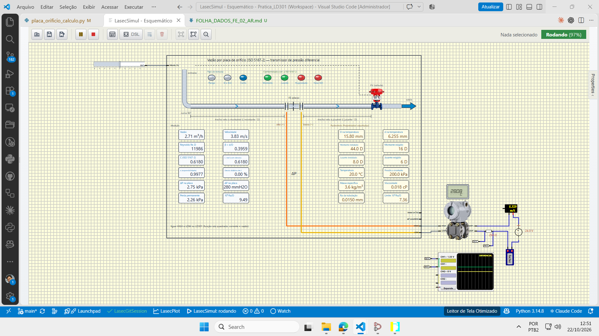

## 2. Montar o caminho de comunicação no PACTware

O procedimento abaixo parte de um projeto vazio do **PACTware 5.0**, com os DTMs **HART Communication** e **SMAR LD301** disponíveis. Se já estiver usando um projeto que contenha `HOST PC → COM20 → LD301`, confira a porta e a opção Multimaster nos itens 3 e 4 e prossiga para a conexão na seção 3. Para abrir o exemplo existente, use **File → Open** e selecione `pactware/LD301_PACTware_FE02_Pratica.PW5`; para preservar o exemplo, salve uma cópia pelo item 6.

1. Abra o PACTware. Para começar uma árvore nova, use **File → New** se houver outro projeto aberto; salve antes o projeto anterior se precisar preservá-lo. No projeto vazio, localize **HOST PC** na árvore **Project**.
2. Clique com o botão direito em **HOST PC** e escolha **Add device**. Na lista, selecione **HART Communication** e clique em **OK**. O canal é criado com o nome inicial **COM0**.

   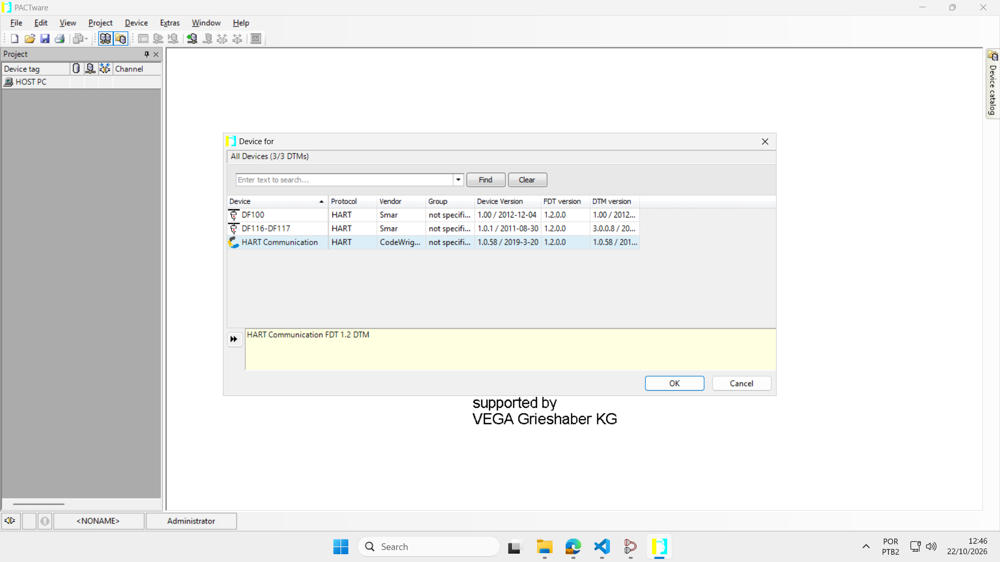

3. Dê dois cliques em **COM0**, ou em **COM20** se o canal já tiver sido configurado. Na aba de parâmetros, abra **Serial Interface** e selecione **COM20 (com0com - bus for serial port pair emulator)**, ou a outra porta COM escolhida no par virtual.
4. Desmarque **Multimaster and Burst mode support**. Clique em **Apply** se estiver habilitado e depois em **OK**. O canal passa a usar o nome da porta selecionada, **COM20** neste exemplo. Se ele já estiver com esse nome, confira a porta e a caixa antes de continuar.

   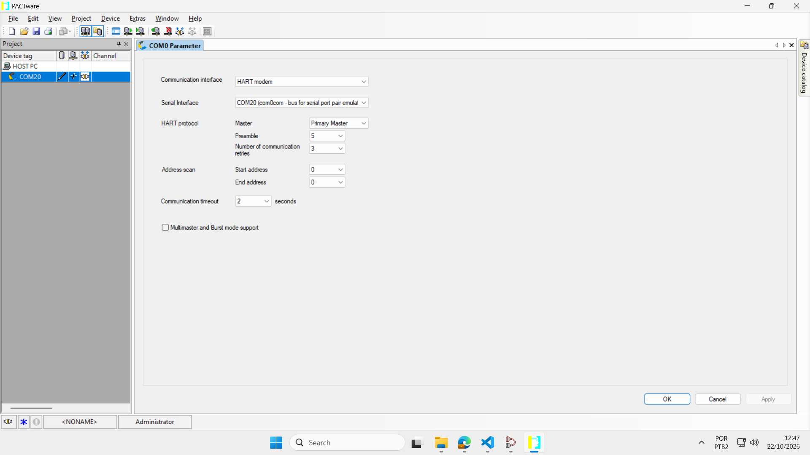

5. Clique com o botão direito em **COM20** e escolha **Add device**. Procure **LD301**, selecione o DTM **SMAR LD301** e clique em **OK**. A árvore deve ficar `HOST PC → COM20 → LD301`.

   Se um dos DTMs não aparecer, abra **Extras → Device catalog administration**, procure seu nome e confira se está marcado. Marque-o e confirme em **OK** se estiver desmarcado. Se ele não constar da lista, é necessário instalar o DTM correspondente compatível com o PACTware antes de continuar; o catálogo não instala o componente por si só.

   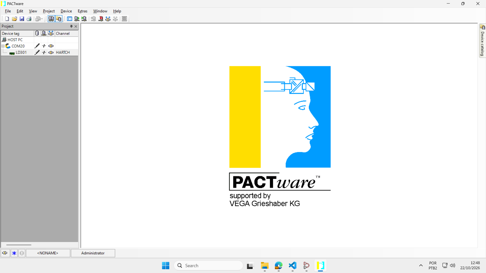

6. Para guardar a árvore e a porta, use **File → Save as**, escolha a pasta `pactware/` e grave um arquivo próprio, por exemplo `LD301_PACTware_FE02_Aluno.PW5`.

## 3. Conectar o canal e o LD301

1. Confirme novamente que o LasecSimul está **Rodando** e que o modem mostra **Fechar**.
2. No PACTware, clique com o botão direito em **COM20** e escolha **Connect**. Aguarde o ícone do canal ficar **verde**.
3. Clique com o botão direito em **LD301** e escolha **Connect**. Aguarde a conexão. Se a aba **LD301 # Parameter** não abrir, dê dois cliques em **LD301**. Confirme **Connected** na barra inferior da aba. O canal e o dispositivo devem aparecer conectados.

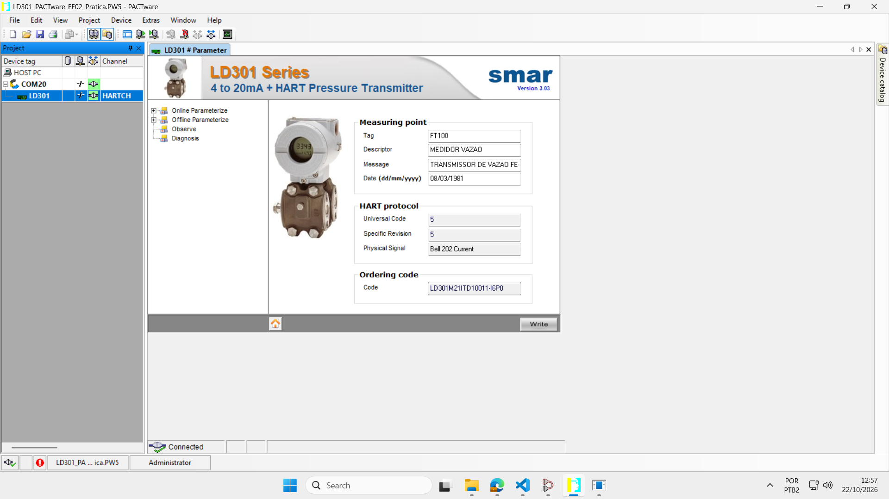

Se a conexão falhar, confira o par `COM20 ↔ CNCB0`, se a simulação continua rodando e se o modem mostra **Fechar**. Desconecte o LD301 e depois o canal COM20; reconecte **COM20 primeiro** e **LD301 depois**. Um nome em negrito sem o ícone verde e sem **Connected** não confirma a conexão.

## 4. Ler e registrar a configuração atual

Na aba **LD301 # Parameter**, use o ramo **Online Parameterize → Blocks**. O ramo **Offline Parameterize** mostra dados do projeto e não comprova a configuração do transmissor conectado.

1. Abra **Summary** e anote **Function**, unidade de pressão, faixa e variáveis do display.
2. Abra **Configuration → Measurement** e anote **(LRV) - Lower Range Value**, **(URV) - Upper Range Value** e **Primary Variable Unit**.
3. Abra **Configuration → User Unit** e anote **Mode**, **Eng. Unit (0%)**, **Eng. Unit (100%)**, **Unit Family** e **Unit Description**.

Essas leituras registram o estado encontrado antes das alterações. Se o projeto de simulação já tiver sido salvo após uma prática anterior, seus valores iniciais podem ser diferentes dos mostrados nas capturas.

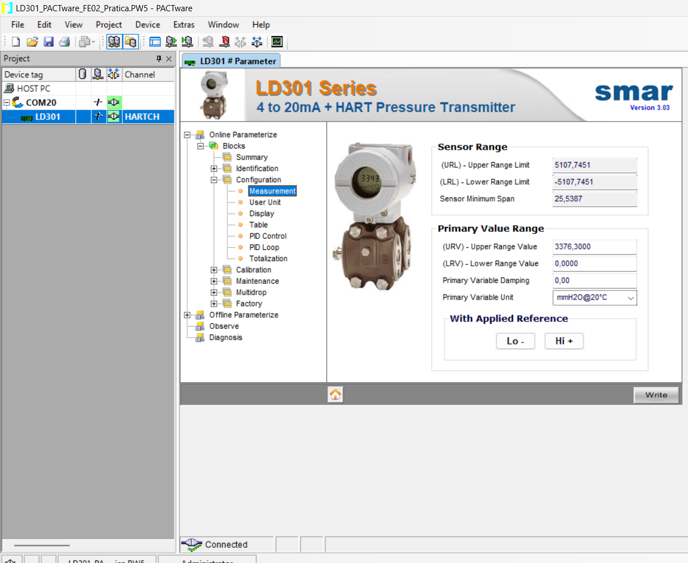

## 5. Ajustar a faixa de pressão diferencial

1. Em **Online Parameterize → Blocks → Configuration → Measurement**, confira **Primary Variable Unit = mmH2O@20°C**. Se estiver diferente, selecione essa unidade, clique em **Write**, vá a outra página e volte a **Measurement** para confirmá-la.
2. Preencha **(LRV) - Lower Range Value = 0** e **(URV) - Upper Range Value = 1150,3**. Esses valores definem a faixa de **pressão diferencial**; o URV não é a vazão indicada nem a escala superior da User Unit.
3. Clique em **Write**. Em seguida, vá a **Summary**, volte a **Measurement** e confirme a unidade, `LRV = 0` e `URV = 1150,3`. Se um valor não permanecer, repita a gravação e a releitura antes de prosseguir.

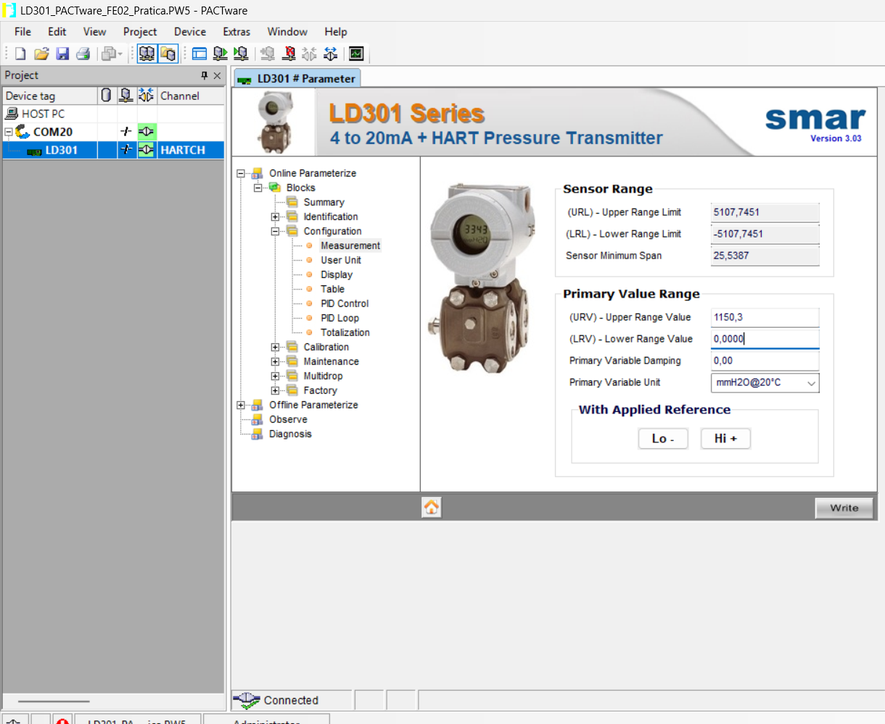

> Para esta planta simulada, usa-se o valor numérico **1150,3** como URV. A planta emprega mmH₂O convencional e o DTM identifica a unidade como mmH₂O a 20 °C; para um transmissor físico, é necessário considerar essa diferença de unidade. Este roteiro é para a simulação.

## 6. Selecionar a função de raiz quadrada

1. Abra **Summary** no ramo **Online Parameterize**.
2. Na lista **Function**, selecione **Sqrt** e clique em **Write**.
3. Acesse outra página e volte a **Summary**. Confirme que **Function = Sqrt** e que o URV continua em `1150,3`.

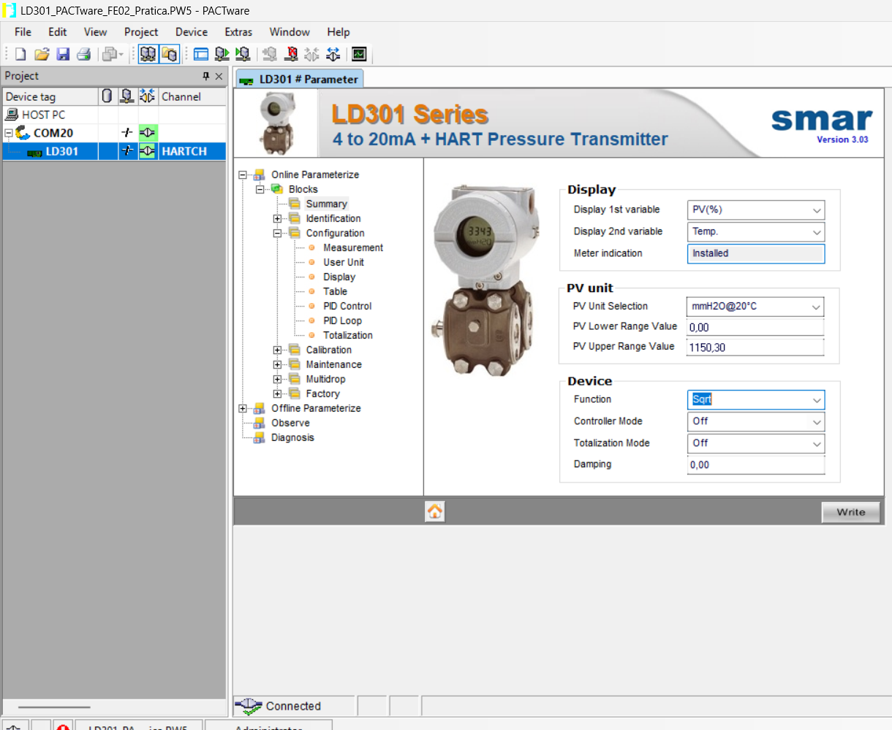

Com a válvula em 50 %, a corrente esperada depois da raiz é aproximadamente **11,90 mA**. A raiz transforma a relação entre pressão diferencial e vazão em uma indicação aproximadamente proporcional à vazão.

### Ponto de corte da raiz

O caso de referência usa **6 % da faixa de pressão**, no modo abrupto **Hard**. Com LRV zero e URV de 1150,3 mmH₂O, o corte corresponde a aproximadamente **69,0 mmH₂O**. Abaixo dele, a saída vai para **4 mA**; após configurar a User Unit de 0 a 15 na próxima seção, a indicação também vai para zero.

Na versão **3.03 do DTM** usada nesta prática, os campos para ler ou alterar esse ponto e esse modo não foram encontrados. Compare as aberturas de **25 %** e **26 %** na seção 9 para verificar se o comportamento é compatível com o caso de referência. Esses dois pontos, isoladamente, não comprovam o valor exato do corte nem permitem configurá-lo.

## 7. Configurar a User Unit

1. Abra **Configuration → User Unit**.
2. Em **Mode**, selecione **On**.
3. Em **Unit Family**, selecione **Volumetric Flow**. Em **Unit Description**, selecione **N m3/h**.
4. Informe **Eng. Unit (0%) = 0** e **Eng. Unit (100%) = 15**.
5. Clique em **Write**. Vá a outra página, volte a **User Unit** e releia **Mode**, unidade e os valores de 0 % e 100 %.

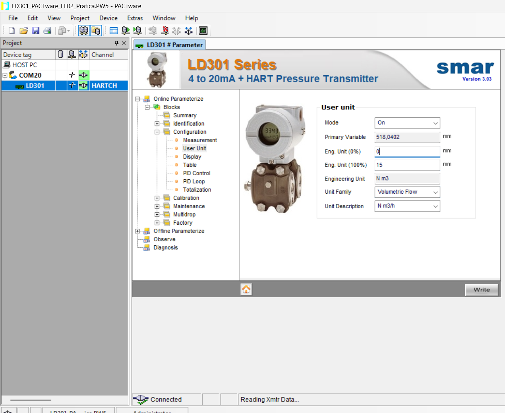

Na captura, os valores estão digitados **antes de Write**: a indicação de unidade ao lado dos campos ainda mostra `mm`. Use os valores relidos depois da gravação para conferir a configuração efetiva.

O valor **15 N m3/h** é o extremo superior da escala de indicação em condições normais. Para a prática, essas condições são **0 °C e 101,325 kPa absolutos**. A vazão volumétrica de operação mostrada pela placa em `m³/h` usa as condições do processo; portanto, os dois valores não devem ser comparados como se tivessem a mesma referência.

## 8. Configurar o display e salvar

1. Abra **Configuration → Display**.
2. Em **Display 1st variable**, selecione **PV**. Em **Display 2nd variable**, selecione **Out(mA)**.
3. Clique em **Write**. Volte ao **Summary** e releia o display, a faixa e a função **Sqrt**.
4. Use **File → Save** no PACTware para guardar a árvore e a porta de comunicação. Em seguida, salve também o projeto no LasecSimul pelo botão **Salvar projeto**: é nele que ficam os parâmetros atuais do LD301 simulado.

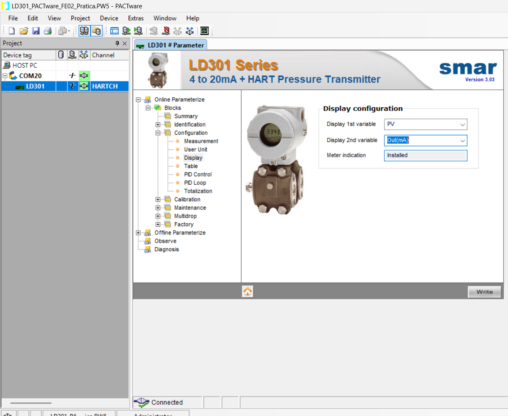

O display do LD301 passa a alternar entre a **PV em N m3/h** e a **corrente em mA**. Se a unidade ou os valores relidos forem diferentes dos configurados, volte à página correspondente, grave com **Write** e releia antes de iniciar os ensaios.

## 9. Testar no LasecSimul

Em cada ponto, selecione o controle **Válvula de controle (%)**, altere **Properties → Valor do sinal** e aguarde pelo menos **5 segundos**. Leia a pressão diferencial na placa, a corrente no amperímetro e a indicação no LCD ou em **Online Parameterize → Blocks → Configuration → User Unit → Primary Variable** no PACTware. Se a página já estiver aberta e o valor não mudar, acesse outra página e volte para provocar uma nova leitura.

Os valores abaixo são **referências para o caso FE-02-AR**, com faixa `0–1150,3`, função **Sqrt**, User Unit `0–15 N m3/h` e corte `6 % / Hard`. As leituras da planta e do display podem aparecer arredondadas.

| Válvula | ΔP esperado na planta | Corrente esperada | PV esperada | O que conferir |
|---:|---:|---:|---:|---|
| 0 % | 0 mmH₂O | 4,000 mA | 0,000 N m3/h | Saída no mínimo. |
| 25 % | ≈ 68,7 mmH₂O | 4,000 mA | 0,000 N m3/h | ΔP ligeiramente abaixo do corte abrupto. |
| 26 % | ≈ 74,4 mmH₂O | ≈ 8,070 mA | ≈ 3,816 N m3/h | ΔP acima do corte; a saída volta a responder. |
| 50 % | ≈ 280,5 mmH₂O | ≈ 11,901 mA | ≈ 7,407 N m3/h | Ponto intermediário para conferência. |
| 75 % | ≈ 639,1 mmH₂O | ≈ 15,926 mA | ≈ 11,181 N m3/h | Corrente e indicação aumentam com a abertura. |
| 100 % | ≈ 1150,3 mmH₂O | ≈ 20,000 mA | ≈ 15,000 N m3/h | Extremo superior da faixa configurada. |

A 25 %, o mostrador da planta pode arredondar o ΔP para **69 mmH₂O**, embora o valor de referência seja cerca de **68,7 mmH₂O**, abaixo do corte de aproximadamente 69,0 mmH₂O. A comparação entre 25 % e 26 % esclarece o efeito do corte.

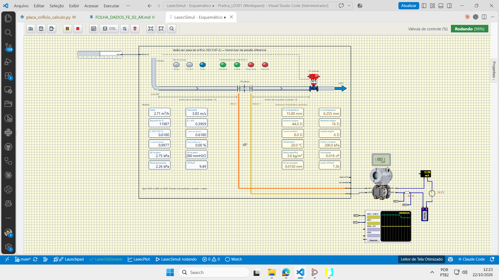

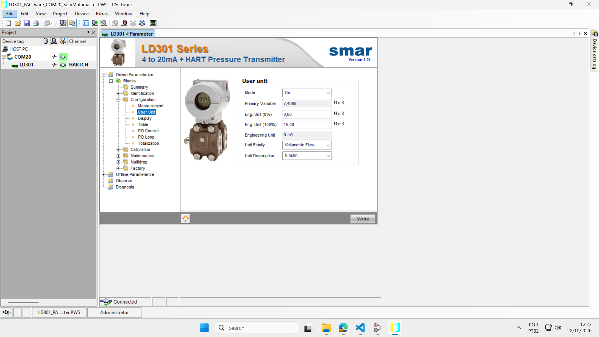

Na execução documentada, a 50 %, o PACTware indicou **7,4068 N m3/h** e o amperímetro aproximadamente **11,90 mA**. A indicação fica um pouco abaixo de 7,5 N m3/h porque a raiz simples não corrige as variações do coeficiente de descarga e da expansibilidade em cada ponto.

## 10. Se a leitura não corresponder

| Sintoma | O que conferir |
|---|---|
| PACTware mostra **Disconnected** | Confirme simulação em **Rodando**, modem mostrando **Fechar** e `CNCB0` no mesmo par da COM selecionada; conecte o canal e depois o **LD301**. |
| Valores digitados não permanecem | Use o ramo **Online Parameterize**, clique em **Write** e releia a página. |
| Corrente ainda parece proporcional ao ΔP | Releia **Summary → Function** e confirme **Sqrt**. |
| PV aparece em `mm` ou em outra escala | Em **User Unit**, confirme **On**, **Volumetric Flow**, **N m3/h** e escala `0–15`; grave e releia. |
| LCD não alterna PV e corrente | Em **Display**, confira **PV** e **Out(mA)**; grave e releia. |
| Corrente fica em 4 mA a 25 % | Para o caso com corte **6 % / Hard**, esse é o comportamento esperado; compare com o ponto de 26 %. |
| Alterações desaparecem ao reabrir a planta | Depois de parametrizar online, salve o projeto no **LasecSimul**; salvar o arquivo do PACTware guarda a árvore e a porta. |

Ao terminar, registre suas próprias leituras e capturas. No PACTware, clique com o botão direito no **LD301** e escolha **Disconnect**; depois faça o mesmo no canal de comunicação, **COM20** no exemplo. No LasecSimul, clique em **Fechar** no modem e pare a simulação.

---

## Siglas, abreviações e símbolos

As siglas identificam equipamentos, tipos de sinal ou parâmetros. Esta lista é uma referência rápida; o significado prático de cada termo aparece no trecho do roteiro em que ele é utilizado.

### Siglas e abreviações

| Sigla | Significado | Em linguagem simples |
|---|---|---|
| **FE** | *Flow Element* (elemento de vazão) | Identifica a placa de orifício, como FE-02-AR. |
| **FT** | *Flow Transmitter* (transmissor de vazão) | Identifica o instrumento de transmissão; **FT100** é a tag do LD301 usado nesta planta. |
| **LD301** | Modelo do transmissor SMAR | Equipamento que recebe HIGH e LOW, calcula a pressão diferencial e fornece o sinal de saída. |
| **HART** | *Highway Addressable Remote Transducer* | Protocolo de comunicação digital utilizado sobre o laço de 4–20 mA. |
| **DTM** | *Device Type Manager* | Módulo de software que disponibiliza as telas e funções de um dispositivo no PACTware. |
| **PACTware** | Nome do aplicativo de configuração | Programa que reúne os DTMs do canal HART e do LD301. |
| **COM** | Designação de porta serial | Porta de comunicação do computador; nesta prática, `COM20` se comunica com `CNCB0` pelo com0com. |
| **PV** | *Primary Variable* (variável primária) | Valor principal apresentado pelo transmissor; nesta configuração, a indicação após a função e a User Unit. |
| **LRV** | *Lower Range Value* | Limite inferior da **faixa de pressão** associada à saída de 4 mA. |
| **URV** | *Upper Range Value* | Limite superior da **faixa de pressão** associada à saída de 20 mA. |
| **LCD** | *Liquid Crystal Display* | Visor do LD301 que alterna as variáveis configuradas. |
| **Sqrt / SQR** | *Square root* (raiz quadrada) | Função aplicada pelo LD301 para converter a relação quadrática `ΔP`–vazão em uma saída aproximadamente proporcional à vazão. |
| **ISO** | *International Organization for Standardization* | Organização responsável pela norma técnica ISO 5167. |
| **GUI** | *Graphical User Interface* | Interface gráfica com janelas, campos e botões. |
| **PID** | Proporcional, integral e derivativo | Tipo de controlador citado entre páginas do DTM, mas que não é objeto dos ajustes de vazão desta aula. |
| **[P]** | Plaqueta | Valor extraído da fotografia. |
| **[E]** | Estipulado | Condição definida para a prática, não extraída da placa. |
| **[C]** | Calculado | Valor obtido por cálculo ou por uma conversão feita à parte. |
| **[O]** | Observado | Valor lido em uma tela, captura ou instrumento da simulação. |

### Símbolos e unidades mais usados

| Notação | O que representa | Unidade ou observação |
|---|---|---|
| `D` / `d` | Diâmetro interno da tubulação / diâmetro do orifício | mm nas propriedades; m nas equações SI. |
| `β` | Razão de diâmetros: `d/D` | Sem unidade. |
| `Q`, `Q₁` | Vazão volumétrica nas condições de operação | m³/h nos mostradores; m³/s nas equações. |
| `Qₙ` | Vazão volumétrica referida às condições normais estipuladas | Nm³/h. |
| `ΔP` | Diferença entre HIGH e LOW | kPa, Pa ou mmH₂O, conforme a tela. |
| `ρ` | Massa específica do fluido | kg/m³. |
| `μ` | Viscosidade dinâmica | cP no formulário; Pa·s na equação de Reynolds. |
| `κ` | Expoente isentrópico do gás | Sem unidade. |
| `Re_D` | Número de Reynolds baseado em `D` | Sem unidade. |
| `C` | Coeficiente de descarga | Sem unidade. |
| `ε` | Fator de expansibilidade do gás | Sem unidade; para líquido, `ε = 1`. |
| `p₁` / `p₂` | Pressão a montante / pressão a jusante | Usar pressões **absolutas** na razão `p₂/p₁`. |
| `mA` | Miliampère | Unidade de corrente do laço, de 4 a 20 mA. |
| `mmH₂O` | Milímetro de coluna d'água convencional | **9,80665 Pa**, adotado no cálculo e na planta. |
| `mmH₂O@20 °C` | Milímetro de coluna d'água segundo a unidade HART do LD301 | **9,7891 Pa**; não confundir com a unidade convencional. |

## Glossário de conceitos

| Conceito | Explicação para esta prática |
|---|---|
| **Montante / jusante** | Antes / depois da placa, considerando o sentido do escoamento. |
| **Placa de orifício** | Peça com um furo de diâmetro conhecido, inserida na tubulação para produzir uma pressão diferencial relacionada à vazão. |
| **Tomada de pressão** | Ponto da tubulação a partir do qual a pressão é levada à entrada HIGH ou LOW do transmissor. |
| **Laço de corrente** | Circuito elétrico por onde circula o sinal de 4–20 mA do transmissor. |
| **Faixa de medição** | Intervalo entre os valores inferior e superior configurados no instrumento; aqui, faixa de **pressão diferencial**. |
| **Span** | Amplitude da faixa: diferença entre o limite superior e o inferior. |
| **Função de transferência** | Regra que transforma o valor medido no valor de saída; neste roteiro, saída linear ou com raiz quadrada. |
| **User Unit** | Escala de engenharia que associa os extremos da saída a valores indicados em uma unidade escolhida, como `N m3/h`. |
| **Ponto de corte (cutoff)** | Limite abaixo do qual a função raiz é tratada de forma especial; no modo Hard, a saída vai ao mínimo. |
| **Damping** | Amortecimento aplicado ao sinal para reduzir oscilações rápidas da indicação. |
| **Vena contracta** | Região de maior contração do jato após o orifício, próxima da menor pressão. |
| **Perda permanente** | Parcela da queda de pressão que não é recuperada depois da placa; não é o `ΔP` entre as tomadas usado como `URV`. |
| **Releitura online** | Ação de voltar ao dispositivo conectado e conferir o valor que foi realmente gravado. |
| **Caso-base** | Exemplo inicial do projeto principal, com água, usado para conhecer a planta antes de trabalhar com a FE-02-AR. |
