# Universidade Federal de Uberlândia — FEELT

## Instrumentação Industrial II · Aula Prática 05

# Medição de vazão por placa de orifício e transmissor SMAR LD301

Este roteiro conduz a medição de vazão por pressão diferencial com três ferramentas: o **Python** calcula a placa e os valores de projeto, o **LasecSimul** simula a planta e o transmissor LD301, e o **PACTware** parametriza o LD301 por HART. A placa usada como exemplo resolvido é a **FE-02-AR** ([foto](imagens/placa03.jpg)). As placas **FE-09-AR** e **FE-01-AR** ficam como exercícios.

> **Situação desta revisão (22/10/2026).** Todas as etapas abaixo foram executadas nesta máquina e registradas com capturas reais das ferramentas.
>
> - **Python:** o script principal foi executado no terminal do VS Code para as três placas. A saída mostra geometria, vazão, Reynolds, C, ε e ΔP ([Oficina 02](#oficina-02)).
> - **LasecSimul:** a "planta zerada" foi diagnosticada e corrigida. O pacote instalado da extensão 0.0.100 não trazia a pasta `bundled/project/schema/block-library`. Sem ela, os blocos `sl.*` apareciam como "?" e os mostradores não recebiam valores. Depois da correção, a planta FE-02-AR respondeu a 0 %, 25 %, 26 %, 50 %, 75 % e 100 % de abertura, com valores iguais aos do Python ([Oficina 03](#oficina-03)).
> - **PACTware:** o projeto foi montado do zero numa execução contínua: Add device do HART Communication, duplo clique, `COM20`, Multimaster desmarcado em etapa própria, Add device do LD301 e projeto salvo. Em seguida: **Abrir** no modem do LasecSimul, **Connect no modem COM20** e **Connect no LD301**, em passos separados ([Oficina 04](#oficina-04)). No **Online Parameterize** foram gravados e relidos: faixa 0–1150,3 mmH₂O, função **Sqrt**, User Unit **0–15 N m³/h** e display **PV / Out(mA)**. O LCD do LD301 passou a mostrar **7.407 Nm3/h** e 11.901 mA ([Oficina 05](#oficina-05)).
> - **Limitação restante:** o DTM 3.03 não expõe os parâmetros do corte do LD301; veja [Validação final e limitações restantes](#validacao-final). A persistência da configuração HART no `.lsproj` foi corrigida.

**Convenção usada em todo o roteiro.** **[P]** = lido na plaqueta fotografada. **[E]** = dado de processo **estipulado para a prática**, conforme pedido do professor. **[C]** = calculado. **[O]** = observado na tela de uma ferramenta durante a execução. Um valor [C] nunca é apresentado como leitura do simulador ou do transmissor.

<details open>
<summary><strong>📑 Índice geral</strong></summary>

- [Apresentação, objetivos e competências](#apresentacao)
- [Parte I — Fundamentação](#parte-i)
  - [Problema de engenharia](#fundamentos)
  - [Placa de orifício e ISO 5167-2](#iso-5167)
  - [Placas fotografadas e folhas de dados](#folhas-dados-placas)
  - [LD301, HART e PACTware](#teoria-ld301-pactware)
  - [Leitura aplicada do manual do LD301](#manual-ld301)
  - [LasecSimul e planta do projeto](#teoria-lasecsimul)
  - [Python no projeto](#teoria-python)
  - [Arquitetura e caminhos de dados](#arquitetura)
- [Pré-requisitos e arquivos](#pre-requisitos)
- [Parte II — Oficinas](#parte-ii)
  - [Oficina 01 — Reconhecer o sistema](#oficina-01)
  - [Oficina 02 — Calcular as placas em Python](#oficina-02)
  - [Oficina 03 — Preparar e validar a planta no LasecSimul](#oficina-03)
  - [Oficina 04 — Montar o caminho HART no PACTware e conectar o LD301](#oficina-04)
  - [Oficina 05 — Parametrizar o LD301 como transmissor de vazão (FE-02-AR)](#oficina-05)
  - [Oficina 06 — Exercícios FE-09-AR e FE-01-AR](#oficina-06)
  - [Oficina 07 — Diagnosticar e avaliar](#oficina-07)
- [Validação final e limitações restantes](#validacao-final)
- [Diagnóstico de problemas](#diagnostico)
- [Glossário](#glossario)
- [Referências](#referencias)
- [Apêndices](#apendices)

</details>

---

<a id="apresentacao"></a>
## Apresentação, objetivos e competências

### Objetivo geral

Relacionar a vazão que passa por uma placa de orifício com a pressão diferencial medida pelo LD301 e com a indicação de vazão produzida pela extração de raiz quadrada no transmissor. A planta do LasecSimul, a parametrização no PACTware e o cálculo em Python são comparados no mesmo ponto de operação.

### Competências

Ao concluir as atividades, o estudante deverá conseguir:

1. Explicar a relação entre vazão, pressão diferencial, razão de diâmetros e propriedades do fluido.
2. Converter vazão normal (Nm³/h) em vazão nas condições de operação (m³/h) e calcular o ΔP de projeto.
3. Executar o cálculo em Python e interpretar Reynolds, C, ε, ΔP e URV.
4. Configurar a placa no LasecSimul e validar a resposta da planta antes de mexer no transmissor.
5. Conectar o canal HART e o dispositivo no PACTware e distinguir as páginas online das offline.
6. Gravar e reler faixa, função raiz, User Unit e display do LD301, e conferir a indicação de vazão no LCD.
7. Reconhecer os limites de validade da ISO 5167-2 e não confundir resultado didático com dimensionamento certificado.

### Como usar a série

Siga as oficinas na ordem. Registre a configuração **antes** de cada alteração, altere um parâmetro por vez e só aceite uma gravação depois de relê-la. Os valores calculados servem de referência; compare-os com o que a planta e o transmissor mostram, sem ajustar os dados observados para coincidir com o cálculo.

---

<a id="parte-i"></a>
# Parte I — Fundamentação

<a id="fundamentos"></a>
## Problema de engenharia

Uma linha industrial precisa medir vazão sem um medidor com partes móveis. A placa de orifício cria uma restrição conhecida: o fluido acelera no furo e a pressão estática cai. Duas tomadas levam as pressões a um transmissor diferencial. O transmissor converte a diferença de pressão num sinal de 4–20 mA e permite, por HART, ler e escrever a configuração.

A cadeia tem uma variável de processo (vazão), um elemento primário (placa), uma variável intermediária (pressão diferencial), um transmissor, um sinal analógico e um canal digital sobreposto. A simulação permite variar a abertura da válvula sem operar uma linha pressurizada. Ela não substitui calibração, avaliação de incerteza nem validação de instalação em campo.

O PACTware é a aplicação de configuração. O DTM (*Device Type Manager*) é o componente de software que fornece as telas específicas de cada equipamento. O script Python é uma ferramenta de cálculo e comparação; ele não se comunica com o PACTware nem com o LasecSimul.

<a id="iso-5167"></a>
## Placa de orifício, Bernoulli e ISO 5167-2

### Derivação ideal

Para escoamento permanente, incompressível, horizontal e sem perdas, Bernoulli entre a seção a montante e a seção contraída dá:

$$P_1+\frac{\rho V_1^2}{2}=P_2+\frac{\rho V_2^2}{2}.$$

A continuidade entre o tubo de diâmetro interno `D` e o orifício de diâmetro `d` dá `V₁ = β²V₂`, com `β = d/D`. Definindo `ΔP = P₁ − P₂`:

$$V_2=\sqrt{\frac{2\Delta P}{\rho(1-\beta^4)}}.$$

O termo `1 − β⁴` vem da velocidade não nula no tubo a montante.

### Equação de vazão

A equação prática inclui o coeficiente de descarga `C` e, para gases, o fator de expansibilidade `ε`:

$$Q=C\varepsilon\frac{\pi d^2}{4}\sqrt{\frac{2\Delta P}{\rho(1-\beta^4)}},\qquad$$
$$\Delta P=\frac{8\rho(1-\beta^4)Q^2}{C^2\varepsilon^2\pi^2d^4}.$$

`Q` é a vazão volumétrica nas condições de operação (m³/s), `ρ` a massa específica a montante (kg/m³), `ΔP` em Pa, e os diâmetros em metros. Para líquidos, `ε = 1`. Para gases, o modelo usa a expressão da ISO 5167-2, que depende de `β`, de `p₂/p₁` (pressões absolutas) e do expoente isentrópico `κ`.

Mantidos os demais termos, `ΔP ∝ Q²`: metade da vazão produz cerca de um quarto do ΔP. O desvio dessa proporção vem da variação de `C` com o número de Reynolds e de `ε` com o ΔP.

### Coeficiente de descarga e regime

O Python e a planta usam a equação de Reader–Harris/Gallagher para `C`, com tomada, `β`, `Re_D` e o termo de tubo pequeno quando `D < 71,12 mm`. O número de Reynolds é:

$$
Re_D=\frac{4\rho Q}{\pi\mu D},
$$

com `μ` em Pa·s. Como `C` depende de `Re_D`, que depende de `Q`, obter `Q` a partir de `ΔP` exige iteração. O script parte de `C = 0,6` e repete o cálculo até convergir (no máximo 50 iterações). No caminho direto (abertura → vazão → ΔP), `C` sai direto e só `ε` é iterado.

A ISO 5167-2 define limites para placas padronizadas, entre eles `50 mm ≤ D ≤ 1000 mm`, `d ≥ 12,5 mm`, `0,10 ≤ β ≤ 0,75`, Reynolds mínimo conforme tomada e `β`, e `p₂/p₁ ≥ 0,75` para `ε`. As três placas desta prática têm `D < 50 mm`, portanto estão **fora** do escopo da norma. Os coeficientes são extrapolados como recurso didático ([escopo oficial da ISO 5167-2:2022](https://www.iso.org/standard/79180.html)).

A pressão cai após a placa, atinge um mínimo próximo da *vena contracta* e se recupera parcialmente. A perda permanente é a diferença entre a pressão a montante e a pressão recuperada; ela é menor que o ΔP entre as tomadas e não deve ser usada como URV.

### Instalação e grandezas que influenciam o resultado

O modelo oferece três tomadas: flange (25,4 mm de cada face), D e D/2, e canto. A tomada altera `C`. Curvas, válvulas e rugosidade alteram o perfil de velocidade. A tabela de trechos retos usada pelo modelo representa uma curva de 90° a montante. As folhas desta prática usam 44D a montante e 8D a jusante.

`D` e `d` são corrigidos pela dilatação térmica a partir de 20 °C. Como todas as folhas estipulam 20 °C, a correção é nula. A opção **desvio didático** aumenta artificialmente o `C` quando certos critérios de instalação ou rugosidade falham. Ela é um recurso de demonstração do projeto, não uma correção da ISO, e fica **desligada** nas três folhas.

<a id="folhas-dados-placas"></a>
### Placas fotografadas e folhas de dados

As fotos fornecem a geometria [P]. Os dados de processo, ausentes nas plaquetas, foram **estipulados para a prática** [E]: ar seco a 20 °C, 200 kPa manométricos a montante, vazão normal referida a 0 °C e 101,325 kPa absolutos, tomadas de canto, 44D/8D, desvio didático desligado. A tag e os números da FE-02-AR e da FE-09-AR estão nítidos. Na placa01.jpg, um reflexo cobre a tag, mas com ampliação os números são legíveis. A identificação **FE-01-AR** dessa placa foi informada pelo professor.

<table><tr><td>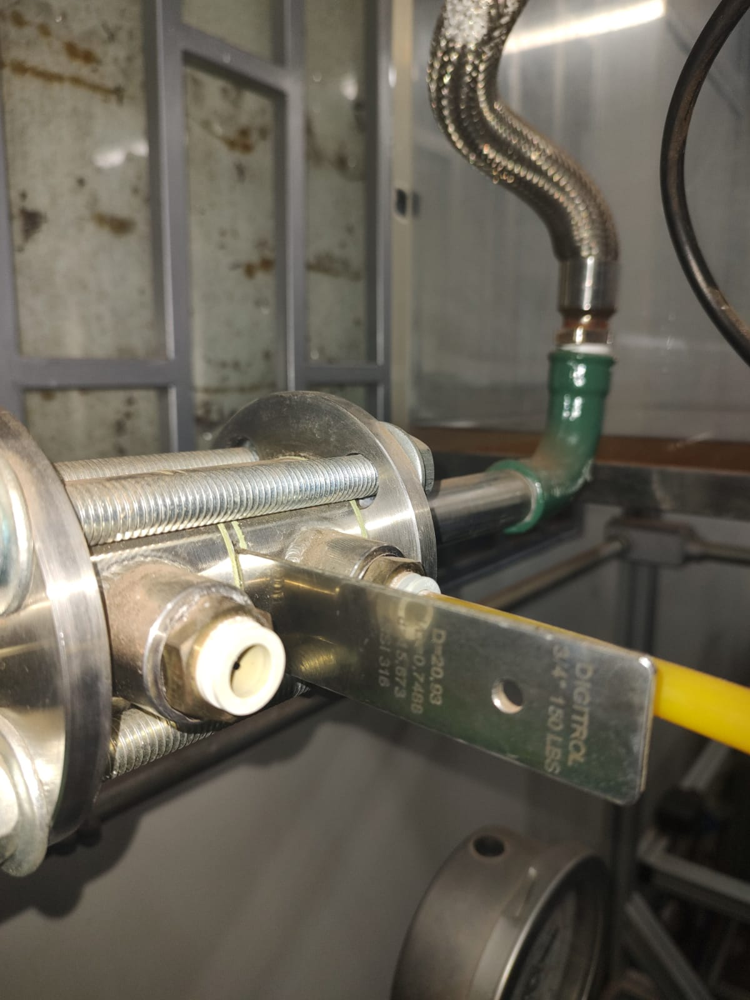</td><td>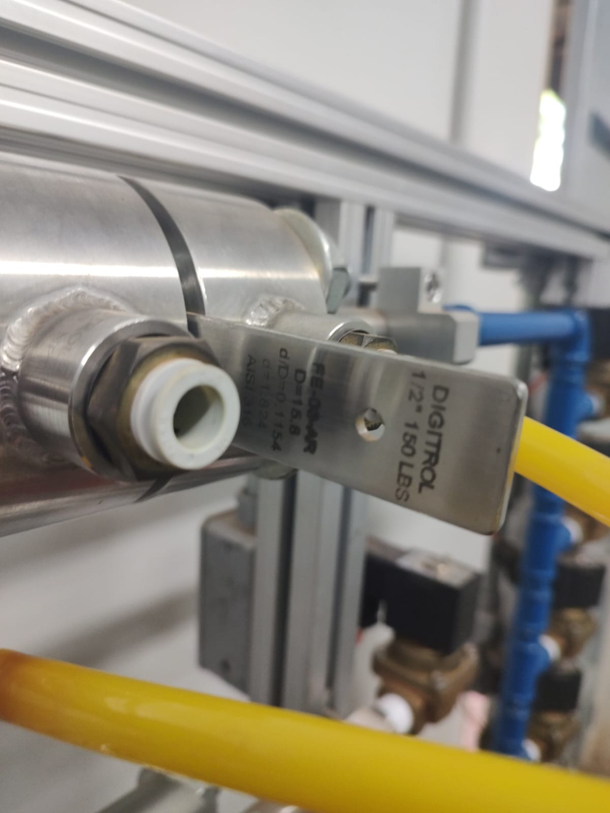</td><td>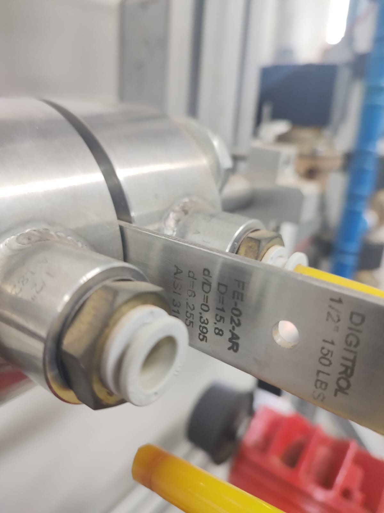</td></tr><tr><td>placa01.jpg — FE-01-AR, 3/4", D = 20,93 mm, d/D = 0,7488, d = 15,673 mm</td><td>placa02.jpg — FE-09-AR, 1/2", D = 15,8 mm, d/D = 0,1154, d = 1,824 mm</td><td>placa03.jpg — FE-02-AR, 1/2", D = 15,8 mm, d/D = 0,395, d = 6,255 mm</td></tr></table>

| Placa | Papel | D / d [P] | β [C] | Qₙ,max [E] | Qmax no LasecSimul [C] | ΔPmax [C] | URV do LD301 [C] | Folha |
|---|---|---:|---:|---:|---:|---:|---:|---|
| FE-02-AR | exemplo resolvido | 15,8 / 6,255 mm | 0,395886 | 15 Nm³/h | 5,413291 m³/h | 11,2802 kPa | 1150,3 mmH₂O | [abrir](folhas_de_dados/FOLHA_DADOS_FE_02_AR.md) |
| FE-09-AR | exercício | 15,8 / 1,824 mm | 0,115443 | 1,5 Nm³/h | 0,541329 m³/h | 15,8621 kPa | 1617,5 mmH₂O | [abrir](folhas_de_dados/FOLHA_DADOS_FE_09_AR.md) |
| FE-01-AR | exercício | 20,93 / 15,673 mm | 0,748829 | 30 Nm³/h | 10,826583 m³/h | 0,7897 kPa | 80,5 mmH₂O | [abrir](folhas_de_dados/FOLHA_DADOS_FE_01_AR.md) |

**Correção desta revisão (FE-01-AR).** A revisão anterior havia lido `d ≈ 8,89 mm` e `β ≈ 0,425` na placa01.jpg e calculado URV ≈ 1123,2 mmH₂O. Com a imagem ampliada, a plaqueta mostra `d/D = 0,7488` e `d = 15,673 mm`, e 15,673/20,93 = 0,748829 confirma a coerência. Com o furo correto, o ΔP máximo cai para 0,79 kPa (≈ 80,5 mmH₂O). A folha e o script de preparação do LasecSimul foram corrigidos.

**Conversão Nm³/h → m³/h.** Pela lei dos gases ideais, `ρₙ = pₙ/(R·Tₙ) = 1,292284 kg/m³` e `ρ₁ = p₁,abs/(R·T₁) = 3,580863 kg/m³`, com `R = 287,05 J/(kg·K)`. A massa se conserva, portanto `Q₁ = Qₙ·ρₙ/ρ₁ = 0,360886·Qₙ`. O LasecSimul e o Python trabalham com `Q₁`, a vazão nas condições de operação. O LD301 é configurado para indicar `Qₙ`. Como p₁ e T₁ são fixos nesta prática, `Qₙ` e `Q₁` são proporcionais, e a escala 0–15 N m³/h corresponde a 0–5,413 m³/h.

<a id="teoria-ld301-pactware"></a>
## LD301, laço 4–20 mA, HART e PACTware

O transmissor do projeto é o **SMAR LD301 (HART) — tag FT100**. Sua medida primária é pressão em `mmH2O@20°C`, calculada no simulador como `HIGH − LOW`. A corrente do laço é a saída. O código de pedido gravado no transmissor simulado é `LD301M21ITD10011-I6P0`. Pelo manual (p. 5.20), **M2** designa um sensor manométrico de −50 a 50 kPa; o simulador o usa como diferencial. Numa instalação real de vazão se especificaria um modelo diferencial (série D), com faixa adequada ao ΔP de projeto.

No PACTware, o DTM **HART Communication** representa o canal ou modem, e o DTM **LD301** apresenta as funções do transmissor. As páginas de **Online Parameterize** leem e escrevem no dispositivo. As de **Offline Parameterize** editam apenas o conjunto de dados do projeto. Editar um valor offline não prova que ele foi gravado no transmissor.

O modem HART do esquema usa a porta `CNCB0`. O com0com cria o par virtual `COM20 ↔ CNCB0`, e o PACTware usa `COM20`. O Python não participa desse caminho.

**Configuração encontrada no arquivo do projeto.** PV em `mmH2O@20C`, LRV = 0, URV = 3376,3, função linear e corte da raiz em 6 % no modo Hard. A **User Unit está ligada** (`On`), com escala 243–800 e unidade `mm`, herança do exemplo de nível do manual. O display mostra PV % e temperatura. A revisão anterior dizia que a User Unit estava desligada. O arquivo (`userUnit.byte0 = 0`, código `On`) e a leitura online ([captura](capturas/pw_n46_user_unit_antes.png)) mostram que está ligada. Com isso, a PV inicial em `mm` não tem significado de vazão.

<a id="manual-ld301"></a>
### Leitura aplicada do manual do LD301

As páginas citadas são as **impressas** no [docs/MANUAL_LD301.pdf](docs/MANUAL_LD301.pdf), com a página do PDF entre parênteses.

| Manual | O que diz | Como entra nesta prática |
|---|---|---|
| p. 3.8 (PDF 36) — Calibração | No modo transmissor, o Valor Inferior corresponde a 4 mA e o Superior a 20 mA. LRV e URV devem respeitar os limites do sensor e o span mínimo. | O URV é a pressão diferencial na vazão máxima (1150,3 mmH₂O), nunca a própria vazão. |
| p. 3.9 (PDF 37) — Tabela 3.1 | A referência interna é inH₂O@20 °C; as demais unidades são convertidas por fator. | `mmH2O@20°C` vale 248,642/25,4 = 9,7891 Pa. O Python e a planta usam 9,80665 Pa (mmH₂O convencional). Veja a nota de unidades abaixo. |
| p. 3.9 (PDF 37) — Unidade do Usuário e Tabela 3.2 | 0 % da User Unit ↔ Valor Inferior; 100 % ↔ Valor Superior. A consistência é responsabilidade do usuário. | Com raiz quadrada, 0–100 % da saída ↔ 0–15 N m³/h. |
| p. 3.10 (PDF 38) — User Unit e código 253 | Com User Unit desabilitada, a PV é mostrada em %. Habilitada, a PV é a pressão após a função de transferência, na unidade escolhida. O código 253 permite unidade especial de 5 caracteres. | O DTM 3.03 oferece `N m3/h` na família Volumetric Flow; não foi preciso usar o código 253. |
| p. 3.10–3.11 (PDF 38–39) — RAIZ e Figura 3.5 | Saída = 10√x. Ponto de corte ajustável, padrão de 6 % da faixa de pressão. Abaixo do corte, o modo Suave segue linear em ΔP e o modo Abrupto leva a saída a 0 %. | O transmissor simulado está em 6 %, Abrupto (Hard). Comportamento verificado a 25 % e 26 % de abertura. |
| p. 3.15 (PDF 43) — Filtro, display | Damping de 0 a 128 s além dos 140 ms do sensor. Até duas variáveis no display, alternadas a cada 3 s (Tabela 3.4). | Damping mantido em 0. Display configurado em PV e corrente. |
| p. 3.16 (PDF 44) — Proteção de escrita | Há trava por software e por hardware. | Se uma gravação falhar, verifique a proteção antes de suspeitar da comunicação. |
| p. 4.13–4.14 (PDF 59–60) — Tabela 4.5 | Funções: linear, SQR, SQR3, SQR5, tabela e combinações. | A lista do DTM (Linear, Sqrt, Sqrt + Table, Sqrt**3, Sqrt**5, Table, Table + Sqrt) coincide com o manual. |
| p. 5.20 (PDF 92) — Faixas do sensor | Faixa 2 (D2/M2): −50 a 50 kPa, span mínimo 0,42 kPa. | O DTM mostra URL ±5107,7451 mmH₂O@20 °C (= 50 kPa) e span mínimo 25,5387 mmH₂O@20 °C (≈ 0,25 kPa). A diferença no span mínimo deve ser registrada como divergência entre o manual e o simulador. |

**Nota de unidades.** O Python e o bloco `dp_mm` da planta usam 1 mmH₂O = 9,80665 Pa. O LD301 rotula a unidade como `mmH2O@20C` (código HART 4), que vale 9,7891 Pa. **No simulador**, o LD301 recebe `HIGH − LOW` já em mmH₂O e não converte; por isso o URV que coincide com a planta é 1150,3. Num **transmissor real**, o mesmo ΔP de 11,2802 kPa vale 1152,3 mmH₂O@20 °C, uma diferença de 0,18 %. Para evitar ambiguidade em campo, use kPa (URV = 11,280 kPa). O script agora imprime os dois valores.

**Sequência de configuração derivada do manual.** (1) ler e registrar a configuração existente; (2) gravar unidade, LRV e URV de pressão; (3) gravar a função raiz e conferir corte e modo; (4) habilitar e escalar a User Unit; (5) ajustar damping e display; (6) reler cada página e comparar com a planta.

<a id="teoria-lasecsimul"></a>
## LasecSimul e planta do projeto

O subsistema **Placa de orifício (vazão por ΔP)** recebe a abertura da válvula (0–100 %) e impõe `Q = Qmax·u/100`. Em seguida aplica um atraso de primeira ordem de 1 s e calcula geometria, Reynolds, `C`, `ε`, `ΔP` e as pressões HIGH e LOW. HIGH e LOW alimentam o LD301. O circuito de sinal tem fonte de 24 V, resistor de 250 Ω, amperímetro, modem HART e osciloscópio.

O modelo interno usa blocos da biblioteca equivalente ao Simulink (`sl.fcn`, `sl.mux`, `sl.gain`, `sl.discrete_transfer_fcn`) e constantes `control.constant`. As **Propriedades exportadas** do bloco da placa são `D`, `d`, tomada, trechos retos, materiais, temperatura, fluido, `ρ`, `μ`, `κ`, `p1`, `Qmax` e desvio didático.

**Histórico e formato do modelo.** A versão antiga do projeto usava blocos `control.calc_expression`. A extensão migrou os 43 blocos para a biblioteca atual `sl.*`. Os três arquivos de placa distribuídos aqui guardam uma cópia completa do subsistema em `project.subsystems`, com identidade `subsystem.local.orifice_flow_dp`; eles não dependem de um `.lssubcircuit` externo. O gerador agora valida a presença dos blocos atuais (`sl.gain`, `sl.fcn`, `sl.mux` e `sl.discrete_transfer_fcn`), rejeita wrappers antigos e remove metadata de procedência externa. A instalação da extensão também precisa incluir `bundled/project/schema/block-library` para a interface reconhecer esses blocos.

<a id="teoria-python"></a>
## Python no projeto

O script principal é [`placa_orificio_calculo.py`](placa_orificio_calculo.py). Ele usa apenas a biblioteca padrão (`argparse`, `math`, `sys`). Implementa as mesmas equações dos blocos da planta: geometria com dilatação, `C` de Reader–Harris/Gallagher, `ε`, Reynolds, perda permanente, conformidade e conversões entre ΔP, corrente e vazão. Os modos de execução são `--valvula`, `--dp`, `--corrente`, `--autoteste` ou perguntas interativas. Os parâmetros da placa podem ser passados na linha de comando (`--D`, `--d`, `--rho`, `--Qmax` etc.).

Trecho do cálculo direto (o mesmo que a planta faz):

```python
C_iso = coeficiente_iso(b, reynolds(cfg, Q_m3h, geo["D_T"]), cfg["tomada"], geo["D_T"])
C_real = C_iso * (1 + dev["total"] / 100)
dp0 = 8 * cfg["rho"] * (1 - b ** 4) * (Q_m3h / 3600) ** 2 \
      / (C_real ** 2 * math.pi ** 2 * d ** 4)
```

Dois scripts auxiliares preparam a prática:

- [`python/gerar_folhas_dados.py`](python/gerar_folhas_dados.py) calcula as três placas com o script principal, imprime um quadro-resumo e grava as três folhas em `folhas_de_dados/`.
- [`python/preparar_placa_lasecsimul.py`](python/preparar_placa_lasecsimul.py) cria `lasecsimul/placa_orificio_FE_*_calculada.lsproj` a partir do projeto principal. Ele grava as Propriedades exportadas da instância da placa e não altera o LD301.

<a id="arquitetura"></a>
## Arquitetura e caminhos de dados

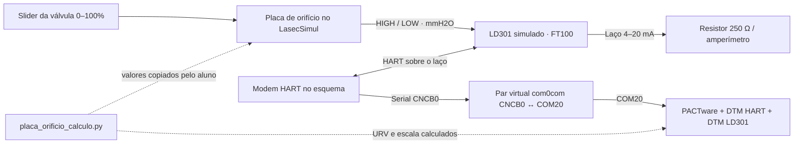

As linhas cheias são caminhos reais do esquema. As tracejadas indicam valores que o aluno transcreve: o Python **não** se comunica com o LasecSimul nem com o PACTware. O resultado do Python fornece `Qmax` para a planta, e `URV` e a escala da User Unit para o transmissor.

| Elemento | Variável | Onde se ajusta | Como se confere |
|---|---|---|---|
| Slider da válvula | abertura `u` (%) | Properties → Valor do sinal | válvula desenhada e vazão na planta |
| Placa simulada | `Q`, `Re`, `C`, `ε`, `ΔP` | Propriedades exportadas | mostradores da planta × saída do Python |
| LD301 FT100 | PV (pressão), corrente, PV de usuário | PACTware → Online Parameterize | releitura no DTM, LCD e amperímetro |
| Modem HART | porta `CNCB0` | propriedades do modem; botão Abrir/Fechar | rótulo do botão e estado no PACTware |
| PACTware | canal `COM20` e dispositivo | árvore do projeto | ícone verde e barra de status **Connected** |

---

<a id="pre-requisitos"></a>
## Pré-requisitos e arquivos

### Softwares usados nesta execução

| Software | Versão observada | Observação |
|---|---|---|
| Windows Server 2025 + VS Code | — | VS Code em modo administrador; workspace confiável |
| Extensão LasecSimul | **0.0.100** (a 0.0.97 está marcada como obsoleta) | O executável em uso é `...\josuemoraisgh.lasecsimul-0.0.100\bundled\core\build\Release\lasecsimul-core.exe`. **Exige a pasta `block-library`**; veja [Oficina 03, Etapa 01](#oficina-03) |
| Python | 3.12.5 | Só biblioteca padrão |
| PACTware | 5.0 | DTM HART Communication (CodeWrights 1.0.58) e DTM SMAR LD301 3.03 |
| com0com | par 0: `COM20 ↔ CNCB0` | Não criar outro par com os mesmos nomes |

### Organização do repositório

```
README.md                    roteiro da prática (este arquivo)
placa_orificio_calculo.py    cálculo principal; rode na raiz: python placa_orificio_calculo.py ...
folhas_de_dados/             folhas FE-02-AR (resolvida), FE-09-AR e FE-01-AR (exercícios)
lasecsimul/                  projetos do LasecSimul (caso-base e uma cópia por placa)
pactware/                    projeto PACTware de referência
python/                      scripts auxiliares e saídas de texto do Python
docs/                        manual do LD301 e relatório de validação
imagens/                     fotos das plaquetas
capturas/                    capturas de tela usadas neste roteiro
```

| Caminho | Uso |
|---|---|
| [`placa_orificio_calculo.py`](placa_orificio_calculo.py) | Cálculo principal, comparação e autoteste (Oficina 02) |
| [`folhas_de_dados/FOLHA_DADOS_FE_02_AR.md`](folhas_de_dados/FOLHA_DADOS_FE_02_AR.md) | Folha da placa do exemplo resolvido |
| [`folhas_de_dados/FOLHA_DADOS_FE_09_AR.md`](folhas_de_dados/FOLHA_DADOS_FE_09_AR.md), [`folhas_de_dados/FOLHA_DADOS_FE_01_AR.md`](folhas_de_dados/FOLHA_DADOS_FE_01_AR.md) | Folhas dos exercícios (Oficina 06) |
| [`lasecsimul/placa_orificio_ld301.lsproj`](lasecsimul/placa_orificio_ld301.lsproj) | Projeto principal: caso-base com água (Oficina 01) e origem das cópias |
| [`lasecsimul/placa_orificio_FE_02_AR_calculada.lsproj`](lasecsimul/placa_orificio_FE_02_AR_calculada.lsproj) | Planta configurada com a FE-02-AR (Oficinas 03 a 05) |
| [`lasecsimul/placa_orificio_FE_09_AR_calculada.lsproj`](lasecsimul/placa_orificio_FE_09_AR_calculada.lsproj), [`lasecsimul/placa_orificio_FE_01_AR_calculada.lsproj`](lasecsimul/placa_orificio_FE_01_AR_calculada.lsproj) | Plantas dos exercícios (Oficina 06) |
| [`pactware/LD301_PACTware_FE02_Pratica.PW5`](pactware/LD301_PACTware_FE02_Pratica.PW5) | Projeto PACTware montado na Oficina 04 (`HOST PC → COM20 → LD301`, Multimaster desmarcado). O aluno deve montar o seu; este serve de referência |
| [`python/gerar_folhas_dados.py`](python/gerar_folhas_dados.py), [`python/preparar_placa_lasecsimul.py`](python/preparar_placa_lasecsimul.py) | Geração das folhas e das cópias do LasecSimul |
| [`python/saidas/`](python/saidas/) | Saídas de texto do Python (autoteste, caso-base, pontos da FE-02-AR) |
| [`docs/MANUAL_LD301.pdf`](docs/MANUAL_LD301.pdf) | Manual do transmissor |
| [`docs/RELATORIO_VALIDACAO.md`](docs/RELATORIO_VALIDACAO.md) | Resultados verificados e limitações restantes |
| [`imagens/`](imagens/), [`capturas/`](capturas/) | Fotos das plaquetas e capturas de tela; o [índice de evidências](#indice-evidencias) lista cada captura |

Os arquivos legados (projetos intermediários, backups de migração, manual duplicado e scripts exploratórios antigos) foram removidos na organização de 22/10/2026 e continuam disponíveis no histórico do git.

---

<a id="parte-ii"></a>
# Parte II — Oficinas

<a id="oficina-01"></a>
<details open>
<summary><strong>📘 Oficina 01 — Reconhecer o sistema</strong></summary>

**Competência:** identificar cada componente e distinguir processo, medição, configuração e cálculo.

#### 🔹 Passo 01 — Abrir o projeto principal

1. No VS Code, abra a pasta do repositório (**Arquivo → Abrir Pasta…**) e confie no workspace quando solicitado.
2. Pressione `Ctrl+P`, digite `placa_orificio_ld301.lsproj` e pressione `Enter`. A aba **LasecSimul - Esquemático** abre.
3. Clique em **Ajustar à tela** na barra do esquemático e depois em **Rodar** (triângulo verde). O cabeçalho passa de **Parado** para **Rodando**.


*Captura real [O], já com a instalação corrigida (Oficina 03): o caso-base com água a 50 % mostra 7,50 m³/h, Re_D = 50329, C = 0,6153, ε = 1,0000 e ΔP = 836 mmH₂O. O LD301, na configuração original (linear, URV 3376,3), produz 7,961 mA. O Python prevê 7,50 m³/h, 836,1 mmH₂O e 7,96 mA ([Apêndice B](#apendice-caso-base)).*

#### 🔹 Passo 02 — Identificar variáveis e equipamentos

1. À esquerda está o slider **Válvula de controle (%)**, ligado à entrada `valve` da placa.
2. No quadro da placa: à esquerda, os mostradores de **Medição** (vazão, velocidade, Re, β, C, C real, ε, desvio, ΔP em kPa e mmH₂O, perda permanente, 10⁴·Ra/D); à direita, os **Parâmetros**; no topo, as lâmpadas de tipo de tomada e de conformidade.
3. As saídas `high` e `low` da placa vão às entradas HIGH e LOW do LD301 (fios laranja e amarelo).
4. À direita: LD301 com LCD, amperímetro, fonte de 24 V, resistor de 250 Ω, **Modem HART-1** (botão vertical **Abrir/Fechar**) e osciloscópio.

**Reflexão:** a PV do LD301 é vazão ou pressão diferencial? Onde a vazão passa a existir no transmissor?

---
</details>

<a id="oficina-02"></a>
<details open>
<summary><strong>📘 Oficina 02 — Calcular as placas em Python</strong></summary>

**Competência:** executar o cálculo reproduzível e entender por que ele vem antes da planta e do transmissor.

**Por que primeiro o Python?** O LasecSimul pede a vazão máxima **nas condições de operação** (`Qmax` em m³/h), não a vazão normal. O LD301 pede a **pressão diferencial** de fundo de escala (URV), não a vazão. O cálculo transforma o dado de processo (15 Nm³/h) nesses dois números: `Qmax = 5,413291 m³/h` para a planta e `URV = 1150,3 mmH₂O` para o transmissor.

#### 🔹 Passo 01 — Abrir o script e localizar a configuração

1. No Explorador do VS Code, clique em `placa_orificio_calculo.py`.
2. Role até o dicionário `CONFIGURACAO` (linhas 34–54). Ele contém os mesmos campos das Propriedades exportadas da planta. Os valores padrão são os do caso-base com água.
3. Não edite o arquivo: os valores de cada placa entram pela linha de comando.

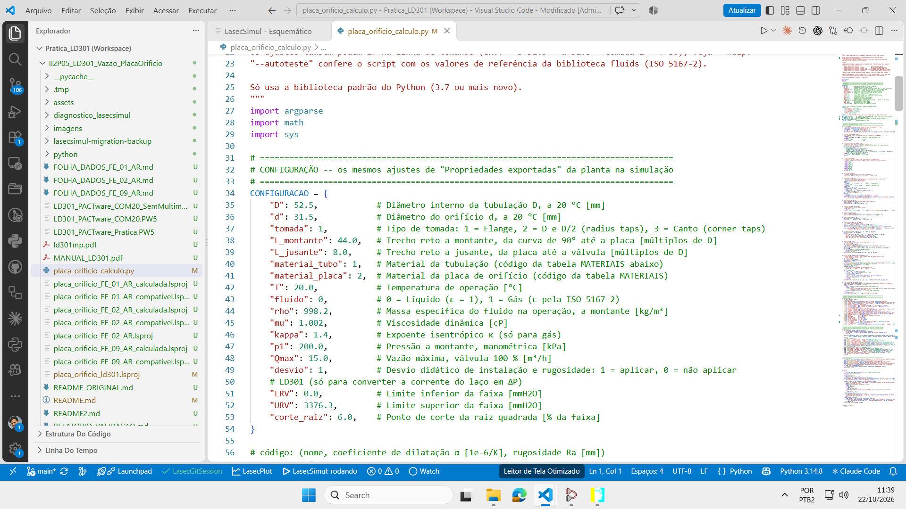

*Captura real: o dicionário `CONFIGURACAO` mostra D, d, tomada, trechos, materiais, T, fluido, ρ, μ, κ, p1, Qmax e desvio, além de LRV, URV e corte da raiz usados para converter corrente em ΔP.*

#### 🔹 Passo 02 — Abrir o terminal, conferir o Python e rodar o autoteste

1. Abra o terminal integrado: `Ctrl+Shift+P` → **Terminal: Criar Novo Terminal**. O prompt deve estar na raiz do repositório.
2. Digite `python --version` e pressione `Enter`.
3. Digite `python placa_orificio_calculo.py --autoteste` e pressione `Enter`.

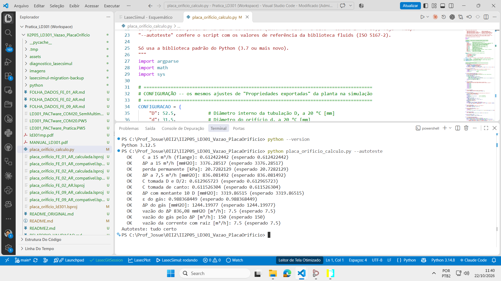

*Captura real: Python 3.12.5. Os 12 casos do autoteste conferem o script com valores de referência da ISO 5167-2 (C, ΔP, perda permanente, ε de gás, inversão ΔP → Q e corrente → Q). Se alguma linha mostrar `FALHA`, não prossiga.*

#### 🔹 Passo 03 — Preparar o comando da FE-02-AR a partir da folha

1. Abra [`FOLHA_DADOS_FE_02_AR.md`](folhas_de_dados/FOLHA_DADOS_FE_02_AR.md) e localize **Comando do cálculo independente**.
2. No terminal, digite `cls` e pressione `Enter`.
3. Digite o comando da folha (sem pressionar `Enter` ainda) e confira cada argumento: `--D 15.8 --d 6.255` [P]; `--tomada 3 --L_montante 44 --L_jusante 8 --material_tubo 1 --material_placa 2 --T 20 --fluido 1 --mu 0.0181 --kappa 1.4 --p1 200 --desvio 0` [E]; `--rho 3.580863081 --Qmax 5.413291324 --URV 1150.3` [C].

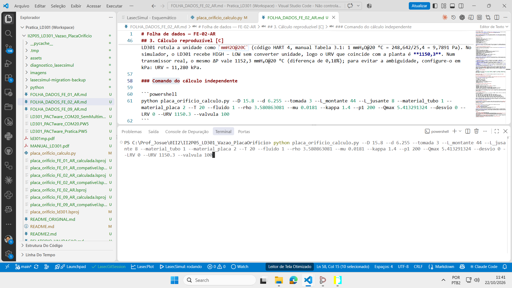

*Captura real: em cima, a folha com o comando de referência; embaixo, o comando digitado no terminal, ainda não executado. Use ponto decimal nos argumentos.*

#### 🔹 Passo 04 — Executar a FE-02-AR a 100 % e interpretar

1. Pressione `Enter`. Maximize o painel do terminal (ícone de maximizar) e role até o início da saída.

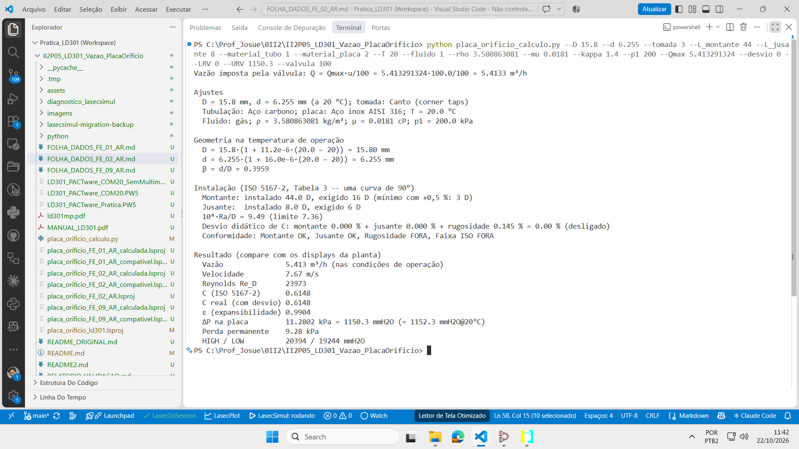

*Captura real da execução. Leitura da saída:*

| Bloco da saída | Valor | Significado |
|---|---|---|
| Vazão imposta | `Q = 5,4133 m³/h` | `Qmax·u/100`, nas condições de operação; equivale a 15 Nm³/h |
| Geometria | `D = 15,80 mm`, `d = 6,255 mm`, `β = 0,3959` | sem correção térmica a 20 °C |
| Instalação | montante 44D ≥ 16D; jusante 8D ≥ 6D; rugosidade e faixa ISO **FORA** | `D < 50 mm` e `d < 12,5 mm`: fora da ISO 5167-2 |
| Reynolds | `23973` | regime turbulento; dentro do mínimo de 5000 das tomadas de canto |
| C | `0,6148` | Reader–Harris/Gallagher com termo de tubo pequeno |
| ε | `0,9904` | ar compressível, `p₂/p₁ = 0,9626` |
| ΔP | `11,2802 kPa = 1150,3 mmH₂O (= 1152,3 mmH₂O@20 °C)` | **é o URV do LD301** |
| Perda permanente | `9,28 kPa` | não é o URV |
| HIGH / LOW | `20394 / 19244 mmH₂O` | sinais enviados ao LD301 pela planta |

#### 🔹 Passo 05 — Executar a FE-02-AR a 50 %

1. Digite `cls`. Pressione a seta para cima para recuperar o comando, troque `--valvula 100` por `--valvula 50` e pressione `Enter`.


*Captura real: metade da vazão produz 280,5 mmH₂O, isto é, 24,38 % do URV, e não exatamente 25 %, porque `C` subiu de 0,6148 para 0,6180 e `ε` de 0,9904 para 0,9977. Com raiz quadrada, a saída esperada é 10·√24,38 = 49,38 %, ou seja, 11,901 mA e 7,407 Nm³/h.*

#### 🔹 Passo 06 — Executar a FE-09-AR e a FE-01-AR

1. Copie o comando de cada folha ([FE-09-AR](folhas_de_dados/FOLHA_DADOS_FE_09_AR.md), [FE-01-AR](folhas_de_dados/FOLHA_DADOS_FE_01_AR.md)), digite `cls` e execute.


*FE-09-AR [O no terminal]: β = 0,1154. O Re_D = 2397 fica abaixo do mínimo de 5000, e a lâmpada de faixa ISO fica FORA. O ΔP = 15,8621 kPa = 1617,5 mmH₂O é o URV da folha.*

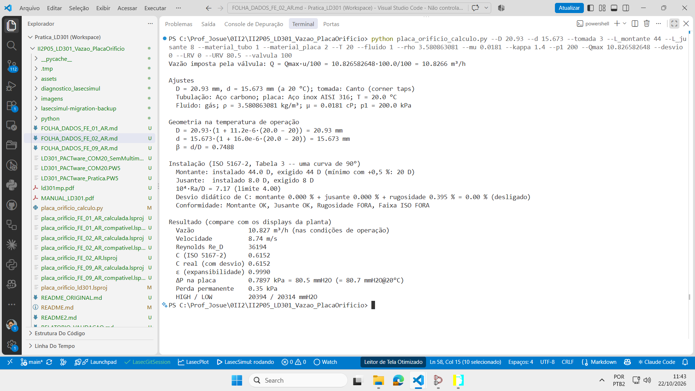

*FE-01-AR [O no terminal], com o furo corrigido d = 15,673 mm: β = 0,7488. O ΔP máximo é só 0,7897 kPa = 80,5 mmH₂O, cerca de 1,6 % do limite de 50 kPa do sensor do LD301 simulado. Escolher a faixa do sensor é parte do exercício.*

#### 🔹 Passo 07 — Gerar as folhas e as cópias do LasecSimul

1. Digite `cls` e execute `python python/gerar_folhas_dados.py`. O script imprime o quadro das três placas e regrava as três folhas.
2. Para cada placa, gere a cópia do projeto com `python python/preparar_placa_lasecsimul.py FE-02-AR`. Se o arquivo já existir, acrescente `--substituir-gerado`. A captura mostra o comando da FE-01-AR.

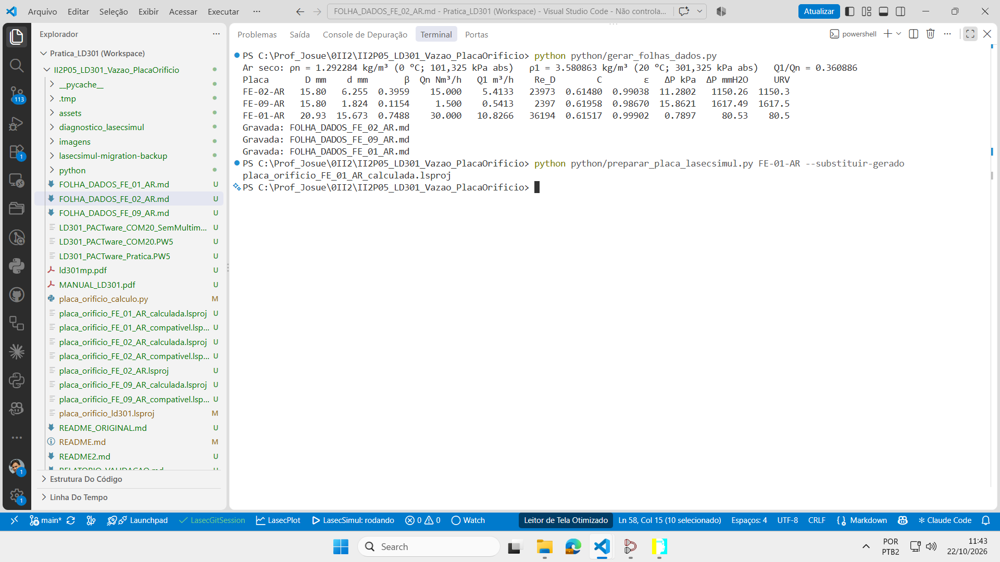

*Captura real do quadro-resumo [C], com unidades no cabeçalho:*

| Placa | D (mm) | d (mm) | β | Qₙ (Nm³/h) | Q₁ (m³/h) | Re_D | C | ε | ΔP (kPa) | ΔP (mmH₂O) | URV |
|---|---:|---:|---:|---:|---:|---:|---:|---:|---:|---:|---:|
| FE-02-AR | 15,80 | 6,255 | 0,3959 | 15,000 | 5,4133 | 23973 | 0,61480 | 0,99038 | 11,2802 | 1150,26 | 1150,3 |
| FE-09-AR | 15,80 | 1,824 | 0,1154 | 1,500 | 0,5413 | 2397 | 0,61958 | 0,98670 | 15,8621 | 1617,49 | 1617,5 |
| FE-01-AR | 20,93 | 15,673 | 0,7488 | 30,000 | 10,8266 | 36194 | 0,61517 | 0,99902 | 0,7897 | 80,53 | 80,5 |

**Logs de texto complementares:** [autoteste](python/saidas/python_autoteste.log), [caso-base a 50 %](python/saidas/python_valvula_50.log) e [FE-02-AR a 100, 75, 50, 26 e 25 %](python/saidas/python_fe02_pontos.log).

**Reflexão:** por que a FE-09-AR, com 1/10 da vazão da FE-02-AR, tem ΔP maior? Por que a FE-01-AR, com o dobro da vazão, tem ΔP 14 vezes menor?

---
</details>

<a id="oficina-03"></a>
<details open>
<summary><strong>📘 Oficina 03 — Preparar e validar a planta no LasecSimul</strong></summary>

**Competência:** configurar a placa na simulação e comprovar que a planta responde antes de parametrizar o transmissor.

<a id="oficina-03-etapa-01"></a>
### Etapa 01 — Verificar se a instalação do LasecSimul mostra a planta

Esta etapa registra o problema encontrado ("planta zerada"), o teste que isolou a causa e a correção aplicada. Em outra máquina do laboratório, faça só a verificação do Passo 04. Se os blocos aparecerem como "?", aplique a correção.

#### 🔹 Passo 01 — Sintoma observado antes da correção

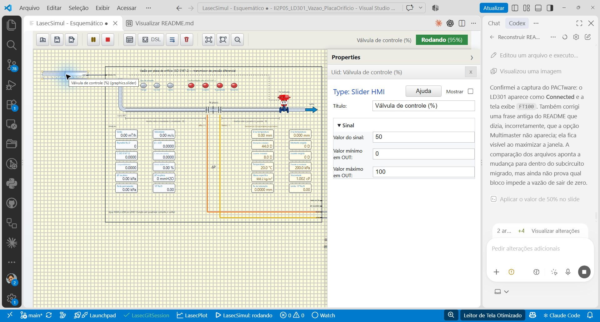

*Captura da sessão anterior [O], projeto principal: o slider está em 50, mas a válvula desenhada indica 0 % e todos os mostradores indicam zero.*


*Captura desta sessão [O], antes da correção: a cópia FE-02-AR roda a 50 % e todos os mostradores da planta indicam 0. **O LD301, porém, responde:** com a configuração original (linear, URV 3376,3), 5,329 mA corresponde a ΔP = (5,329 − 4)/16 × 3376,3 = 280,4 mmH₂O, exatamente o ΔP calculado para 50 % (280,5). Conclusão: o motor de simulação calculava a placa; só os mostradores, ligados aos blocos `sl.*`, não recebiam valores.*

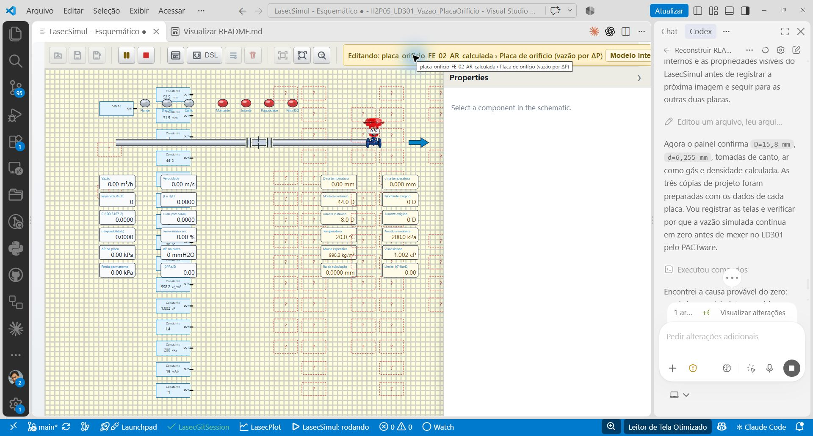

*Captura da sessão anterior [O]: botão direito na placa → **Abrir Modelo Interno**. As constantes `control.constant` são desenhadas normalmente, mas os blocos `sl.fcn`, `sl.mux`, `sl.gain` e `sl.discrete_transfer_fcn` aparecem como "?" (tipo desconhecido para a interface).*

#### 🔹 Passo 02 — Teste discriminante

Para separar "migração errada" de "instalação incompleta", criou-se um projeto de teste temporário (não mantido no repositório). Ele continha dois blocos `sl.gain` novos **fora** da placa, ligados às saídas `flow` e `dp`, cada um com um mostrador.

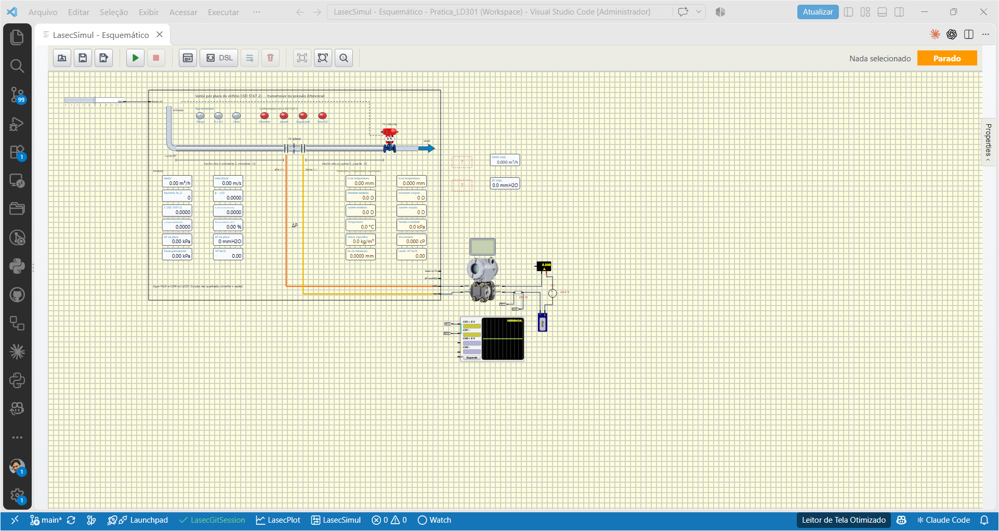

*Captura real [O]: projeto de teste aberto, simulação parada. Os dois `sl.gain` recém-criados, que não passaram por migração, também aparecem como "?". O problema atinge qualquer bloco `sl.*`, portanto não é da migração da placa.*

#### 🔹 Passo 03 — Causa identificada

- Em `out/catalog/blockLibraryLoader.js`, a extensão registra os blocos `sl.*` lendo `bundled/project/schema/block-library/*.json`.
- No pacote 0.0.100 instalado, essa pasta **não existe**. Só existe `bundled/project/schema/component-catalog.json`.
- O motor (`lasecsimul-core.exe`) embute a mesma especificação e executa os blocos. As 2134 linhas significativas dos 13 arquivos do repositório-fonte do LasecSimul (versão 0.0.100) foram encontradas, sem exceção, dentro do executável.
- Sem as entradas de catálogo, a interface desenha "?" e a extensão não lê os valores desses blocos. Os mostradores ligados a eles ficam no valor estático 0, embora o motor calcule.

#### 🔹 Passo 04 — Correção aplicada e verificação

1. Feche as simulações abertas.
2. Copie os 13 arquivos da biblioteca de blocos do repositório-fonte do LasecSimul para a pasta da extensão instalada (PowerShell, nesta máquina):

   ```powershell
   $dst = "$env:USERPROFILE\.vscode\extensions\josuemoraisgh.lasecsimul-0.0.100\bundled\project\schema\block-library"
   New-Item -ItemType Directory -Force $dst
   Copy-Item "C:\SourceCode\LasecSimul\project\schema\block-library\*.json" $dst
   ```

   Os arquivos são `attributes`, `continuous`, `discontinuities`, `discrete`, `logic`, `lookup`, `math`, `pid-continuous`, `pid-discrete`, `routing`, `sinks`, `sources` e `userdefined` (`.json`). Para desfazer, apague a pasta `block-library` criada.
3. No VS Code: `Ctrl+Shift+P` → **Desenvolvedor: Recarregar a Janela**.
4. Abra a cópia FE-02-AR, rode, clique com o botão direito na placa → **Abrir Modelo Interno** e confira se os blocos têm nome e ligações.

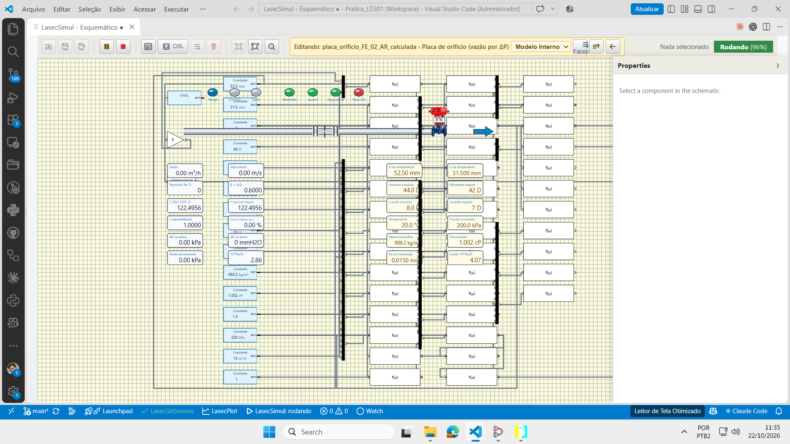

*Captura real [O] depois da correção: os mesmos blocos agora aparecem como **Fcn**, **Mux**, **Gain** e **Discrete Transfer Fcn**. Volte ao esquema principal pela seta de navegação no topo.*

> **Atenção para o professor e o técnico do laboratório.** A correção vale para esta máquina. Nas demais, repita o Passo 04 ou instale uma versão da extensão que traga `bundled/project/schema/block-library`. Convém reportar a ausência ao mantenedor do LasecSimul.

<a id="oficina-03-etapa-02"></a>
### Etapa 02 — Configurar a placa FE-02-AR

#### 🔹 Passo 01 — Gerar e abrir a cópia de trabalho

1. No terminal: `python python/preparar_placa_lasecsimul.py FE-02-AR --substituir-gerado`. A saída é `placa_orificio_FE_02_AR_calculada.lsproj`, gravada em `lasecsimul/`. O projeto principal permanece intacto.
2. `Ctrl+P` → `placa_orificio_FE_02_AR_calculada.lsproj` → `Enter`. Se aparecer "O esquemático atual tem alterações não salvas", escolha **Descartar** para não gravar o projeto anterior.

#### 🔹 Passo 02 — Conferir as Propriedades exportadas

1. Clique uma vez no quadro da placa e expanda **Properties** à direita.
2. Compare com a folha. A primeira captura mostra os valores **antes** (projeto principal, água). As duas seguintes mostram a cópia FE-02-AR.

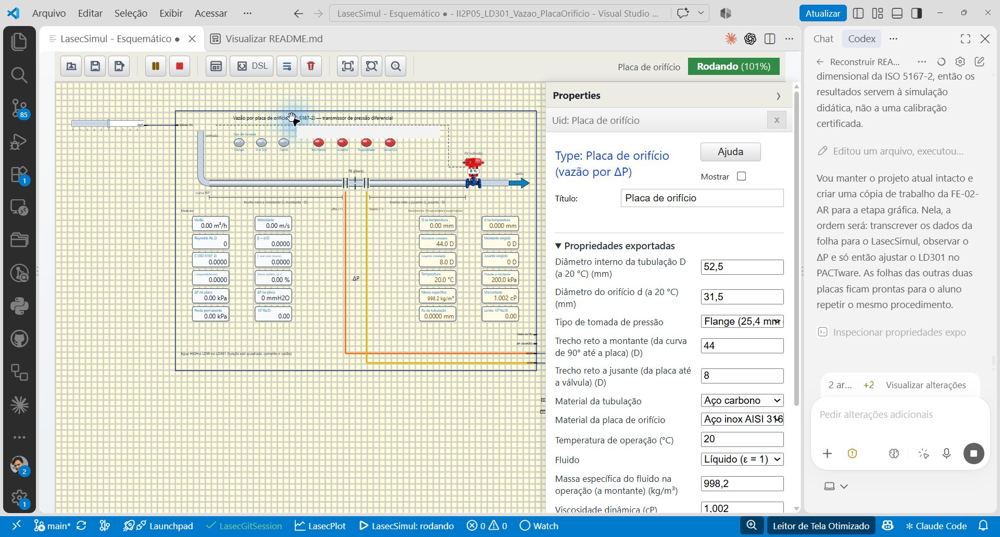

*Antes [O]: D = 52,5 mm, d = 31,5 mm, tomada flange, Líquido, ρ = 998,2 kg/m³, μ = 1,002 cP.*

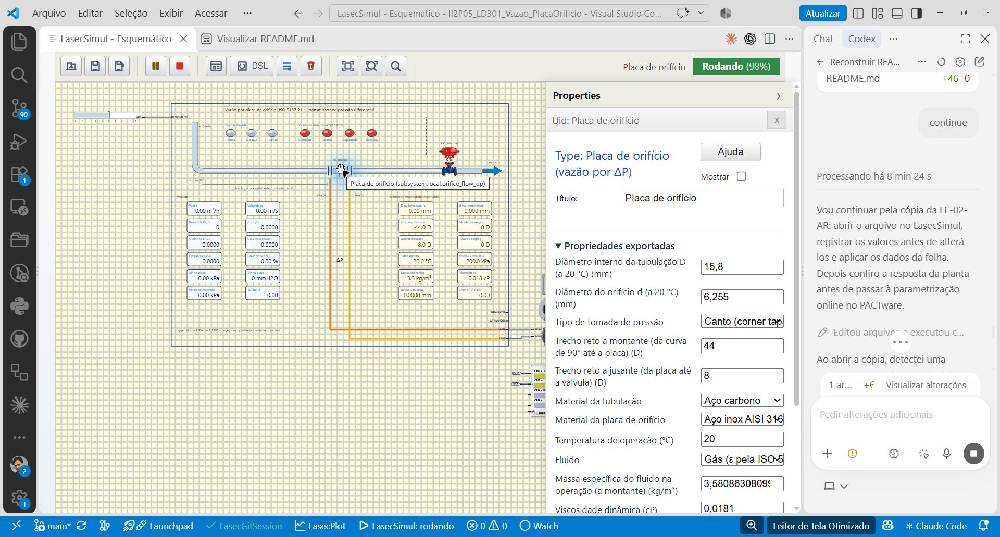

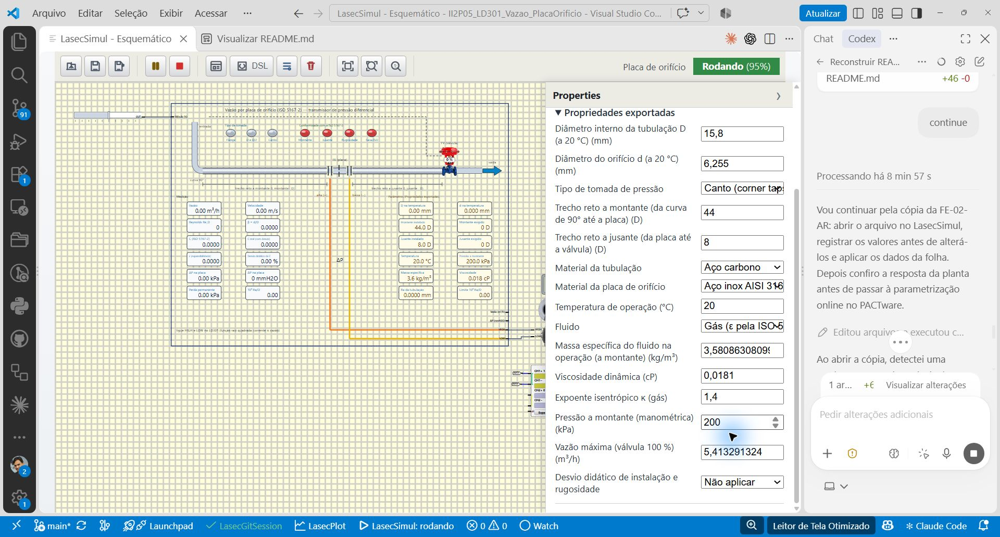

*Depois [O]: D = 15,8; d = 6,255; Canto; 44 D; 8 D; aço carbono; AISI 316; 20 °C; Gás; ρ = 3,5808630809…; μ = 0,0181; κ = 1,4; p₁ = 200; Qmax = 5,413291324; desvio "Não aplicar". São os valores da folha. Estas duas capturas são da sessão anterior, **antes** da correção da Etapa 01; por isso os mostradores aparecem em zero. A resposta correta está na Etapa 03.*

<a id="oficina-03-etapa-03"></a>
### Etapa 03 — Rodar a planta e validar a resposta

**Como mudar a abertura.** Clique no slider (à esquerda), expanda **Properties** e clique duas vezes no campo **Valor do sinal**. Apague o conteúdo com `Backspace`, digite o novo valor e pressione `Enter`. O campo limita o valor a 0–100: se você digitar sem apagar, "50" + "100" vira 100. Aguarde pelo menos 5 s, pois o atraso é de 1 s. **Não** pressione `Delete` ou `Backspace` com o slider selecionado no desenho: isso apaga o componente e reconstrói a simulação (veja a [observação na Oficina 05](#o05-reconstrucao)).

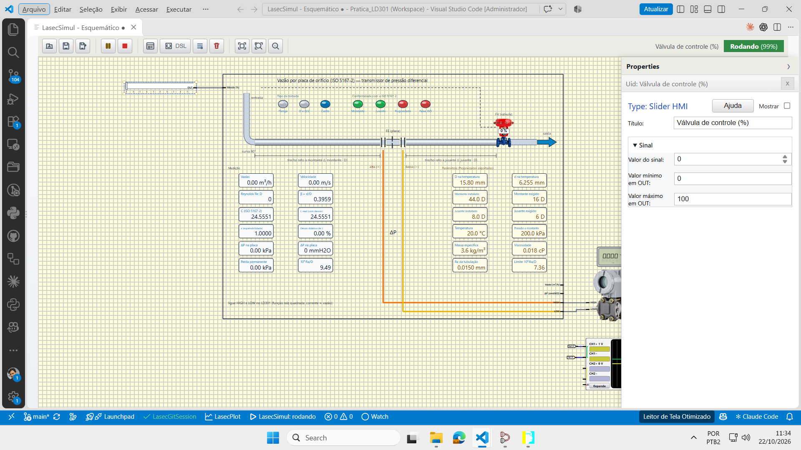

*0 % [O]: vazão 0,00 m³/h e ΔP 0. Os parâmetros (15,80 mm; 6,255 mm; 3,6 kg/m³; 0,018 cP) já aparecem nos mostradores, sinal de que a leitura dos blocos `sl.*` funciona.*


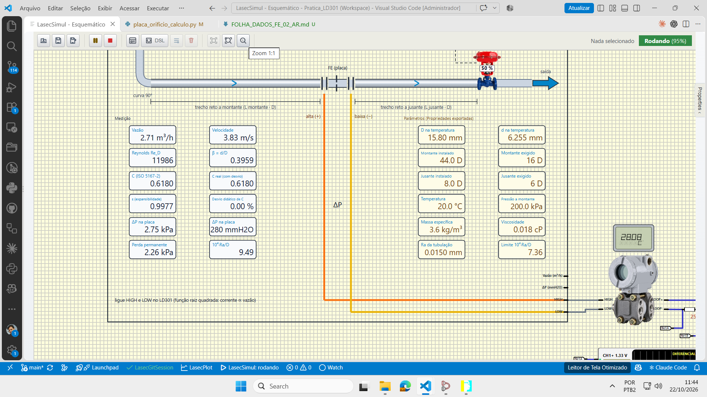

*50 % [O]: 2,71 m³/h; 3,83 m/s; Re 11986; β 0,3959; C = C real = 0,6180; ε 0,9977; desvio 0,00 %; ΔP 2,75 kPa = 280 mmH₂O; perda permanente 2,26 kPa.*

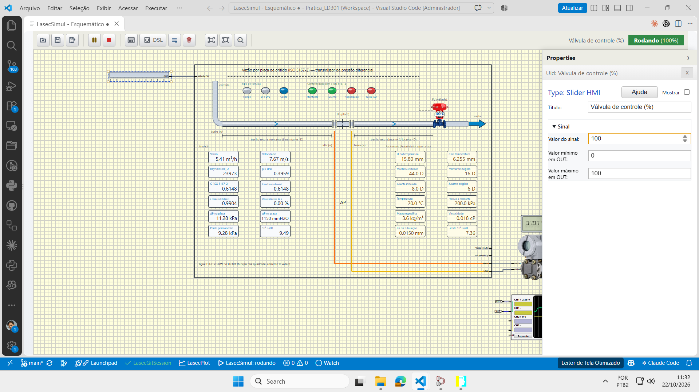

*100 % [O]: 5,41 m³/h; 7,67 m/s; Re 23973; C 0,6148; ε 0,9904; ΔP 11,28 kPa = 1150 mmH₂O; perda permanente 9,28 kPa. As lâmpadas **Rugosidade** e **Faixa ISO** ficam vermelhas, como previsto pelo Python.*

| Abertura | Q Python [C] | Q planta [O] | Re Python / planta | C Python / planta | ε Python / planta | ΔP Python [C] | ΔP planta [O] |
|---:|---:|---:|---:|---:|---:|---:|---:|
| 0 % | 0 | 0,00 m³/h | — | — | — | 0 | 0 mmH₂O |
| 50 % | 2,707 m³/h | 2,71 m³/h | 11986 / 11986 | 0,6180 / 0,6180 | 0,9977 / 0,9977 | 2,7505 kPa = 280,5 mmH₂O | 2,75 kPa = 280 mmH₂O |
| 100 % | 5,413 m³/h | 5,41 m³/h | 23973 / 23973 | 0,6148 / 0,6148 | 0,9904 / 0,9904 | 11,2802 kPa = 1150,3 mmH₂O | 11,28 kPa = 1150 mmH₂O |

**Resultado:** a planta FE-02-AR está **validada**. A mudança de abertura produz vazão e ΔP coerentes com o Python em 0, 50 e 100 %; os pontos de 25, 26 e 75 % aparecem na Oficina 05.

---
</details>

<a id="oficina-04"></a>
<details open>
<summary><strong>📘 Oficina 04 — Montar o caminho HART no PACTware e conectar o LD301</strong></summary>

**Competência:** montar a árvore de comunicação a partir de um projeto vazio, escolher a porta virtual e conectar, nesta ordem, o modem do LasecSimul, o canal HART (modem no PACTware) e o dispositivo.

> Todas as capturas desta oficina vêm de **uma única execução contínua**, em 22/10/2026 entre 12:45 e 13:02. O projeto resultante é [`pactware/LD301_PACTware_FE02_Pratica.PW5`](pactware/LD301_PACTware_FE02_Pratica.PW5). A única exceção é a tela do com0com, do Passo 01, registrada na sessão anterior com o mesmo par de portas.

#### 🔹 Passo 01 — Conferir o par virtual

1. Abra **Setup for com0com** e confira o par `COM20 ↔ CNCB0`. O PACTware usa `COM20`; o modem do LasecSimul usa `CNCB0`. Não crie outro par com esses nomes.

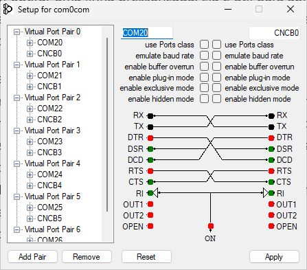

#### 🔹 Passo 02 — Abrir o PACTware

1. Abra o **PACTware 5.0** pelo menu Iniciar. O projeto novo (`<NONAME>`) mostra apenas `HOST PC` na árvore **Project**.

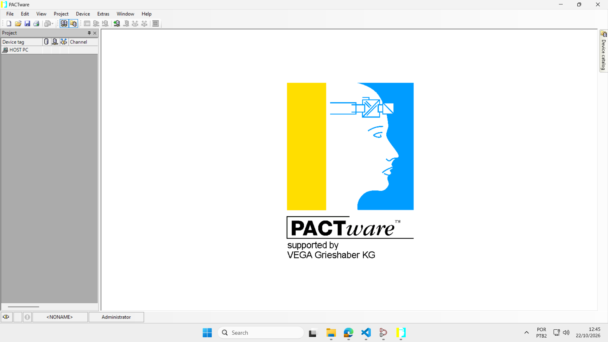

#### 🔹 Passo 03 — Add device: HART Communication em HOST PC

1. Clique com o botão direito em `HOST PC` e escolha **Add device**.

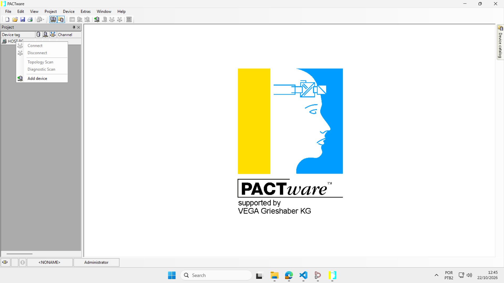

2. A janela **Device for** lista 3 DTMs para este nível (DF100, DF116-DF117 e HART Communication). Selecione **HART Communication** (CodeWrights, 1.0.58) e clique em **OK**.

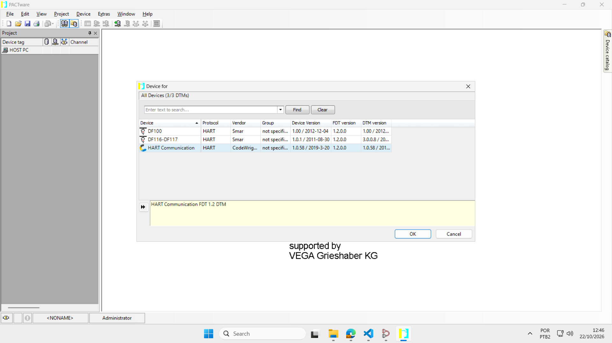

3. Surge o filho `COM0`: o DTM do modem HART, ainda na porta padrão.

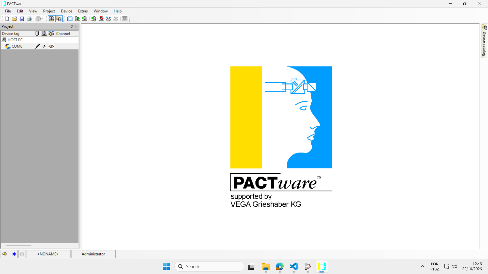

#### 🔹 Passo 04 — Dois cliques em COM0 e escolha da porta COM20

1. Dê **dois cliques em `COM0`**. Abre a aba **COM0 Parameter**: Communication interface `HART modem`, Serial Interface `COM0`, Primary Master, preâmbulo 5, 3 tentativas, endereços 0 a 0, timeout 2 s. Nesta instalação, **Multimaster and Burst mode support** vem **marcado**.

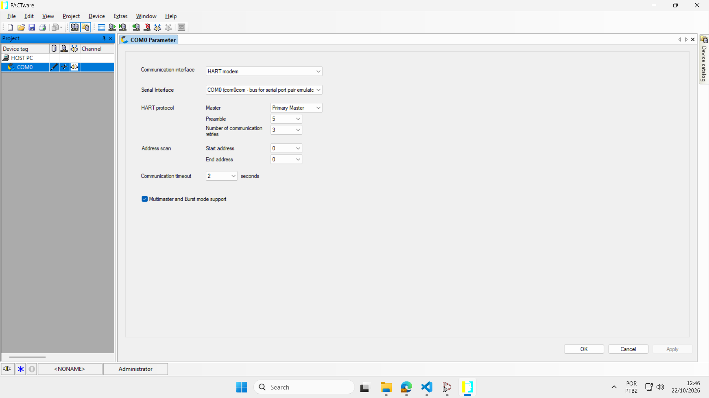

2. Abra a lista **Serial Interface** e escolha `COM20 (com0com - bus for serial port pair emulator)`.

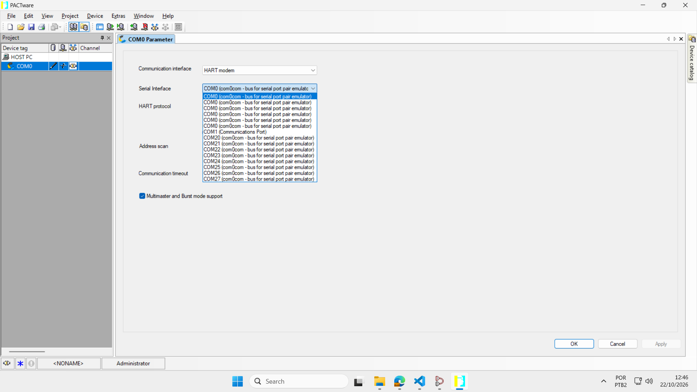

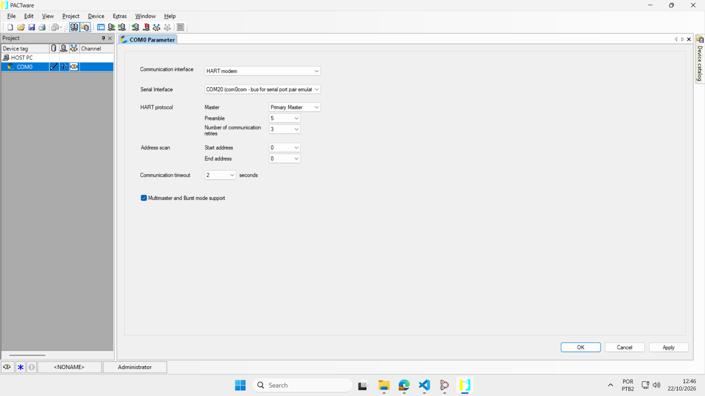

3. Clique em **Apply**. O nome na árvore muda de `COM0` para `COM20`.


#### 🔹 Passo 05 — Desmarcar "Multimaster and Burst mode support" (etapa própria)

1. Ainda na aba de parâmetros, clique uma vez na caixa **Multimaster and Burst mode support** e confira que ela ficou vazia.


2. Clique em **Apply** (o botão fica cinza) e depois em **OK**.


3. **Confira:** dê dois cliques em `COM20` de novo. A aba agora se chama **COM20 Parameter**, com COM20 e a caixa desmarcada. Feche com **OK**.

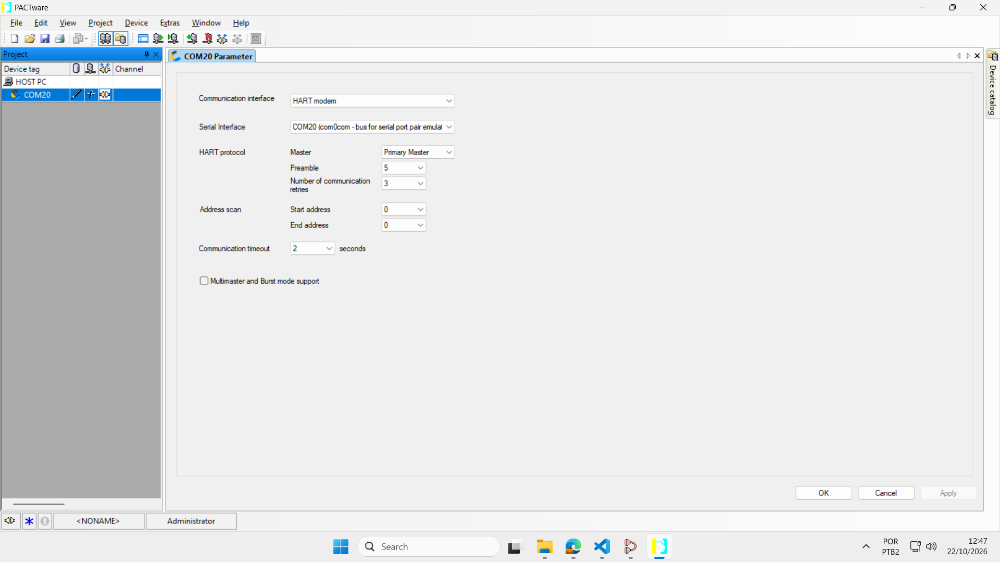

#### 🔹 Passo 06 — Add device: LD301 sob o canal COM20

1. Clique com o botão direito em `COM20` e escolha **Add device**.

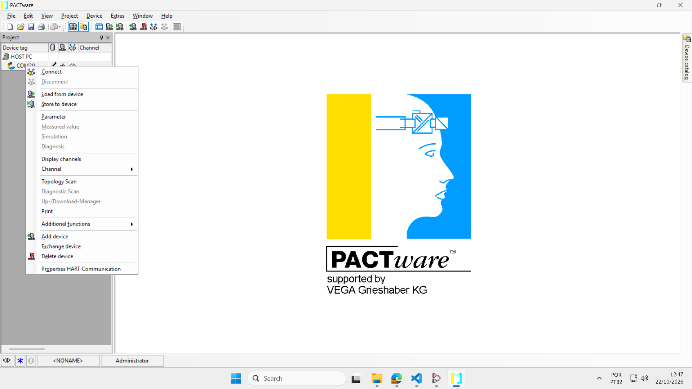

2. Agora a lista mostra **32 DTMs HART**. Digite `LD301` na busca e clique em **Find**.

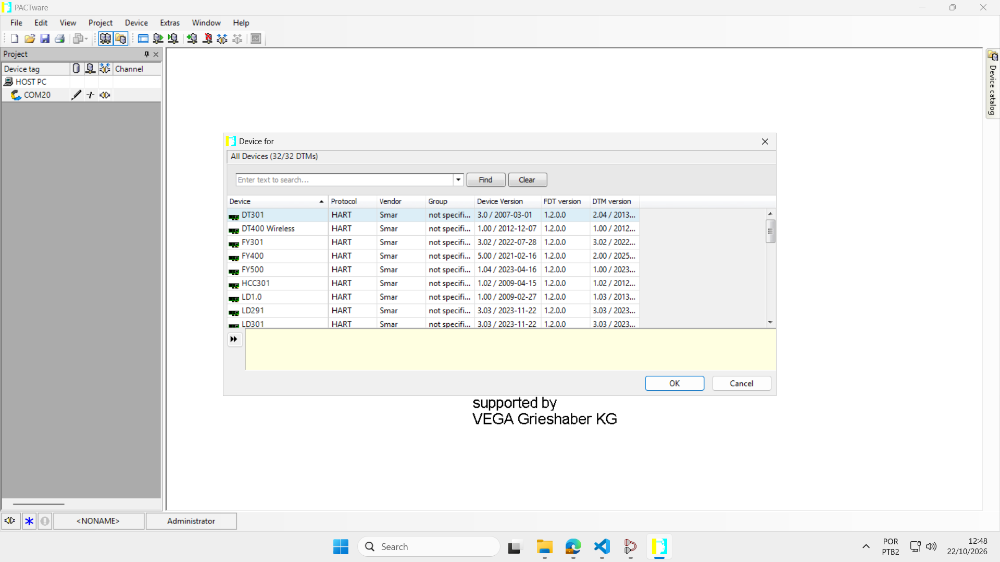

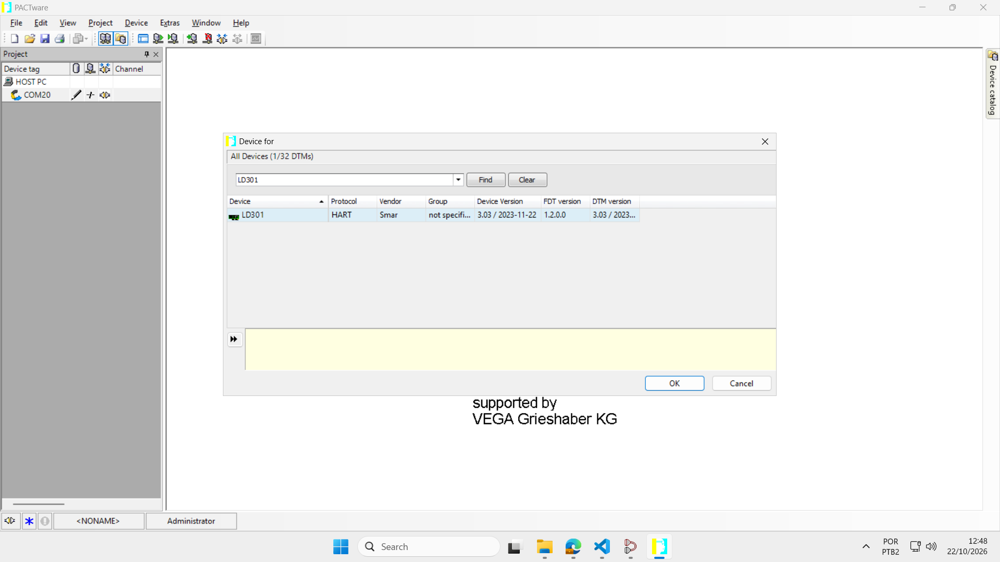

3. Selecione a linha **LD301** e clique em **OK**. A árvore fica `HOST PC → COM20 → LD301`, no canal `HARTCH`.

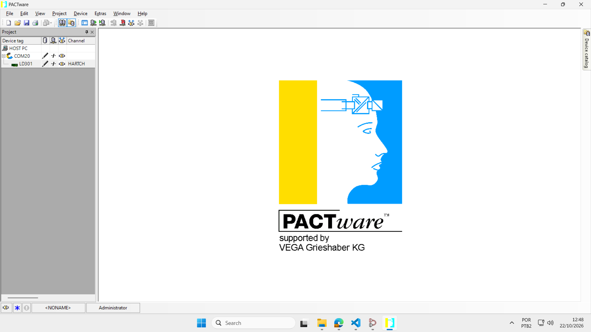

#### 🔹 Passo 07 — Salvar o projeto

1. **File → Save as**. Em **File name**, digite o caminho completo do repositório, por exemplo `...\II2P05_LD301_Vazao_PlacaOrificio\pactware\LD301_PACTware_FE02_Pratica.PW5`, e clique em **Save**. Na captura, o arquivo foi gravado na raiz porque as pastas ainda não existiam; no repositório organizado ele fica em `pactware/`.

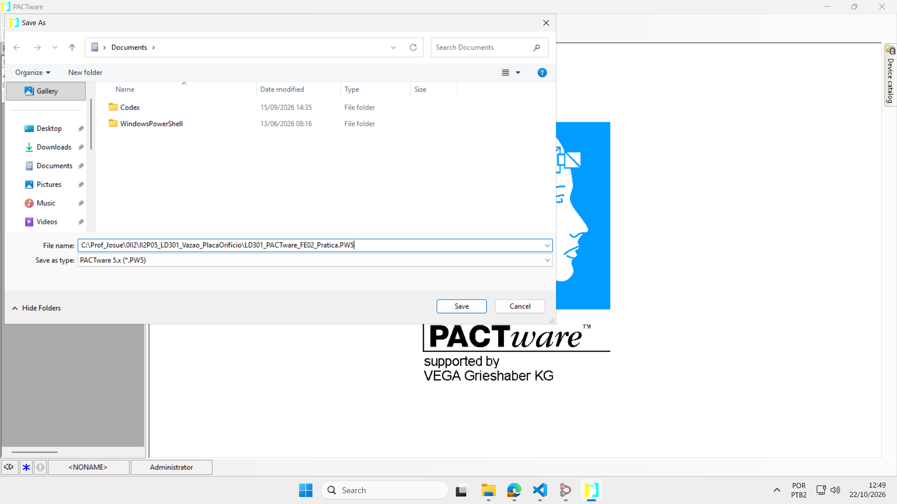

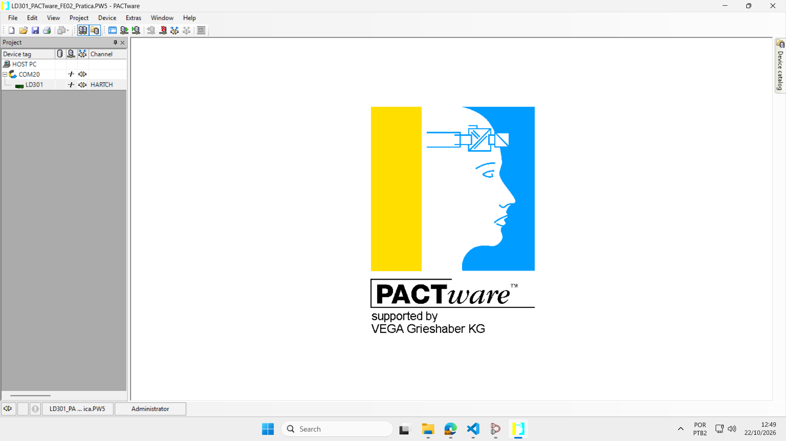

#### 🔹 Passo 08 — Iniciar a simulação e abrir o modem no LasecSimul

1. No VS Code, abra `lasecsimul/placa_orificio_FE_02_AR_calculada.lsproj`, clique em **Ajustar à tela** e em **Rodar**. O cabeçalho mostra **Rodando**; com a válvula em 50 %, a planta indica 2,71 m³/h e 280 mmH₂O. O LD301 ainda está com a configuração do arquivo (linear, URV 3376,3), por isso o amperímetro marca 5,328 mA.
2. Localize o **Modem HART-1**, no canto inferior direito. O botão vertical indica **Abrir**: a porta `CNCB0` ainda está fechada.


3. Clique em **Abrir**. O botão passa a **Fechar** e a porta `CNCB0` fica aberta.

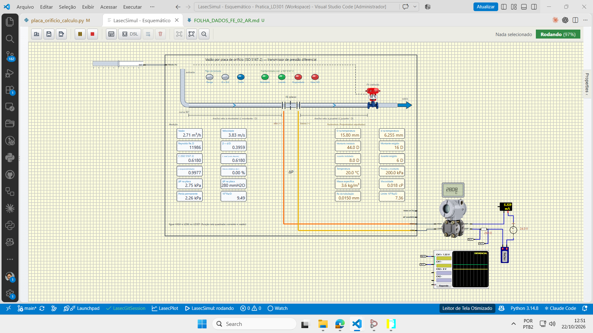

#### 🔹 Passo 09 — Connect no modem (canal COM20)

**Importante:** antes do dispositivo, é preciso conectar o **modem** no PACTware, isto é, o canal **HART Communication / COM20**.

1. Clique com o botão direito em **COM20** e escolha **Connect**.

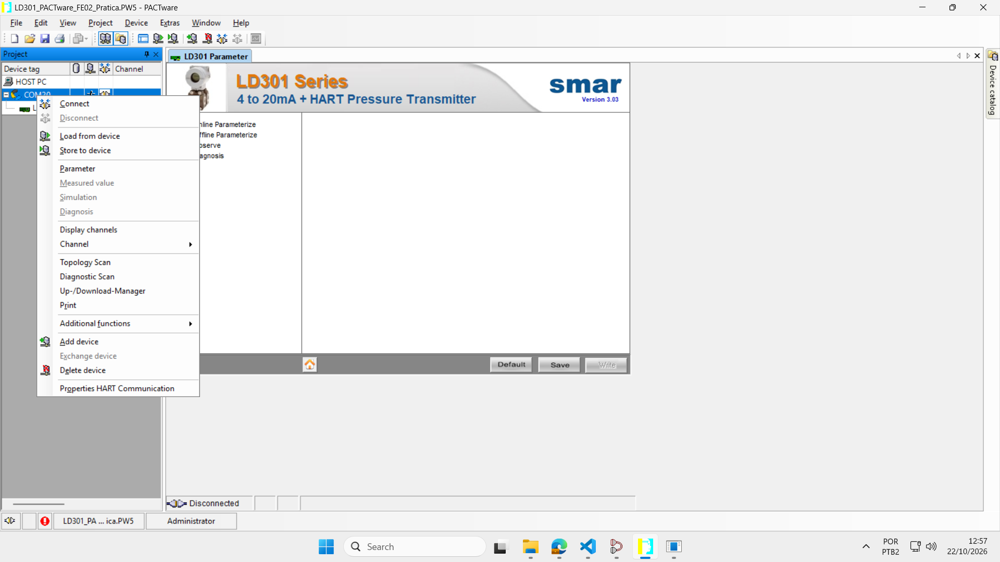

2. Confira o ícone de conexão do canal: ele precisa ficar **verde** e o nome **COM20** em negrito. O LD301 continua desconectado: conectar o canal não conecta o dispositivo.

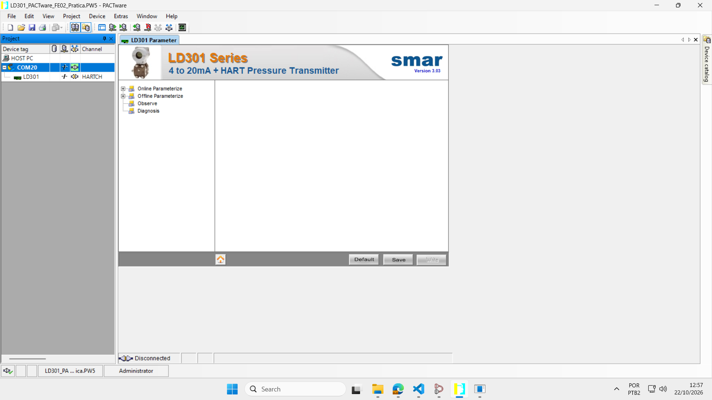

#### 🔹 Passo 10 — Connect no dispositivo LD301

1. Clique com o botão direito em **LD301** e escolha **Connect**.

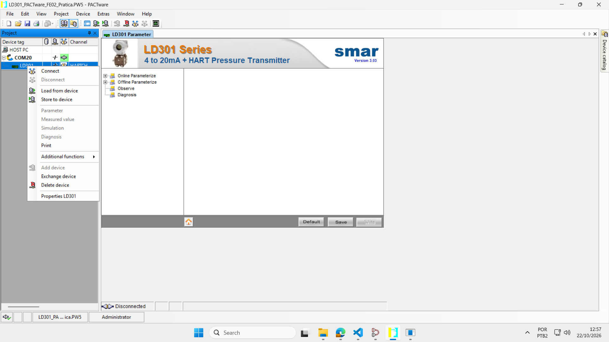

2. Aguarde a aba **LD301 # Parameter** (o `#` indica a instância online do DTM). Ela mostra tag **FT100**, descritor **MEDIDOR VAZAO**, Universal Code 5, Bell 202 e o código de pedido. Na barra inferior deve aparecer **Connected**, com os dois ícones da árvore em verde.

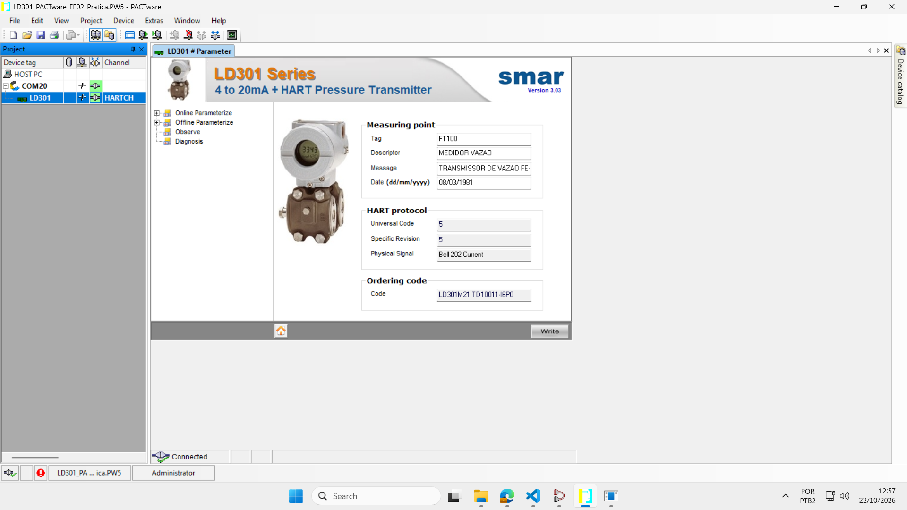

> **Observação do professor e o que aconteceu nesta execução (ordem errada).** Na primeira tentativa, o **Connect** no COM20 foi feito com o modem do LasecSimul ainda em **Abrir** (porta fechada). O PACTware ficou parado em 67 % em "PACTware action active".
>
> 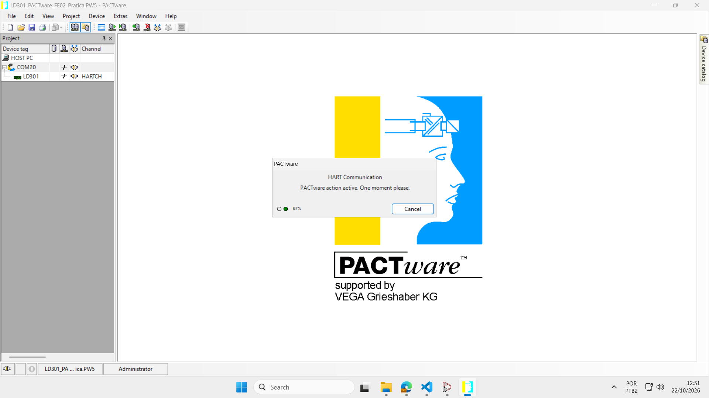
>
> Mesmo depois de abrir o modem, o canal não ficou verde (zoom: plugue aberto à esquerda; o mesmo plugue fechado, mas sem verde, à direita):
>
> <table><tr><td>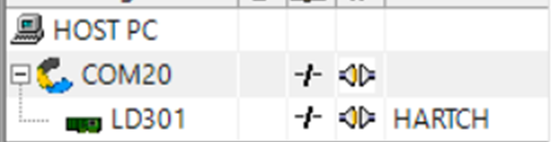</td><td>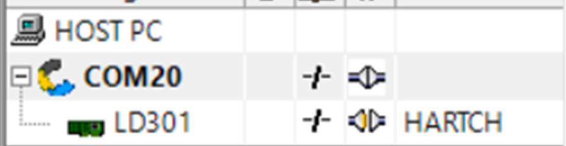</td></tr></table>
>
> O Connect no LD301 deixou o nome em negrito, mas o DTM abriu com **Disconnected**. Desconectar e conectar de novo **só o LD301** não resolveu nesta execução, e a página online respondeu "Device is Disconnected!":
>
> 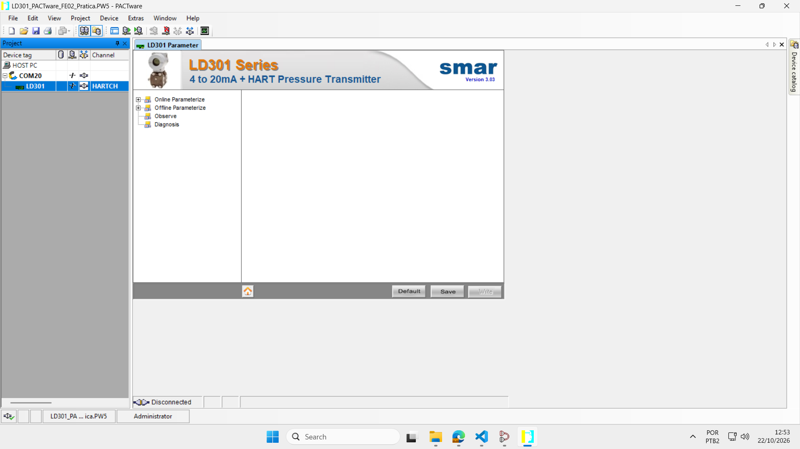
>
> 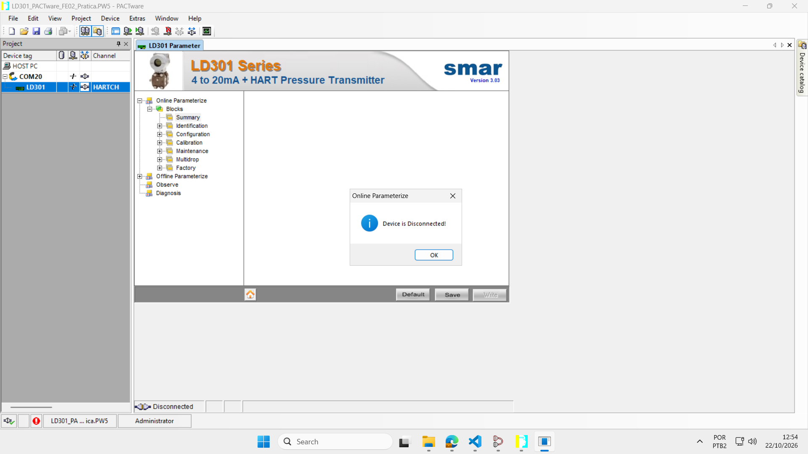
>
> **O que resolveu:** desconectar também o modem (COM20). O PACTware avisou "It was not possible to close the connection… Force closing of connection?"; responda **Yes**. Com os dois desconectados e o modem do LasecSimul em **Fechar** (aberto), refaça **Connect no modem COM20** (Passo 09, ícone verde) e depois **Connect no LD301** (Passo 10).
>
> 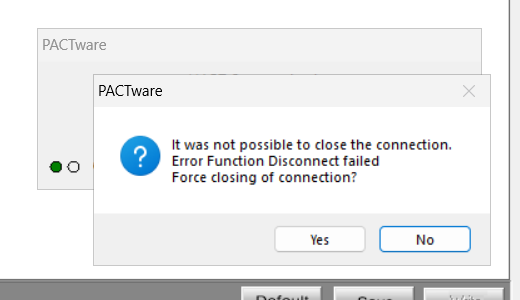
>
> 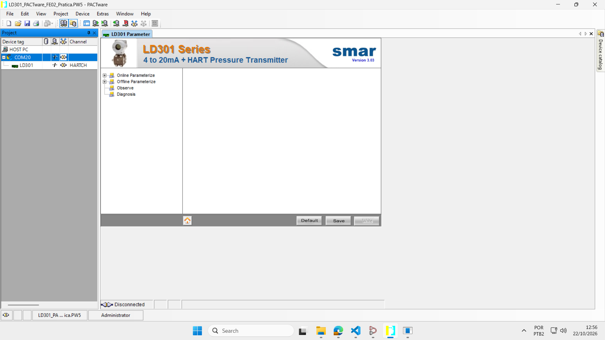
>
> Resumo: **(1)** LasecSimul **Rodando**; **(2)** **Abrir** no modem do LasecSimul; **(3)** **Connect no modem COM20** (verde); **(4)** **Connect no LD301**; **(5)** DTM com `#` e **Connected**. Se algum Connect foi feito antes de abrir o modem, desconecte o LD301 e o COM20 (forçando se necessário) e repita a partir do item 3. Na sessão anterior, em que o canal havia conectado normalmente, bastou desconectar e conectar novamente o LD301.

---
</details>

<a id="oficina-05"></a>
<details open>
<summary><strong>📘 Oficina 05 — Parametrizar o LD301 como transmissor de vazão (FE-02-AR)</strong></summary>

**Competência:** gravar e reler faixa, função raiz, User Unit e display, e verificar a indicação de vazão.

**Condição inicial:** planta FE-02-AR validada (Oficina 03) e rodando com a válvula em 50 %; modem aberto; COM20 e LD301 conectados (Oficina 04). Os Passos 01 a 07 continuam a mesma execução contínua do projeto `LD301_PACTware_FE02_Pratica.PW5` (12:57–13:02).

<a id="o05-p03"></a>
#### 🔹 Passo 01 — Ler e registrar a configuração existente

1. Na aba **LD301 # Parameter**, expanda **Online Parameterize → Blocks** e clique em **Summary**. Não use o ramo **Offline Parameterize**.

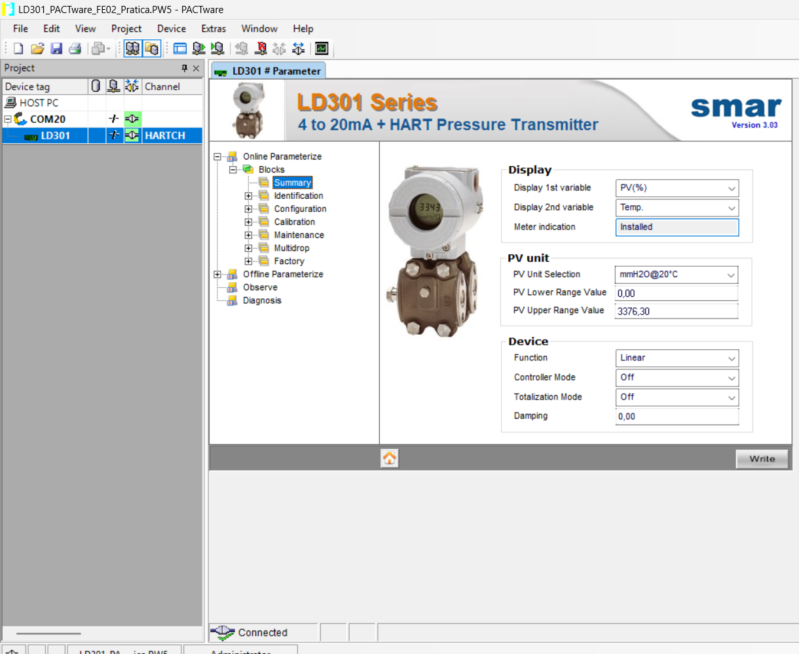

2. Expanda **Configuration** e clique em **Measurement**.


*Leitura online [O]: URV = 3376,3 mmH₂O@20 °C (caso-base com água), função **Linear**, display PV(%)/Temp. As páginas de Configuration são Measurement, User Unit, Display, Table, PID Control, PID Loop e Totalization.*

**Online × offline.** As páginas de **Offline Parameterize** mostram o conjunto de dados do projeto, não o transmissor: na sessão anterior, Measurement offline exibia `psi` e faixa 0–30 ([captura](capturas/pactware_28_ld301_medicao_offline.png)), valores que não são do FT100. Só o ramo **Online** lê e grava no dispositivo.

<a id="o05-p04"></a>
#### 🔹 Passo 02 — Gravar a faixa de pressão (URV)

1. Em **Measurement**, clique no campo **(URV) - Upper Range Value**, selecione o conteúdo e digite `1150,3`. O Windows em português usa vírgula decimal. Mantenha LRV = 0 e a unidade `mmH2O@20°C`.

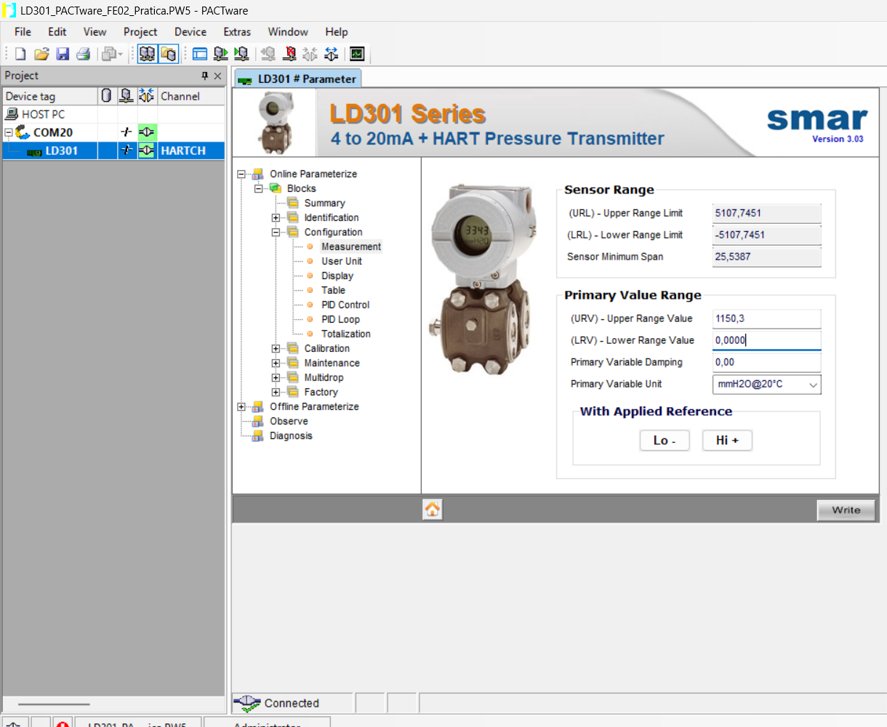

2. Clique em **Write**.

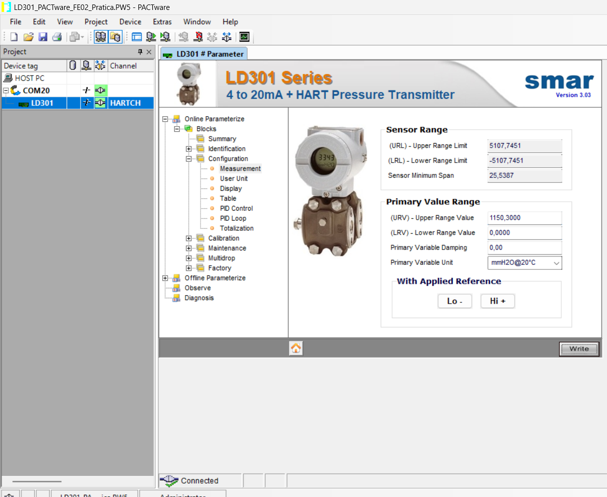

3. **Releia:** clique em **Summary** e volte a **Measurement**.


4. Efeito na planta a 50 %, ainda com função linear (captura da primeira execução, mesma configuração):


*[O]: ΔP = 280 mmH₂O, LCD 24,38 % e 7,901 mA. Previsto [C]: 280,5/1150,3 = 24,38 % → 4 + 16 × 0,2438 = 7,901 mA. Com a função linear, a corrente é proporcional ao ΔP e não à vazão.*

<a id="o05-p05"></a>
#### 🔹 Passo 03 — Gravar a função raiz quadrada

1. Em **Summary**, abra a lista **Function**. As opções coincidem com a Tabela 4.5 do manual: Linear, Sqrt, Sqrt + Table, Sqrt\*\*3, Sqrt\*\*5, Table, Table + Sqrt.


2. Selecione **Sqrt** e clique em **Write**.


3. **Releia** (Measurement → Summary).


4. Efeito na planta a 50 % (primeira execução):


*[O]: 11,90 mA. Previsto [C]: 10·√24,38 = 49,38 % → 11,901 mA. Agora a corrente é aproximadamente proporcional à vazão.*

<a id="o05-p06"></a>
#### 🔹 Passo 04 — Conferir o ponto de corte

O manual (p. 3.10) define o ponto de corte em % da faixa de pressão (padrão de 6 %) e o modo Suave ou Abrupto. **Nas páginas online do DTM 3.03 percorridas, esses dois parâmetros não aparecem.** Foram percorridas Summary, Identification (Device, Sensor, Flange/Seal), Configuration (Measurement, User Unit, Display, Table), Calibration, Maintenance e Factory. A página Table, por exemplo, só tem os pontos X/Y:


O transmissor simulado guarda `sqrtCutoff.point = 6` e `sqrtCutoff.mode = Hard` no arquivo do projeto. Como esses campos não puderam ser editados pelo DTM, o corte foi **verificado pelo comportamento** (Passo 07, 25 % e 26 %): 6 % de 1150,3 = 69,0 mmH₂O. Abaixo desse valor, a corrente deve ser 4,000 mA e a PV 0.

<a id="o05-p07"></a>
#### 🔹 Passo 05 — Gravar a User Unit em N m³/h

1. Clique em **Configuration → User Unit**. Estado encontrado: **Mode On**, escala 243–800, família **Length**, unidade **mm** (herança do exemplo de nível do manual) e PV = 518,0402 mm, sem significado de vazão.


2. Em **Unit Family**, escolha **Volumetric Flow**. Em **Unit Description**, escolha **N m3/h** (penúltima opção).


3. Digite **Eng. Unit (0%) = 0** e **Eng. Unit (100%) = 15**. Mantenha **Mode = On**.


4. Clique em **Write** e **releia** (Measurement → User Unit).


*[O]: Primary Variable = **7,4068 N m³/h** a 50 %. Previsto [C]: 15 × 0,4938 = 7,407 Nm³/h. A vazão normal real nesse ponto é 7,500 Nm³/h. A diferença de 1,2 % vem da variação de C e ε entre 50 % e 100 %, que a raiz quadrada do transmissor não compensa.*

<a id="o05-p08"></a>
#### 🔹 Passo 06 — Configurar o display e conferir o LCD

1. Clique em **Configuration → Display**. Estado encontrado: 1ª **PV(%)**, 2ª **Temp.**


2. Escolha **Display 1st variable = PV** e **Display 2nd variable = Out(mA)**.


3. Clique em **Write** e **releia** pelo **Summary**.


4. Confira o LCD do LD301 no LasecSimul: ele alterna as duas variáveis a cada 3 s (manual, p. 3.15).


<table><tr><td></td><td></td></tr></table>

*[O]: o LCD alterna **7.407 Nm3/h** e **11.901 mA**; o amperímetro indica **11,90 mA**. A indicação de vazão no display está confirmada.*

5. Grave o projeto PACTware com **File → Save** para guardar a árvore de comunicação e a porta. Depois de qualquer alteração online no LD301, use **Ctrl+S / Salvar** no LasecSimul: os parâmetros HART atuais do transmissor interno são copiados para o `.lsproj`.

<a id="o05-reconstrucao"></a>
> **Histórico do problema de persistência (corrigido).** Na primeira execução, antes da correção, um `Backspace` enviado com o slider selecionado apagou o componente; o `Ctrl+Z` reconstruiu a simulação e o LD301 voltou à configuração original do `.lsproj` (linear, URV 3376,3). As capturas abaixo documentam esse comportamento anterior à correção.
>
> Agora, ao salvar o projeto no LasecSimul, as propriedades HART atuais do LD301 interno são copiadas para os overrides da instância no `.lsproj`. A captura também ocorre antes de reconstruir a simulação, preservando os valores na sessão e marcando o projeto como alterado. Para persistir no arquivo em disco, pressione **Ctrl+S / Salvar** no LasecSimul após configurar o LD301 pelo PACTware. **File → Save** no PACTware continua salvando somente a árvore de comunicação e a porta.
>
> A regressão de save/reopen verifica a função Sqrt e o cutoff Hard de 6 %; a auditoria LD301 passou com 256 verificações e zero falhas (`core/test/core/protocols/HartLd301Test.cpp`).
>
> 
>
> 

<a id="o05-p09"></a>
#### 🔹 Passo 07 — Verificar a indicação em vários pontos

Mude a abertura (como na Oficina 03, Etapa 03), aguarde 5 s e registre planta, amperímetro, LCD e, quando indicado, a PV lida no PACTware (**User Unit → Primary Variable**).


*100 % [O]: 5,41 m³/h; 1150 mmH₂O; amperímetro e LCD **20,00 mA**; PV lida = **14,9997 N m³/h**. Na captura, o primeiro dígito (meio dígito "1") do LCD aparece fraco; a PV lida por HART é a referência numérica.*


*75 % [O]: 4,06 m³/h; Re 17980; C 0,6159; ε 0,9947; 639 mmH₂O; **15,93 mA**; LCD **11,180 Nm3/h**.*


*50 % [O]: 280 mmH₂O; **11,90 mA**; PV = **7,4068 N m³/h**.*


*26 % [O]: 1,41 m³/h; Re 6233; 74 mmH₂O = 6,47 % da faixa, logo acima do corte; **8,070 mA**. A raiz amplifica: 6,47 % de ΔP vira 25,4 % de saída.*


*25 % [O]: 1,35 m³/h; 69 mmH₂O = 5,97 % da faixa, logo abaixo do corte de 6 %; **4,000 mA** e PV = **0,0000 N m³/h**. Corte **abrupto** confirmado: com 1,35 m³/h passando, o transmissor indica zero.*

**Tabela final da FE-02-AR (Python [C] × observado [O])**

| Abertura | ΔP Python | ΔP planta | Corrente prevista | Corrente observada | PV prevista (Nm³/h) | PV / LCD observada | Evidência |
|---:|---:|---:|---:|---:|---:|---|---|
| 100 % | 1150,3 mmH₂O | 1150 mmH₂O | 20,000 mA | 20,00 mA | 14,9997 | 14,9997 (HART); LCD 20,00 mA | [planta](capturas/lasecsimul_27_fe02_final_100_lcd_vazao.png), [PV](capturas/pactware_66_fe02_pv_100_nm3h.png) |
| 75 % | 639,1 mmH₂O | 639 mmH₂O | 15,926 mA | 15,93 mA | 11,181 | LCD 11,180 | [planta](capturas/lasecsimul_32_fe02_valvula_75.png) |
| 50 % | 280,5 mmH₂O | 280 mmH₂O | 11,901 mA | 11,90 mA | 7,407 | 7,4068 (HART); LCD 7,407 | [planta](capturas/lasecsimul_33_fe02_valvula_50_apos_regravacao.png), [PV](capturas/pactware_69_fe02_pv_50_apos_regravacao.png) |
| 26 % | 74,4 mmH₂O | 74 mmH₂O | 8,070 mA | 8,070 mA | 3,816 | não registrado | [planta](capturas/lasecsimul_31_fe02_valvula_26_acima_corte.png) |
| 25 % | 68,7 mmH₂O | 69 mmH₂O | 4,000 mA | 4,000 mA | 0,000 | 0,0000 (HART) | [planta](capturas/lasecsimul_30_fe02_valvula_25_corte_abrupto.png), [PV](capturas/pactware_67_fe02_pv_25_corte_zero.png) |

**Resultado:** o LD301 foi parametrizado online como transmissor de vazão. Cada página foi gravada e relida, e a indicação coincide com o cálculo em todos os pontos.

**Reflexão:** por que 26 % de abertura já produz 25 % de saída, enquanto 25 % de abertura produz 0 %? Que modo de corte evitaria esse salto e qual seria a corrente a 25 %?

---
</details>

<a id="oficina-06"></a>
<details open>
<summary><strong>📘 Oficina 06 — Exercícios FE-09-AR e FE-01-AR</strong></summary>

**Objetivo:** repetir as Oficinas 02, 03 e 05 com outra placa, sem copiar a tabela de conferência.

As cópias do LasecSimul já foram geradas e **conferidas pelo autor nesta revisão**: a planta responde com os valores do Python. **O LD301 dessas cópias continua com a configuração original** (linear, URV 3376,3); a parametrização é tarefa do aluno.

### FE-09-AR — placa02.jpg


*Verificação [O]: a 50 %, 390 mmH₂O (folha: 390,0); a 100 %, 1617 mmH₂O (folha: 1617,5). O LD301, ainda linear com URV 3376,3, indica 11,66 mA = 4 + 16 × 1617/3376,3.*

### FE-01-AR — placa01.jpg (furo corrigido)


*Verificação [O]: 10,83 m³/h e 81 mmH₂O (folha: 80,5). O LD301, linear com URV 3376,3, quase não sai de 4 mA (4,382 mA): a faixa do transmissor está 40 vezes maior que o ΔP da placa.*

### Roteiro do aluno

1. Abra a foto da placa e confira cada valor [P] da folha.
2. Calcule à mão ρₙ, ρ₁, Q₁,max, β, Re, C, ε, ΔPmax e URV. Depois execute o comando da folha e capture o terminal (Oficina 02).
3. Abra `lasecsimul/placa_orificio_FE_09_AR_calculada.lsproj` ou `lasecsimul/placa_orificio_FE_01_AR_calculada.lsproj` e confira as Propriedades exportadas (Oficina 03).
4. Rode a simulação, clique **Abrir** no modem e faça **Connect** no modem COM20 e depois no LD301 (Oficina 04, Passos 08–10).
5. Grave e releia: URV da folha, **Sqrt**, User Unit 0 → Qₙ,max em **N m3/h**, display PV / Out(mA).
6. Preencha a seção 7 da folha com valores **observados** a 0, 25, 50 e 100 %, citando a captura de cada um.
7. **FE-09-AR:** discuta o Re_D < 5000 e o uso da equação de C fora da faixa.
8. **FE-01-AR:** o URV de 80,5 mmH₂O fica acima do span mínimo do sensor, mas é 63 vezes menor que o limite superior de 50 kPa. Pela tabela de faixas do manual (p. 5.20), qual sensor você especificaria? Que Qₙ,max produziria cerca de 1000 mmH₂O com esta placa?

---
</details>

<a id="oficina-07"></a>
<details open>
<summary><strong>📘 Oficina 07 — Diagnosticar e avaliar</strong></summary>

Investigue por camada, do processo para o host:

1. **Planta:** a simulação está **Rodando**? Os mostradores mudam com a abertura? Se os blocos aparecem como "?", aplique a correção da [Oficina 03, Etapa 01](#oficina-03-etapa-01).
2. **Transmissor:** a corrente no amperímetro é coerente com ΔP/URV e com a função (linear ou raiz)? Use `python placa_orificio_calculo.py --corrente <mA> --raiz` com os parâmetros da placa.
3. **Modem e porta:** o botão do modem está em **Fechar** (porta aberta)? O par `COM20 ↔ CNCB0` existe? Outro programa ocupa a porta?
4. **PACTware:** o **modem COM20** está com o ícone **verde** e o **dispositivo** mostra `#` na aba e **Connected**? Se não: desconecte o LD301 e o COM20 (forçando o fechamento se o PACTware pedir), confira o modem do LasecSimul em **Fechar** e faça Connect no COM20 e depois no LD301.
5. **Persistência HART:** depois de alterar parâmetros online, use **Ctrl+S / Salvar** no LasecSimul. Se o projeto foi reconstruído, confira o indicador de alterações e salve o `.lsproj` antes de fechar.

**Critério de avaliação:** (a) explica a equação e a conversão Nm³/h → m³/h; (b) executa o script e interpreta a saída; (c) diferencia PV de pressão e indicação de vazão; (d) descreve o caminho HART; (e) apresenta, para cada gravação, a captura antes, depois e da releitura; (f) classifica cada ensaio como **APROVADO**, **FALHOU** ou **PENDENTE**, citando a evidência.

---
</details>

<a id="validacao-final"></a>
## Validação final e limitações restantes

| Item | Estado | Evidência |
|---|---|---|
| Autoteste e sintaxe do script principal | **APROVADO** | [captura](capturas/python_02_versao_autoteste.png); `python -m py_compile` sem erro |
| Cálculo das três placas no terminal | **APROVADO** | [FE-02 100 %](capturas/python_04_fe02_saida_valvula_100.png), [FE-02 50 %](capturas/python_05_fe02_saida_valvula_50.png), [FE-09](capturas/python_06_fe09_saida.png), [FE-01](capturas/python_07_fe01_saida.png), [quadro](capturas/python_08_tres_placas_resumo.png) |
| Planta zerada no LasecSimul | **CORRIGIDO** nesta máquina (biblioteca `block-library` ausente no pacote 0.0.100) | [antes](capturas/lasecsimul_10_fe02_antes_mostradores_zerados_ld301_responde.png), [teste](capturas/lasecsimul_11_teste_sl_gain_sem_biblioteca.png), [depois](capturas/lasecsimul_15_modelo_interno_blocos_reconhecidos.png) |
| Resposta da planta FE-02-AR (0/25/26/50/75/100 %) | **APROVADO** | Oficinas 03 e 05 |
| Caso-base com água a 50 % | **APROVADO** | [captura](capturas/lasecsimul_37_caso_base_agua_valvula_50_corrigido.png) |
| FE-09-AR e FE-01-AR na planta | **APROVADO** (planta); LD301 **não parametrizado** (exercício) | [FE-09](capturas/lasecsimul_34_fe09_valvula_100_verificacao.png), [FE-01](capturas/lasecsimul_36_fe01_valvula_100_verificacao.png) |
| Blocos atuais e subsistema local nos três projetos de placa | **APROVADO** — `sl.*` e definição completa incorporada no `.lsproj`; sem dependência de `.lssubcircuit` externo | `lasecsimul/placa_orificio_FE_{02,09,01}_AR_calculada.lsproj`; gerador validado |
| Montagem do PACTware desde o projeto vazio (Add device, duplo clique, COM20, Multimaster em etapa própria, Add LD301, salvar) | **APROVADO** | [início](capturas/pw_n01_pactware_aberto_host_pc.png), [COM20](capturas/pw_n08_com20_aplicada_multimaster_marcado.png), [Multimaster](capturas/pw_n10_multimaster_aplicado.png), [árvore](capturas/pw_n15_arvore_com20_ld301.png), [salvo](capturas/pw_n17_projeto_salvo.png) |
| Modem aberto; Connect no modem COM20 e depois no LD301 | **APROVADO** | [modem](capturas/ls_n02_fe02_modem_aberto_fechar.png), [COM20 verde](capturas/pw_n35_modem_com20_conectado_verde.png), [Connected](capturas/pw_n37_ld301_connected_ft100.png) |
| Ordem errada (Connect com o modem fechado) e recuperação | **REGISTRADO** — só reconectar o LD301 não bastou; foi preciso forçar o fechamento do COM20 e reconectar modem e dispositivo | [67 %](capturas/pw_n19_connect_com20_modem_fechado_preso_67.png), [Disconnected](capturas/pw_n30_dtm_aberto_antes_reconexao_disconnected.png), [forçar](capturas/pw_n32_canal_preso_forcar_fechamento.png) |
| URV, Sqrt, User Unit e Display gravados e relidos online | **APROVADO** (duas execuções) | [releitura final](capturas/pw_n52_summary_releitura_final.png), [User Unit](capturas/pw_n49_user_unit_releitura.png), [LCD](capturas/ls_n03z_lcd_7407_nm3h.png) |
| Indicação de vazão no LCD e por HART | **APROVADO** | [LCD 50 %](capturas/lasecsimul_24_fe02_final_50_lcd_nm3h_zoom.png), [PV 100 %](capturas/pactware_66_fe02_pv_100_nm3h.png) |
| Edição do ponto e do modo de corte pelo DTM | **LIMITAÇÃO DO DTM 3.03** — a tela não expõe esses parâmetros; o LD301 aceita Command 157 (valor em %) e Command 191 (Hard/Bumpless), com releitura por Command 156. O padrão desta atividade continua 6 % / Hard. | [25 %](capturas/pactware_67_fe02_pv_25_corte_zero.png), [26 %](capturas/lasecsimul_31_fe02_valvula_26_acima_corte.png); comandos validados em `core/test/core/protocols/HartLd301Test.cpp` |
| Persistência da configuração HART no `.lsproj` | **CORRIGIDO** — Salvar no LasecSimul copia as propriedades atuais do LD301 interno; a captura também ocorre antes de reconstruir o circuito. Use Ctrl+S após parametrizar pelo PACTware para gravar o arquivo em disco. O projeto `.PW5` do PACTware guarda a árvore e a porta, não substitui o `.lsproj`. | Regressão save/reopen de Sqrt e cutoff em `core/test/core/protocols/HartLd301Test.cpp`; auditoria LD301: 256 verificações, 0 falhas |
| Correção da extensão nas outras máquinas | **CORRIGIDO NO EMPACOTADOR** — `scripts/package-release.js` agora inclui `project/schema/block-library` em `bundled/` e interrompe o empacotamento se a biblioteca faltar. A correção chega às máquinas com a próxima versão empacotada da extensão. | Oficina 03, Etapa 01 |
| Dimensões físicas das placas e conformidade ISO | **FORA DO ESCOPO** — leitura por foto; D < 50 mm; uso didático | folhas de dados |

Ao final da primeira execução, a desconexão do canal `COM20` travou em 67 % ("PACTware action active") porque a simulação já tinha sido parada. Ela foi encerrada com **Cancel → Yes** e o PACTware foi fechado. A Oficina 04 foi então refeita do zero, com o PACTware aberto de novo.

<a id="diagnostico"></a>
## Diagnóstico de problemas

| Sintoma | Verificações em ordem | Interpretação |
|---|---|---|
| Blocos do modelo interno aparecem como "?" e mostradores ficam em 0 | atualize para uma versão empacotada após 22/10/2026; confirme `bundled/project/schema/block-library` e recarregue a janela | versões anteriores não incluíam a biblioteca `sl.*`; o empacotador agora exige e instala os JSON necessários |
| Planta não altera ΔP | simulação rodando; slider 0–100; aguardar 5 s; `Qmax` e geometria | testar o mesmo ponto no Python |
| Valor do slider vira 100 ao digitar | apagar o conteúdo antes de digitar | o campo limita a 0–100 e anexa o texto |
| Parâmetros HART não aparecem ao reabrir o `.lsproj` | o projeto LasecSimul foi salvo depois das alterações online? | use Ctrl+S / Salvar no LasecSimul; salvar apenas o `.PW5` do PACTware não grava a configuração no `.lsproj` |
| Connect no COM20 parado em 67 % | o modem do LasecSimul está em **Abrir** (fechado) ou a simulação foi parada antes de desconectar | inicie a simulação, deixe o modem em **Fechar** (porta aberta), desconecte o LD301 e depois o COM20; se preso, force o fechamento e reconecte COM20 antes do LD301 |
| COM20 em negrito sem verde e DTM Disconnected | Connect feito antes de abrir o modem | Disconnect no LD301 e no COM20 (forçar = Yes), depois Connect no COM20 (verde) e no LD301 |
| Canal verde e LD301 Disconnected | modem **Aberto**? Disconnect/Connect no LD301 | observação do professor; resolveu na sessão anterior |
| `Upload failed` | conexão do dispositivo feita antes de abrir o modem | reconectar o LD301 |
| Corrente 4 mA com vazão > 0 | ΔP/URV abaixo de 6 % com corte Hard? | comportamento esperado do corte abrupto |
| Corrente quase 4 mA na FE-01-AR | URV muito maior que o ΔP da placa | ajustar URV para 80,5 mmH₂O |
| PV em `mm` sem sentido | User Unit ligada com escala de nível | configurar Volumetric Flow / N m3/h |
| Script não inicia | `python --version`; caminho; ponto decimal nos argumentos | o modo interativo aceita vírgula |

<a id="glossario"></a>
## Glossário

| Termo | Definição nesta prática |
|---|---|
| `β` | razão entre o diâmetro do orifício `d` e o diâmetro interno do tubo `D` |
| `C` | coeficiente de descarga (Reader–Harris/Gallagher) |
| `ε` | fator de expansibilidade do gás |
| DTM | módulo de software com as telas de comunicação ou configuração de um equipamento |
| HART | protocolo digital sobreposto ao laço 4–20 mA |
| LRV / URV | limites inferior e superior da faixa de **pressão** do LD301 |
| Nm³/h | vazão de volume referido a 0 °C e 101,325 kPa absolutos |
| PV | variável primária; com User Unit ligada, é a pressão depois da função de transferência, na unidade do usuário |
| `Q₁` | vazão volumétrica nas condições de operação (m³/h) |
| `Re_D` | número de Reynolds referido ao diâmetro do tubo |
| User Unit | escala de engenharia do LD301: 0 % ↔ LRV e 100 % ↔ URV |
| mmH₂O / mmH₂O@20 °C | 9,80665 Pa (convencional, usado no script e na planta) / 9,7891 Pa (unidade HART 4 do LD301) |

<a id="referencias"></a>
## Referências

1. SMAR. *LD301 — Manual de Instruções, Operação e Manutenção*, cópia local [docs/MANUAL_LD301.pdf](docs/MANUAL_LD301.pdf); também no [site da SMAR](https://www.smar.com.br/public/img/dropzone/arquivos/ld301mp.pdf). Páginas usadas: 3.8–3.11, 3.15–3.16, 4.13–4.14, 5.20 e 5.25.
2. ISO 5167-1 e ISO 5167-2:2022. *Measurement of fluid flow by means of pressure differential devices*. [Escopo da parte 2](https://www.iso.org/standard/79180.html).
3. Reader-Harris, M. J.; Sattary, J. A. "The orifice plate discharge coefficient equation". *Flow Measurement and Instrumentation*, 1990.
4. NIST. [Pressure and gas flow unit conversions](https://www.nist.gov/pml/owm/metric-si/unit-conversion/pressure-and-gas-flow-unit-conversions) (condições de referência de gás).
5. LASEC-UFU. [Repositório LasecSimul](https://github.com/LASEC-UFU/LasecSimul).
6. Delmée, G. J. *Manual de Medição de Vazão*. Blucher.
7. Bell, C. et al. Biblioteca `fluids` (origem dos valores de referência do autoteste).

<a id="apendices"></a>
## Apêndices

### A. Comandos úteis

```powershell
python --version
python placa_orificio_calculo.py --autoteste
python placa_orificio_calculo.py --valvula 50
python placa_orificio_calculo.py --dp 836.1
python placa_orificio_calculo.py --corrente 11.96 --raiz
python python/gerar_folhas_dados.py
python python/preparar_placa_lasecsimul.py FE-02-AR --substituir-gerado
python -m py_compile placa_orificio_calculo.py
```

Unidades: `--dp` em mmH₂O (9,80665 Pa), `--corrente` em mA, `--valvula` em %, `--D`/`--d` em mm, `--T` em °C, `--rho` em kg/m³, `--mu` em cP, `--p1` em kPa manométricos, `--Qmax` em m³/h nas condições de operação.

<a id="apendice-caso-base"></a>
### B. Caso-base do projeto principal (água, 15 m³/h)

Configuração do arquivo: D = 52,5 mm, d = 31,5 mm, β = 0,6, tomada flange, água a 20 °C (ρ = 998,2 kg/m³, μ = 1,002 cP), p₁ = 200 kPa, 44D/8D, LD301 com URV = 3376,3 mmH₂O.

| Abertura | Q | Re_D | C | ΔP | Corrente linear | Corrente com raiz |
|---:|---:|---:|---:|---:|---:|---:|
| 100 % | 15,00 m³/h | 100668 | 0,6124 | 3376,3 mmH₂O | 20,00 mA | 20,00 mA |
| 75 % | 11,25 m³/h | 75501 | 0,6135 | 1892,5 mmH₂O | 12,97 mA | 15,98 mA |
| 50 % | 7,50 m³/h | 50334 | 0,6153 | 836,1 mmH₂O | 7,96 mA | 11,96 mA |
| 30 % | 4,50 m³/h | 30200 | 0,6184 | 298,0 mmH₂O | 5,41 mA | 8,75 mA |
| 20 % | 3,00 m³/h | 20134 | 0,6216 | 131,1 mmH₂O | 4,62 mA | 4,00 mA (corte) |

Valores [C] do script. O ponto de 50 % foi observado na planta corrigida (Oficina 01): 7,50 m³/h, 836 mmH₂O e 7,961 mA com o LD301 linear.

### C. Correções feitas nesta revisão

1. **FE-01-AR:** d = 15,673 mm e d/D = 0,7488 (antes 8,89 mm e 0,425). Folha e projeto recalculados. URV de 1123,2 para 80,5 mmH₂O.
2. **Planta zerada:** causa identificada (biblioteca `block-library` ausente no pacote 0.0.100) e corrigida; resposta da planta comprovada. A afirmação anterior de que "a resposta da planta falhou" foi reinterpretada: o motor calculava, só a visualização falhava.
3. **`preparar_placa_lasecsimul.py`:** deixou de trocar o modelo da placa pelo modelo antigo do backup. Agora parte do projeto principal (modelo `sl.*`), valida os blocos novos e a definição local embutida, remove metadata de procedência externa e corrige d da FE-01-AR. As cópias `_compativel`, que dependiam do modelo antigo, foram removidas.
4. **`placa_orificio_calculo.py`:** a saída mostra Q com 3 casas, ΔP em kPa com 4 casas e em mmH₂O e mmH₂O@20 °C. O cabeçalho aponta o projeto correto. Nenhuma equação mudou; o autoteste continua passando.
5. **Folhas de dados:** origem de cada valor ([P]/[E]/[C]/[O]); Re, C e ε por ponto; páginas reais do DTM para cada parâmetro; seção de valores observados; verificação item a item dos limites da ISO; nota sobre mmH₂O@20 °C.
6. **User Unit inicial:** estava **ligada** (243–800 mm), e não desligada como dizia o README anterior.
7. **Manual:** referências passaram a citar a página impressa e a do PDF. Registradas a lista de funções, as unidades de User Unit, o display e as divergências (span mínimo; código M2).

<a id="indice-evidencias"></a>
### D. Índice de evidências (capturas desta revisão)

| Arquivo em `capturas/` | Etapa |
|---|---|
| `python_01` a `python_08` | Oficina 02 — script, versão/autoteste, comando, FE-02 a 100 % e 50 %, FE-09, FE-01, quadro |
| `lasecsimul_05`, `09`, `10`, `11` | Oficina 03 — sintoma da planta zerada e teste discriminante (antes da correção) |
| `lasecsimul_15` | Oficina 03 — modelo interno depois da correção |
| `lasecsimul_06`, `07`, `08` | Oficina 03 — Propriedades exportadas antes e depois (FE-02-AR) |
| `lasecsimul_12`, `13`, `14`, `16` | Oficina 03 — validação da planta FE-02-AR |
| `lasecsimul_37` | Oficina 01 — caso-base com água |
| `com0com_01`, `pw_n01` a `pw_n17` | Oficina 04 — par virtual e PACTware desde o projeto vazio até salvar (12:45–12:49) |
| `ls_n01`, `ls_n02`, `pw_n19` a `pw_n37` | Oficina 04 — modem, ordem errada, recuperação e conexão correta (12:49–12:57) |
| `pw_n38` a `pw_n52`, `ls_n03`, `ls_n03z`, `ls_n04z` | Oficina 05 — leitura, gravação, releitura e LCD (12:57–13:02) |
| `pactware_28` | Oficina 05 — exemplo de página offline (sessão anterior) |
| `lasecsimul_20`, `22`, `pactware_68` | Oficina 05 — efeito do URV e da raiz na planta; página Table sem campos de corte (primeira execução) |
| `lasecsimul_26`, `pactware_65` | Oficina 05 — reconstrução da simulação e releitura |
| `lasecsimul_24`, `27` a `33`, `pactware_66`, `67`, `69` | Oficina 05 — verificação em 100/75/50/26/25 % (primeira execução) |
| `lasecsimul_34` a `36` | Oficina 06 — FE-09-AR e FE-01-AR |

As capturas de sessões anteriores que não aparecem no texto foram removidas na organização do repositório. Continuam disponíveis no histórico do git (commit `2d4e531`).
