<p align="center">
  <strong>UNIVERSIDADE FEDERAL DE UBERLÂNDIA · FEELT</strong><br>
  Instrumentação Industrial II · Aula Prática 05
</p>

# Medição de vazão por placa de orifício e transmissor SMAR LD301

<p align="center"><strong>Da vazão no processo à indicação do instrumento: entender, calcular, simular e configurar.</strong></p>

---

## O que você vai aprender nesta prática

Imagine uma tubulação por onde passa ar. Você precisa saber **quanto ar está escoando**, mas não há um medidor que forneça essa informação diretamente. A solução estudada aqui usa uma **placa de orifício**, que provoca uma diferença de pressão no escoamento. Essa diferença é medida pelo **transmissor SMAR LD301** e, após a configuração adequada, pode ser apresentada como vazão.

A atividade reúne três ferramentas, cada qual com uma função bem definida:

| Ferramenta | Para que serve | Resultado que o aluno deve obter |
|---|---|---|
| **Python** | Calcular vazão e pressão diferencial a partir dos parâmetros informados e da grandeza escolhida. | Vazão nas condições de operação e ΔP para o ponto selecionado. |
| **LasecSimul** | Reproduzir a tubulação, a placa, a medição e o circuito elétrico do instrumento. | Vazão, diferença de pressão e corrente observadas na planta simulada. |
| **PACTware + HART** | Ler e modificar os parâmetros do LD301 por uma comunicação digital. | Transmissor ajustado para indicar vazão e configuração confirmada por releitura. |

A **FE-02-AR** ([foto da placa](imagens/placa03.jpg)) é o exemplo completo, acompanhado do cálculo à verificação no visor. As **FE-09-AR** e **FE-01-AR** são exercícios orientados, para que você aplique o mesmo raciocínio a placas diferentes.

> [!IMPORTANT]
> **As três placas são utilizadas com finalidade didática.** As dimensões delas ficam fora da faixa geométrica abrangida pela ISO 5167-2. O roteiro ensina a interpretar os modelos e a instrumentação, **não** substitui um dimensionamento certificado para instalação industrial.

**Como identificar a origem dos números:** **[P]** = valor lido na **plaqueta**; **[E]** = valor **estipulado** para o exercício; **[C]** = resultado **calculado**; **[O]** = resultado **observado** em uma tela. Essa distinção aparece nas tabelas e nas legendas: um cálculo [C] não deve ser confundido com uma medição [O].

> **Primeira vez com esses termos?** Consulte a [lista de siglas](#siglas) e o [glossário de conceitos](#glossario). Não é necessário conhecê-los de antemão; eles são explicados quando aparecem na atividade.

<details open>
<summary><strong>📑 Índice geral</strong></summary>

- [Apresentação, objetivos e competências](#apresentacao)
- [Guia rápido: a sequência da prática](#guia-rapido)
- [Parte I — Fundamentação](#parte-i)
  - [Problema de engenharia](#fundamentos)
  - [Placa de orifício e ISO 5167-2](#iso-5167)
  - [Placas fotografadas e folhas de dados](#folhas-dados-placas)
  - [LD301, HART e PACTware](#teoria-ld301-pactware)
  - [Leitura aplicada do manual do LD301](#manual-ld301)
  - [LasecSimul e planta do projeto](#teoria-lasecsimul)
  - [Python no projeto](#teoria-python)
  - [Arquitetura e caminhos de dados](#arquitetura)
- [Pré-requisitos e arquivos](#pre-requisitos)
- [Parte II — Oficinas](#parte-ii)
  - [Oficina 01 — Reconhecer o sistema](#oficina-01)
  - [Oficina 02 — Calcular as placas em Python](#oficina-02)
  - [Oficina 03 — Preparar e validar a planta no LasecSimul](#oficina-03)
  - [Oficina 04 — Montar o caminho HART no PACTware e conectar o LD301](#oficina-04)
  - [Oficina 05 — Parametrizar o LD301 como transmissor de vazão (FE-02-AR)](#oficina-05)
  - [Oficina 06 — Exercícios FE-09-AR e FE-01-AR](#oficina-06)
  - [Oficina 07 — Diagnosticar e avaliar](#oficina-07)
- [Validação final e limitações restantes](#validacao-final)
- [Diagnóstico de problemas](#diagnostico)
- [Siglas, abreviações e símbolos](#siglas)
- [Glossário](#glossario)
- [Referências](#referencias)
- [Apêndices](#apendices)
  - [Abrir e usar a calculadora gráfica](#apendice-calculadora)
  - [Caso-base com água](#apendice-caso-base)
  - [Correções registradas no material](#apendice-correcoes)
  - [Índice das capturas de tela](#indice-evidencias)

</details>

---

<a id="apresentacao"></a>
## Apresentação, objetivos e competências

### O problema que vamos resolver

O LD301 **não mede vazão diretamente**: ele mede a diferença entre duas pressões. É a relação física entre vazão e pressão diferencial, somada à configuração da função de **raiz quadrada** do transmissor, que permite transformar essa medição em uma indicação de vazão.

Ao final, você deverá conseguir acompanhar toda a cadeia:

**Vazão no tubo → placa de orifício → diferença de pressão (ΔP) → LD301 → sinal de 4–20 mA e indicação em Nm³/h.**

### Competências desenvolvidas

Ao concluir as atividades, você será capaz de:

1. **Explicar** por que a placa gera uma diferença de pressão e como a geometria e o fluido influenciam essa diferença.
2. **Calcular** a vazão nas condições de operação, a pressão diferencial máxima e os parâmetros que entram no modelo: `β`, Reynolds, `C` e `ε`.
3. **Comparar** os resultados do Python com os números que aparecem nos instrumentos da planta simulada.
4. **Estabelecer** a comunicação HART entre LasecSimul e PACTware, reconhecendo quando um equipamento está realmente conectado.
5. **Parametrizar e conferir** faixa de pressão, extração de raiz quadrada, unidade de engenharia e display do LD301.
6. **Identificar limitações** do modelo e separar o que foi observado, calculado e apenas estimado para fins de ensino.

<a id="guia-rapido"></a>
### Guia rápido: a sequência da prática

| Momento | Oficinas | Pergunta que você deverá responder |
|---|---|---|
| **1 · Entender** | [01](#oficina-01) | O que passa pelo tubo, o que a placa produz e o que o transmissor realmente mede? |
| **2 · Calcular** | [02](#oficina-02) | Quais valores de vazão e pressão deverão ser inseridos na simulação e no instrumento? |
| **3 · Simular** | [03](#oficina-03) | A placa simulada reproduz os resultados do cálculo em diferentes aberturas? |
| **4 · Comunicar** | [04](#oficina-04) | Como fazer o PACTware conversar, de fato, com o LD301 simulado? |
| **5 · Configurar e conferir** | [05](#oficina-05) | Como passar da medida de pressão para a indicação de vazão? |
| **6 · Aplicar e diagnosticar** | [06](#oficina-06) e [07](#oficina-07) | O método se mantém consistente em outras placas e diante de possíveis falhas? |

**Método de trabalho:** faça uma alteração por vez, anote o valor anterior e **releia cada parâmetro depois de gravá-lo**. Quando comparar Python e LasecSimul, use o mesmo ponto de operação e mantenha separados os registros [C] e [O]. As capturas de tela mostram onde clicar; as tabelas explicam o que os números significam.

---

<a id="parte-i"></a>
# Parte I — Fundamentação

<a id="fundamentos"></a>
## Problema de engenharia

Uma indústria precisa acompanhar a vazão de uma linha, isto é, **o volume de fluido que atravessa uma seção do tubo por unidade de tempo**. Uma placa com um furo menor que o diâmetro interno da tubulação cria uma restrição: o fluido acelera ao passar por ela, e a pressão estática diminui.

Instalando duas tomadas de pressão — uma antes e outra depois da placa — é possível medir essa diferença, chamada **pressão diferencial**, representada por `ΔP`. O LD301 recebe as pressões nas entradas **HIGH** e **LOW**, calcula sua diferença e a converte em uma saída elétrica de **4 a 20 mA**. A configuração por **HART** permite ajustar e consultar o transmissor digitalmente, utilizando o mesmo circuito de corrente.

Há, portanto, duas grandezas diferentes:

| Grandeza | O que significa | Onde aparece nesta prática |
|---|---|---|
| **Vazão (`Q`)** | Quanto fluido escoa por unidade de tempo. É a informação que queremos conhecer. | No cálculo, nos mostradores da placa e na indicação final em `N m3/h`. |
| **Pressão diferencial (`ΔP`)** | Quanto a pressão medida a montante excede a medida a jusante. É a grandeza que o LD301 recebe. | Nos sinais HIGH/LOW, no ajuste de faixa `URV` e nas comparações com a simulação. |

A corrente do transmissor deve acompanhar a vazão **depois** de aplicada a função correta. Antes disso, com saída linear, ela acompanha a pressão diferencial. Essa diferença será observada na [Oficina 05](#oficina-05).

> [!NOTE]
> **Papéis das ferramentas:** o Python realiza contas; o LasecSimul reproduz o processo e o instrumento; o PACTware altera os parâmetros do LD301 por meio de um **DTM** (componente que fornece as telas do dispositivo). O Python **não envia dados automaticamente** às outras ferramentas: o aluno utiliza seus resultados como referência e transfere os ajustes necessários.

A simulação permite estudar mudanças de vazão sem operar uma tubulação real. Ela não substitui a calibração do instrumento, a análise de incerteza ou a verificação de uma instalação em campo.

<a id="iso-5167"></a>
## Placa de orifício, Bernoulli e ISO 5167-2

### Derivação ideal

**Por que a pressão cai?** Considere primeiro uma situação ideal: escoamento permanente (sem mudanças com o tempo), em tubo horizontal, com fluido incompressível e sem perdas. A equação de Bernoulli relaciona a pressão à energia associada à velocidade nos dois pontos:

$$P_1+\frac{\rho V_1^2}{2}=P_2+\frac{\rho V_2^2}{2}.$$

Nessa expressão, `P₁` e `P₂` são as pressões nas duas seções, `V₁` e `V₂` são as velocidades do fluido e `ρ` é sua massa específica. Como o fluido passa pela seção maior e depois pela menor, a **continuidade** relaciona as velocidades: `V₁ = β²V₂`, sendo `β = d/D`. Assim, `D` é o diâmetro interno do tubo e `d` é o diâmetro do furo. Definindo `ΔP = P₁ − P₂`, obtemos:

$$V_2=\sqrt{\frac{2\Delta P}{\rho(1-\beta^4)}}.$$

O fator `1 − β⁴` considera que o fluido **já se movimentava antes** de chegar ao orifício. Essa dedução ajuda a entender o fenômeno; o cálculo real precisa incluir o comportamento da placa e, no caso de gases, a compressibilidade.

### Equação de vazão

A placa real não se comporta exatamente como a restrição ideal. Por isso, a equação utilizada no cálculo acrescenta dois fatores: `C`, o **coeficiente de descarga**, que corrige a diferença entre o escoamento real e o ideal; e `ε`, o **fator de expansibilidade**, que considera a mudança de densidade do gás quando a pressão cai. As expressões a seguir permitem calcular a vazão a partir de `ΔP` ou, no sentido inverso, calcular `ΔP` a partir da vazão:

$$Q=C\varepsilon\frac{\pi d^2}{4}\sqrt{\frac{2\Delta P}{\rho(1-\beta^4)}},\qquad$$
$$\Delta P=\frac{8\rho(1-\beta^4)Q^2}{C^2\varepsilon^2\pi^2d^4}.$$

**Como ler as equações:** `Q` é a vazão volumétrica **nas condições de operação**, em m³/s; `ρ` é a massa específica antes da placa, em kg/m³; `ΔP` está em pascals (Pa); e `D` e `d` devem estar em metros. Para líquidos, toma-se `ε = 1`. Para gases, `ε` depende da razão entre as pressões **absolutas** `p₂/p₁`, da geometria (`β`) e do expoente isentrópico `κ`, conforme o modelo adotado da ISO 5167-2.

**A ideia principal:** se todo o restante ficasse constante, `ΔP ∝ Q²`. Portanto, reduzir a vazão à metade faria a pressão diferencial cair para **aproximadamente um quarto**. Na prática, `C` e `ε` também variam; por isso, o valor não é exatamente 25 %. É essa relação quadrática que explica a necessidade da função **raiz quadrada** no transmissor.

### Coeficiente de descarga e regime

O coeficiente `C` depende da geometria, da posição das tomadas e de como o fluido escoa. O Python e o LasecSimul utilizam a equação de **Reader–Harris/Gallagher**, considerando `β`, o número de Reynolds `Re_D`, a tomada de pressão e um termo para tubos com `D < 71,12 mm`.

O **número de Reynolds** é uma grandeza sem unidade usada para caracterizar o regime do escoamento. Ele depende da vazão, da massa específica, da viscosidade e do diâmetro do tubo:

$$
Re_D=\frac{4\rho Q}{\pi\mu D},
$$

A viscosidade dinâmica é `μ`, em Pa·s. Quando conhecemos `Q`, calculamos `Re_D` e depois `C`. Quando conhecemos apenas `ΔP` e queremos descobrir `Q`, surge uma dependência circular: **para encontrar `Q`, precisamos de `C`; para encontrar `C`, precisamos de `Q`**. O modelo resolve esse problema por aproximações sucessivas, começando com `C = 0,6` e realizando até 50 iterações. No percurso abertura → vazão → `ΔP`, o cálculo obtém `C` diretamente e itera `ε` quando necessário.

> [!WARNING]
> **A norma tem um domínio de validade.** A ISO 5167-2 prevê, entre outros requisitos, `50 mm ≤ D ≤ 1000 mm`, `d ≥ 12,5 mm`, `0,10 ≤ β ≤ 0,75`, Reynolds mínimo conforme a tomada e `β`, além de `p₂/p₁ ≥ 0,75` para o cálculo de `ε`. As **três placas possuem `D < 50 mm`**; portanto, ficam fora do escopo geométrico da norma. A aplicação desses coeficientes aqui é **extrapolação didática**, não comprovação de conformidade ([escopo da ISO 5167-2:2022](https://www.iso.org/standard/79180.html)).

Depois do orifício, o jato se estreita até uma região chamada *vena contracta*, onde a pressão atinge um mínimo. Mais adiante, parte da pressão é recuperada. A diferença que permanece após essa recuperação é a **perda permanente de pressão**. Ela **não é igual** ao `ΔP` medido entre as tomadas; para configurar o `URV` do LD301 nesta prática, utiliza-se o `ΔP` de projeto, **não** a perda permanente.

### Instalação e grandezas que influenciam o resultado

As **tomadas de pressão** são os pontos em que a tubulação fornece as pressões ao transmissor. O modelo permite tomadas de **flange** (25,4 mm de cada face da placa), **D e D/2** e **canto**. Mudar a posição das tomadas muda a relação de pressão considerada no cálculo e influencia `C`.

A instalação também importa. Uma curva ou válvula próxima pode deformar o perfil de velocidades; a rugosidade da parede do tubo também interfere. No modelo, a referência para os trechos retos considera uma curva de 90° a montante. Para as três placas, os dados estipulam **44D antes** e **8D depois** da placa: são comprimentos de tubo expressos em múltiplos do diâmetro interno `D`.

O programa também prevê correção de `D` e `d` por dilatação térmica, usando 20 °C como referência. Como o fluido foi estipulado a **20 °C**, essa correção é nula nos exercícios.

A chave **desvio didático** pode aumentar artificialmente `C` quando certos critérios de instalação ou rugosidade não são atendidos. É um mecanismo de demonstração do LasecSimul, **não** uma correção prescrita pela ISO, e permanece **desligado** em todas as folhas.

<a id="folhas-dados-placas"></a>
### Placas fotografadas e folhas de dados

As fotos fornecem a geometria [P]. Os dados de processo, ausentes nas plaquetas, foram **estipulados para a prática** [E]: ar seco a 20 °C, 200 kPa manométricos a montante, vazão normal referida a 0 °C e 101,325 kPa absolutos, tomadas de canto, 44D/8D, desvio didático desligado. A tag e os números da FE-02-AR e da FE-09-AR estão nítidos. Na placa01.jpg, um reflexo cobre a tag, mas com ampliação os números são legíveis. A identificação **FE-01-AR** dessa placa foi informada pelo professor.

**As três placas utilizadas**

| Fotografia | Identificação e dimensões lidas na plaqueta [P] |
|---|---|
| 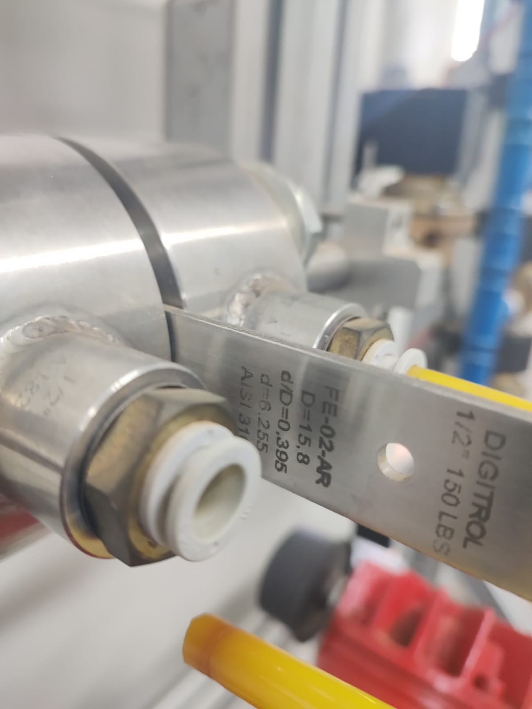 | **FE-02-AR · exemplo guiado**<br>Tubulação de 1/2"; `D = 15,8 mm`; `d = 6,255 mm`.<br>A leitura da placa informa `d/D = 0,395`. |
| 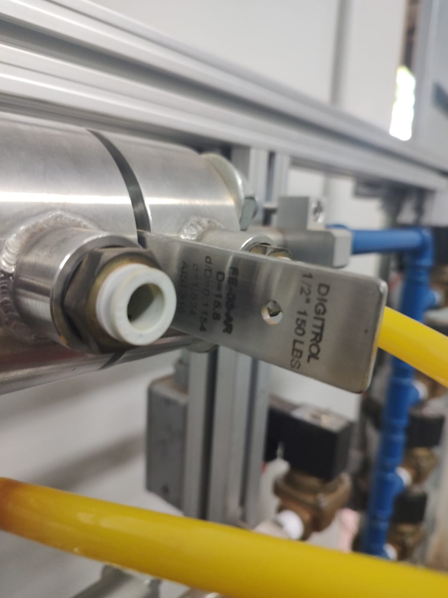 | **FE-09-AR · exercício 1**<br>Tubulação de 1/2"; `D = 15,8 mm`; `d = 1,824 mm`.<br>Relação indicada: `d/D = 0,1154`. |
| 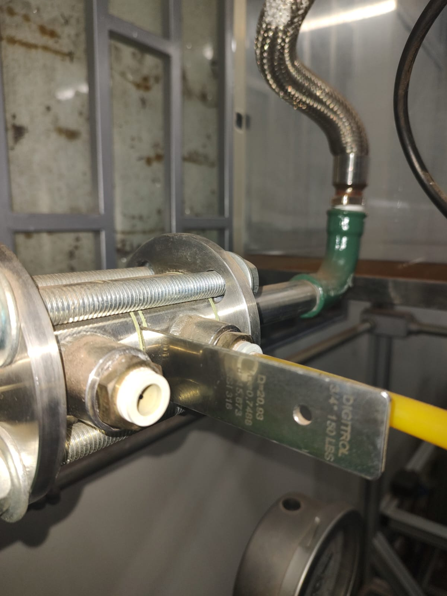 | **FE-01-AR · exercício 2**<br>Tubulação de 3/4"; `D = 20,93 mm`; `d = 15,673 mm`.<br>Relação indicada: `d/D = 0,7488`; tag informada pelo professor. |

#### Da plaqueta aos valores de projeto

**1. Geometria das placas:** estes números identificam qual elemento primário será utilizado.

| Placa | Papel | `D` / `d` [P] | `β = d/D` [C] | Folha completa |
|---|---|---|---:|---|
| **FE-02-AR** | Exemplo resolvido | 15,8 / 6,255 mm | 0,395886 | [Abrir folha](folhas_de_dados/FOLHA_DADOS_FE_02_AR.md) |
| **FE-09-AR** | Exercício | 15,8 / 1,824 mm | 0,115443 | [Abrir folha](folhas_de_dados/FOLHA_DADOS_FE_09_AR.md) |
| **FE-01-AR** | Exercício | 20,93 / 15,673 mm | 0,748829 | [Abrir folha](folhas_de_dados/FOLHA_DADOS_FE_01_AR.md) |

**2. Dados de processo e ajustes calculados:** os valores desta tabela serão usados nas ferramentas.

| Placa | Vazão volumétrica normal a 100 % [E] | Vazão volumétrica de operação a 100 % [C] | `ΔP` a 100 % [C] | `URV` de ΔP proposto [C] |
|---|---:|---:|---:|---:|
| **FE-02-AR** | 15 Nm³/h | 5,413291 m³/h | 11,2802 kPa | **1150,3 mmH₂O** |
| **FE-09-AR** | 1,5 Nm³/h | 0,541329 m³/h | 15,8621 kPa | **1617,5 mmH₂O** |
| **FE-01-AR** | 30 Nm³/h | 10,826583 m³/h | 0,7897 kPa | **80,5 mmH₂O** |

> [!TIP]
> Para a FE-02-AR, a vazão volumétrica de operação a 100 % é **5,413291 m³/h**. O ΔP calculado nesse ponto é aproximadamente **1150,3 mmH₂O convencionais**, adotado como URV de pressão no LD301 simulado. A User Unit é configurada separadamente com **15 Nm³/h** em 100 %.

<details>
<summary><strong>📌 Nota de revisão — correção da leitura da FE-01-AR</strong></summary>

Em uma versão anterior, o reflexo da foto levou à interpretação `d ≈ 8,89 mm` e `β ≈ 0,425`, resultando em `URV ≈ 1123,2 mmH₂O`. A ampliação da imagem permitiu identificar `d/D = 0,7488` e `d = 15,673 mm`. A divisão `15,673/20,93 = 0,748829` confirma essa leitura. Com o diâmetro correto, a pressão diferencial máxima é de aproximadamente **0,79 kPa (80,5 mmH₂O)**. A folha de dados e o gerador da planta foram atualizados.

</details>

#### Por que 15 Nm³/h viram 5,413 m³/h?

**Nm³/h** expressa o volume que a mesma quantidade de gás ocuparia nas **condições normais de referência** (aqui, 0 °C e 101,325 kPa absolutos). **m³/h** expressa o volume efetivo nas **condições de operação da tubulação** (aqui, 20 °C e 200 kPa manométricos a montante). Como o ar está a pressão maior na tubulação, ele ocupa um volume menor, mesmo que a quantidade de massa que escoa seja a mesma.

O cálculo utiliza a lei dos gases ideais e a conservação de massa:

- Densidade normal: `ρₙ = pₙ/(R·Tₙ) = 1,292284 kg/m³`.
- Densidade a montante: `ρ₁ = p₁,abs/(R·T₁) = 3,580863 kg/m³`.
- Constante específica do ar: `R = 287,05 J/(kg·K)`.
- Conversão: `Q₁ = Qₙ·ρₙ/ρ₁ = 0,360886·Qₙ`.

Assim, para a FE-02-AR, **15 Nm³/h** correspondem a **5,413291 m³/h** no processo. O **LasecSimul e o Python** trabalham com a vazão `Q₁`, enquanto o **LD301 será configurado para mostrar a vazão normal `Qₙ`**. Essa conversão é válida para as condições fixadas nesta atividade; fora delas, as densidades devem ser recalculadas.

**Três ajustes diferentes no mesmo ponto de referência:**

| Grandeza ou ajuste | FE-02-AR a 100 % | Onde aparece | O que representa |
|---|---:|---|---|
| **Vazão volumétrica de operação a 100 %** | `5,413291324 m³/h` | Calculadora e **Propriedades exportadas** da placa | Vazão no tubo nas condições de operação usadas no modelo. É uma entrada do simulador para a válvula a 100 %. |
| **Valor superior da faixa de ΔP (URV)** | `1150,3 mmH₂O` convencionais no simulador | PACTware → **Measurement → (URV) - Upper Range Value** | Extremo superior escolhido para a faixa da pressão diferencial. Neste exercício, foi ajustado ao ΔP calculado no ponto de referência; não é a vazão nem o limite físico superior do sensor (**URL**). |
| **User Unit — Eng. Unit (100%)** | `15 N m3/h` | PACTware → **User Unit → Eng. Unit (100%)** | Valor de indicação escolhido para 100 % da escala de saída, em condições normais de referência. |

Os dois valores de vazão representam a mesma vazão mássica no ponto de referência, expressa em condições de volume diferentes. A correspondência acima usa ar seco, `20 °C` e `301,325 kPa absolutos` na operação, e `0 °C` e `101,325 kPa absolutos` na condição normal. O transmissor usa a raiz e a escala configuradas; ele não mede temperatura e pressão de linha para recalcular automaticamente a vazão normal.

Os termos **Valor Inferior**, **Valor Superior** e **Unidade do Usuário** seguem o [manual do LD301, páginas impressas 3.8 a 3.10](docs/MANUAL_LD301.pdf). No DTM, os campos aparecem como **LRV**, **URV** e **Eng. Unit (100%)**. O rótulo **Vazão volumétrica de operação a 100 %** é um parâmetro do modelo didático, não um campo HART do transmissor. Vazão normal é uma vazão volumétrica referida a condições de base, que devem ser informadas; veja o [guia técnico de medição de vazão da Emerson](https://www.emerson.com/is/content/emerson/en/measurement-instrumentation/marketing/industries/oil-and-gas/documents/doc-rosemount-00805-0100-1041.pdf).

<a id="teoria-ld301-pactware"></a>
## LD301, laço 4–20 mA, HART e PACTware

O instrumento do projeto é o **SMAR LD301**, identificado na planta pela **tag FT100**. Uma *tag* é o nome usado para reconhecer um instrumento no projeto. O LD301 recebe duas pressões e calcula a diferença `HIGH − LOW`; portanto, sua medição física é **pressão diferencial**, não vazão.

O resultado chega ao sistema como **corrente de 4–20 mA**: 4 mA representa o limite inferior da faixa configurada e 20 mA representa o superior. Ao selecionar a função de raiz quadrada e a unidade de engenharia, o transmissor passa a fornecer uma indicação proporcional à vazão nas condições deste exercício.

**Limitação específica do equipamento simulado:** o código de pedido armazenado é `LD301M21ITD10011-I6P0`. O manual (p. 5.20) identifica **M2** como sensor **manométrico** de −50 a 50 kPa; o modelo didático o utiliza como diferencial. Em uma instalação industrial real, seria necessário especificar o modelo **diferencial** da série D, com faixa compatível com o processo.

O **PACTware** é a aplicação em que a configuração será realizada. Ele utiliza dois **DTMs**: **HART Communication**, para o canal de comunicação, e **LD301**, para abrir as telas específicas do transmissor.

| Área do PACTware | O que ela faz | Como verificar o resultado |
|---|---|---|
| **Online Parameterize** | Lê e grava parâmetros no LD301 conectado. | Use **Write** e **releia** a página; confira o comportamento no LasecSimul. |
| **Offline Parameterize** | Edita valores guardados no projeto do PACTware, sem comprovar alteração no instrumento. | Não use uma edição offline como evidência de gravação no LD301. |

Esta distinção é essencial: **ver um valor na tela não significa que o transmissor o recebeu**.

A comunicação digital precisa de um caminho entre as duas aplicações. O programa **com0com** cria o par de portas seriais virtuais `COM20 ↔ CNCB0`: o **LasecSimul abre `CNCB0`** no modem de sua planta e o **PACTware se conecta por `COM20`**. Assim, os comandos HART atravessam um enlace virtual que reproduz a comunicação com um instrumento. O Python permanece independente desse enlace.

**Ponto de partida documentado do LD301:** na execução registrada, a unidade de pressão era `mmH2O@20C`, `LRV = 0`, `URV = 3376,3`, a função era **Linear** e o corte de raiz estava em **6 % / Hard**. A **User Unit já estava ligada**, com escala **243–800 mm** de um exemplo de nível; sua PV em `mm` **não representava vazão**. O display começava em PV % e temperatura. A leitura online da [User Unit antes da mudança](capturas/pw_n46_user_unit_antes.png) registra esse estado. Se a cópia usada já tiver sido salva após alterações, os valores podem ser outros: confira-os online na [Oficina 05](#oficina-05).

<a id="manual-ld301"></a>
### Leitura aplicada do manual do LD301

As páginas citadas são as **impressas** no [docs/MANUAL_LD301.pdf](docs/MANUAL_LD301.pdf), com a página do PDF entre parênteses.

| Manual | O que diz | Como entra nesta prática |
|---|---|---|
| p. 3.8 (PDF 36) — Calibração | No modo transmissor, o Valor Inferior corresponde a 4 mA e o Superior a 20 mA. LRV e URV devem respeitar os limites do sensor e o span mínimo. | Nesta prática, o URV de pressão foi escolhido igual ao ΔP calculado no ponto de referência: 1150,3 mmH₂O convencionais no simulador. |
| p. 3.9 (PDF 37) — Tabela 3.1 | A referência interna é inH₂O@20 °C; as demais unidades são convertidas por fator. | `mmH2O@20°C` vale 248,642/25,4 = 9,7891 Pa. O Python e a planta usam 9,80665 Pa (mmH₂O convencional). Veja a nota de unidades abaixo. |
| p. 3.9 (PDF 37) — Unidade do Usuário e Tabela 3.2 | 0 % da User Unit ↔ Valor Inferior; 100 % ↔ Valor Superior. A consistência é responsabilidade do usuário. | Com raiz quadrada, 0–100 % da saída ↔ 0–15 N m³/h. |
| p. 3.10 (PDF 38) — User Unit e código 253 | Com User Unit desabilitada, a PV é mostrada em %. Habilitada, a PV é a pressão após a função de transferência, na unidade escolhida. O código 253 permite unidade especial de 5 caracteres. | O DTM 3.03 oferece `N m3/h` na família Volumetric Flow; não foi preciso usar o código 253. |
| p. 3.10–3.11 (PDF 38–39) — RAIZ e Figura 3.5 | Saída = 10√x. Ponto de corte ajustável, padrão de 6 % da faixa de pressão. Abaixo do corte, o modo Suave segue linear em ΔP e o modo Abrupto leva a saída a 0 %. | O transmissor simulado está em 6 %, Abrupto (Hard). Comportamento verificado a 25 % e 26 % de abertura. |
| p. 3.15 (PDF 43) — Filtro, display | Damping de 0 a 128 s além dos 140 ms do sensor. Até duas variáveis no display, alternadas a cada 3 s (Tabela 3.4). | Damping mantido em 0. Display configurado em PV e corrente. |
| p. 3.16 (PDF 44) — Proteção de escrita | Há trava por software e por hardware. | Se uma gravação falhar, verifique a proteção antes de suspeitar da comunicação. |
| p. 4.13–4.14 (PDF 59–60) — Tabela 4.5 | Funções: linear, SQR, SQR3, SQR5, tabela e combinações. | A lista do DTM (Linear, Sqrt, Sqrt + Table, Sqrt**3, Sqrt**5, Table, Table + Sqrt) coincide com o manual. |
| p. 5.20 (PDF 92) — Faixas do sensor | Faixa 2 (D2/M2): −50 a 50 kPa, span mínimo 0,42 kPa. | O DTM mostra URL ±5107,7451 mmH₂O@20 °C (= 50 kPa) e span mínimo 25,5387 mmH₂O@20 °C (≈ 0,25 kPa). A diferença no span mínimo deve ser registrada como divergência entre o manual e o simulador. |

> [!IMPORTANT]
> **Atenção a duas definições de mmH₂O:** a calculadora Python e o bloco `dp_mm` da planta usam **1 mmH₂O = 9,80665 Pa**. Já a unidade HART `mmH2O@20C` (código 4) equivale a **9,7891 Pa**. No **LD301 simulado**, `HIGH − LOW` já chega em mmH₂O e não passa por essa conversão; por isso o ajuste que corresponde à planta é **URV = 1150,3**. Em um **transmissor físico**, o mesmo `ΔP = 11,2802 kPa` corresponde a **1152,3 mmH₂O@20 °C** (diferença de cerca de 0,18 %). Para evitar ambiguidade em campo, pode-se trabalhar diretamente em **kPa** (`URV = 11,280 kPa`). A janela apresenta as duas conversões.

**Ordem de configuração indicada pelo manual e adotada aqui:** primeiro registrar o estado atual; depois configurar **unidade de pressão e faixa (LRV/URV)**; selecionar **raiz quadrada** e conferir o **corte**; ajustar a **User Unit**; conferir o **damping** e ajustar o **display**; por fim, **reler e conferir** os resultados na planta.

<a id="teoria-lasecsimul"></a>
## LasecSimul e planta do projeto

No **LasecSimul**, o subsistema **Placa de orifício (vazão por ΔP)** representa a tubulação e a placa. Um controle deslizante (*slider*) ajusta a abertura da válvula de **0 a 100 %**. Antes da resposta dinâmica, o modelo adota `Q = Qop,100·u/100`: a vazão de operação cresce proporcionalmente à abertura `u`. `Qop,100` é a **vazão volumétrica de operação a 100 %**, chamada `Qmax` na chave interna histórica do Python e `c_qmax` dentro do projeto.

Um atraso de primeira ordem de **1 s** evita que o valor varie de modo instantâneo. Em seguida, os blocos calculam a geometria efetiva, Reynolds, `C`, `ε` e `ΔP`. As saídas **HIGH** e **LOW** entregam as pressões ao LD301. O circuito inclui ainda **fonte de 24 V**, **resistor de 250 Ω**, **amperímetro** (para visualizar a corrente), **modem HART** e **osciloscópio** (para acompanhar sinais).

O modelo interno usa blocos da biblioteca equivalente ao Simulink (`sl.fcn`, `sl.mux`, `sl.gain`, `sl.discrete_transfer_fcn`) e constantes `control.constant`. As **Propriedades exportadas** incluem geometria, tomada, trechos retos, materiais, fluido, pressão, **vazão volumétrica de operação a 100 %** e desvio didático.

<details>
<summary><strong>🔧 Nota para quem mantém o projeto — formato dos blocos e migração</strong></summary>

A versão antiga utilizava `control.calc_expression`. A extensão migrou **43 blocos** para a biblioteca `sl.*`. Os três arquivos de placa incluem a definição completa do subsistema em `project.subsystems`, sob a identidade `subsystem.local.orifice_flow_dp`, sem exigir `.lssubcircuit` externo. O gerador verifica a presença de `sl.gain`, `sl.fcn`, `sl.mux` e `sl.discrete_transfer_fcn`, rejeita wrappers antigos e remove metadados de procedência externa. Para que o editor reconheça esses blocos, a distribuição da extensão deve conter `bundled/project/schema/block-library`.

</details>

<a id="teoria-python"></a>
## Python no projeto

O Python é usado nesta prática por uma **janela gráfica Tkinter**. Abra `python/interface/tela_tk.py` no VS Code e clique em **Run Python File** (triângulo ▶ no canto superior direito). Se o VS Code pedir um interpretador, selecione a instalação Python disponível. A janela será aberta; use seus campos, listas e botões para executar as tarefas da prática.

Na janela, a lista **Configuração** carrega os parâmetros prontos do caso-base ou de uma das três placas. Escolha a origem do cálculo — abertura da válvula, `ΔP` ou corrente do LD301 —, informe o valor e clique em **Calcular** para ver vazão, pressão diferencial, Reynolds, coeficientes e os detalhes das verificações de conformidade. Os campos continuam editáveis para condições próprias. A aba **Arquivos da prática** também permite gerar as folhas de dados e preparar uma cópia do projeto LasecSimul, com confirmação visual antes de substituir arquivos existentes.

Ao alterar uma entrada ou escolher outra placa, a janela limpa o resultado anterior. Clique em **Calcular** novamente para mostrar os valores correspondentes à configuração atual.

Na calculadora e no LasecSimul, o campo **Vazão volumétrica de operação a 100 %** usa o mesmo nome; sua unidade é `m³/h`. Os valores prontos vêm da conversão explicada em [Por que 15 Nm³/h viram 5,413 m³/h?](#folhas-dados-placas), que a janela não realiza. Os campos **Valor inferior da faixa de ΔP (LRV)** e **Valor superior da faixa de ΔP (URV)** são entradas para converter corrente em pressão. No preset, o URV é uma referência para a prática, não uma leitura online do transmissor. O ΔP calculado aparece no painel da direita.

No modo **Corrente (mA)**, a opção de raiz considera o corte **abrupto (Hard)** informado no formulário; a janela não seleciona nem configura o modo de corte do transmissor. Verifique a função e a faixa do instrumento antes de comparar. O modo suave não é reproduzido por essa conversão.

As equações ficam em [`python/calculos.py`](python/calculos.py), independentes da janela. [`python/servicos/servico_calculo.py`](python/servicos/servico_calculo.py) valida os dados e coordena a chamada ao núcleo matemático; `python/interface/tela_tk.py` cuida apenas dos campos e da apresentação. O fluxo é **interface → serviço → cálculos**.

Trecho do cálculo direto (o mesmo que a planta faz):

```python
C_iso = coeficiente_iso(b, reynolds(cfg, Q_m3h, geo["D_T"]), cfg["tomada"], geo["D_T"])
C_real = C_iso * (1 + dev["total"] / 100)
dp0 = 8 * cfg["rho"] * (1 - b ** 4) * (Q_m3h / 3600) ** 2 \
      / (C_real ** 2 * math.pi ** 2 * d ** 4)
```

As folhas de dados e os projetos de cada placa já estão disponíveis nas pastas `folhas_de_dados/` e `lasecsimul/`. Nesta prática, consulte esses arquivos e faça as contas interativas na janela Tkinter; não é necessário gerar arquivos auxiliares.

<a id="arquitetura"></a>
## Arquitetura e caminhos de dados


| Elemento | Variável | Onde se ajusta | Como se confere |
|---|---|---|---|
| Slider da válvula | abertura `u` (%) | Properties → Valor do sinal | válvula desenhada e vazão na planta |
| Placa simulada | `Q`, `Re`, `C`, `ε`, `ΔP` | Propriedades exportadas | mostradores da planta × saída do Python |
| LD301 FT100 | PV (pressão), corrente, PV de usuário | PACTware → Online Parameterize | releitura no DTM, LCD e amperímetro |
| Modem HART | porta `CNCB0` | propriedades do modem; botão Abrir/Fechar | rótulo do botão e estado no PACTware |
| PACTware | canal `COM20` e dispositivo | árvore do projeto | ícone verde e barra de status **Connected** |

---

<a id="pre-requisitos"></a>
## Pré-requisitos e arquivos

### Softwares usados na execução documentada

Os números abaixo são as **versões usadas para produzir as capturas deste roteiro**, não uma garantia de compatibilidade de qualquer outra instalação. Antes de começar, confirme que o LasecSimul abre o projeto sem blocos desconhecidos e que o PACTware encontra os DTMs necessários.

| Software | Versão observada | Observação |
|---|---|---|
| Windows Server 2025 + VS Code | — | VS Code em modo administrador; workspace confiável |
| Extensão LasecSimul | **0.0.100** (a 0.0.97 está marcada como obsoleta) | O executável em uso é `...\josuemoraisgh.lasecsimul-0.0.100\bundled\core\build\Release\lasecsimul-core.exe`. **Exige a pasta `block-library`**; veja [Oficina 03, Etapa 01](#oficina-03-etapa-01) |
| Python | 3.12.5 | Usa a biblioteca padrão, incluindo Tkinter para a janela |
| PACTware | 5.0 | DTM HART Communication (CodeWrights 1.0.58) e DTM SMAR LD301 3.03 |
| com0com | par 0: `COM20 ↔ CNCB0` | Não criar outro par com os mesmos nomes |

### Organização do repositório

Abra a **pasta raiz do repositório** no VS Code. É a pasta em que fica este `README_v3.md`; os caminhos abaixo são **relativos a essa raiz**, inclusive os links para imagens e manuais exibidos no GitHub.

```
README_v3.md                 roteiro da prática (este arquivo)
python/interface/             janela gráfica para todos os cálculos da prática
python/servicos/              validação e coordenação dos cálculos
python/calculos.py            equações e critérios de cálculo
folhas_de_dados/             folhas FE-02-AR (resolvida), FE-09-AR e FE-01-AR (exercícios)
lasecsimul/                  projetos do LasecSimul (caso-base e uma cópia por placa)
pactware/                    projeto PACTware de referência
python/                      calculadora gráfica, serviços e regras de cálculo
docs/                        manual do LD301 e relatório de validação
imagens/                     fotos das plaquetas
capturas/                    capturas de tela usadas neste roteiro
```

| Caminho | Uso |
|---|---|
| [`python/calculos.py`](python/calculos.py) | Regras e equações do domínio (ISO 5167-2) |
| [`python/interface/tela_tk.py`](python/interface/tela_tk.py), [`python/servicos/servico_calculo.py`](python/servicos/servico_calculo.py) | Interface gráfica Tkinter e serviço de aplicação |
| [`folhas_de_dados/FOLHA_DADOS_FE_02_AR.md`](folhas_de_dados/FOLHA_DADOS_FE_02_AR.md) | Folha da placa do exemplo resolvido |
| [`folhas_de_dados/FOLHA_DADOS_FE_09_AR.md`](folhas_de_dados/FOLHA_DADOS_FE_09_AR.md), [`folhas_de_dados/FOLHA_DADOS_FE_01_AR.md`](folhas_de_dados/FOLHA_DADOS_FE_01_AR.md) | Folhas dos exercícios (Oficina 06) |
| [`lasecsimul/placa_orificio_ld301.lsproj`](lasecsimul/placa_orificio_ld301.lsproj) | Projeto principal: caso-base com água (Oficina 01) e origem das cópias |
| [`lasecsimul/placa_orificio_FE_02_AR_calculada.lsproj`](lasecsimul/placa_orificio_FE_02_AR_calculada.lsproj) | Planta configurada com a FE-02-AR (Oficinas 03 a 05) |
| [`lasecsimul/placa_orificio_FE_09_AR_calculada.lsproj`](lasecsimul/placa_orificio_FE_09_AR_calculada.lsproj), [`lasecsimul/placa_orificio_FE_01_AR_calculada.lsproj`](lasecsimul/placa_orificio_FE_01_AR_calculada.lsproj) | Plantas dos exercícios (Oficina 06) |
| [`pactware/LD301_PACTware_FE02_Pratica.PW5`](pactware/LD301_PACTware_FE02_Pratica.PW5) | Projeto PACTware montado na Oficina 04 (`HOST PC → COM20 → LD301`, Multimaster desmarcado). O aluno deve montar o seu; este serve de referência |
| [`docs/MANUAL_LD301.pdf`](docs/MANUAL_LD301.pdf) | Manual do transmissor |
| [`docs/RELATORIO_VALIDACAO.md`](docs/RELATORIO_VALIDACAO.md) | Resultados verificados e limitações restantes |
| [`imagens/`](imagens/), [`capturas/`](capturas/) | Fotos das plaquetas e capturas de tela; o [índice de evidências](#indice-evidencias) lista cada captura |

<details>
<summary><strong>📦 Histórico dos arquivos antigos</strong></summary>

Projetos intermediários, cópias de segurança de migração, o manual duplicado e scripts exploratórios foram retirados da árvore principal em **22/10/2026**. Eles permanecem no histórico do Git, caso seja necessário consultar versões anteriores.

</details>

---

<a id="parte-ii"></a>
# Parte II — Oficinas

<a id="oficina-01"></a>
<details open>
<summary><strong>📘 Oficina 01 — Reconhecer o sistema</strong></summary>

**O que você fará:** abrir a planta, localizar os componentes e seguir o caminho da vazão até a indicação no instrumento.

**Ao terminar, você deverá identificar:** a válvula, a placa, as tomadas HIGH e LOW, o LD301, o amperímetro e o modem HART.

> [!NOTE]
> **Primeiro, um exemplo com água.** O projeto principal contém um caso-base com água. Ele serve para conhecer a interface antes de passar à **FE-02-AR, que usa ar**. Portanto, os valores deste primeiro exemplo **não** são os ajustes finais da FE-02-AR.

#### 🔹 Passo 01 — Abrir o projeto principal

1. No VS Code, abra a pasta do repositório (**Arquivo → Abrir Pasta…**) e confie no workspace quando solicitado.
2. Pressione `Ctrl+P`, digite `placa_orificio_ld301.lsproj` e pressione `Enter`. A aba **LasecSimul - Esquemático** abre.
3. Na barra do esquemático, clique em **Ajustar zoom a tudo** e depois em **Iniciar simulação** (triângulo verde). O cabeçalho passa de **Parado** para **Rodando**. Se quiser comparar a captura abaixo, ajuste a válvula para 50 % conforme a [Oficina 03](#oficina-03-etapa-02).


*Captura real [O], já com a instalação corrigida (Oficina 03): o caso-base com água a 50 % mostra 7,50 m³/h, Re_D = 50329, C = 0,6153, ε = 1,0000 e ΔP = 836 mmH₂O. O LD301, na configuração original (linear, URV 3376,3), produz 7,961 mA. A calculadora prevê 7,50 m³/h e 836,1 mmH₂O; 7,96 mA é obtido separadamente pela relação linear da faixa ([Apêndice B](#apendice-caso-base)).*

#### 🔹 Passo 02 — Identificar variáveis e equipamentos

1. À esquerda está o slider **Válvula de controle (%)**, ligado à entrada `valve` da placa.
2. No quadro da placa, observe três áreas: **Medição** (os valores calculados durante a simulação, como vazão, velocidade, Reynolds, `β`, `C`, `ε`, `ΔP` e perda permanente); **Parâmetros** (as características configuradas, como diâmetros e fluido); e **indicadores de conformidade** (avisos sobre critérios e limites do modelo). Os indicadores também incluem rugosidade, desvio e o tipo de tomada de pressão.
3. As saídas `high` e `low` da placa vão às entradas HIGH e LOW do LD301 (fios laranja e amarelo).
4. À direita: LD301 com LCD, amperímetro, fonte de 24 V, resistor de 250 Ω, **Modem HART-1** (botão vertical **Abrir/Fechar**) e osciloscópio.

**Verifique antes de continuar:** localize visualmente o caminho **válvula → placa → HIGH/LOW → LD301 → amperímetro**. A placa relaciona vazão a `ΔP`, mas a medida primária recebida pelo transmissor ainda é **pressão diferencial**. A indicação de vazão só aparecerá depois da configuração da **raiz** e da **unidade de usuário**, na Oficina 05.

**Questão para pensar:** por que observar uma corrente elétrica, por si só, não informa em que unidade está sendo mostrada a vazão?

---
</details>

<a id="oficina-02"></a>
<details open>
<summary><strong>📘 Oficina 02 — Calcular as placas em Python</strong></summary>

**O que você fará:** abrir a calculadora gráfica, configurar cada placa e obter resultados que serão comparados com a folha de dados e com a planta.

**Por que começar pelo Python?** A janela permite conferir a vazão volumétrica de operação a 100 % já informada e calcular o ΔP nesse ponto. Para a FE-02-AR, a entrada é `5,413291 m³/h`; o ΔP calculado é aproximadamente `1150,3 mmH₂O`, referência para o `URV` de pressão do LD301.

**Critério de conclusão:** calcular as três placas pela janela, registrar os resultados e identificar as verificações que aparecem como **OK** ou **FORA**. As placas pequenas usadas nesta prática estão fora de alguns limites dimensionais da ISO 5167-2; o cálculo é didático e não declara conformidade normativa.

#### 🔹 Passo 01 — Abrir a calculadora gráfica

1. No Explorador do VS Code, abra `python/interface/tela_tk.py`.
2. Clique em **Run Python File** (ícone ▶ no canto superior direito). A janela **Vazão em placa de orifício — ISO 5167-2** será aberta.
3. Mantenha a janela aberta durante os cálculos e as operações de arquivo.

#### 🔹 Passo 02 — Configurar a FE-02-AR

Na aba **Calculadora**, à esquerda, escolha **FE-02-AR** na lista **Configuração**. A janela preenche os campos com os parâmetros da tabela. Confira-os antes do cálculo; todos continuam editáveis. Se algum campo não estiver visível, use a barra de rolagem da área **Parâmetros do modelo**.

| Campo da janela | Valor FE-02-AR |
|---|---:|
| D / d | 15,8 mm / 6,255 mm |
| Tomada | 3 (canto) |
| Trechos montante / jusante | 44 D / 8 D |
| Material do tubo / placa | 1 / 2 |
| Temperatura | 20 °C |
| Fluido | 1 (gás) |
| ρ / μ / κ | 3,580863081 kg/m³ / 0,0181 cP / 1,4 |
| p1 | 200 kPa manométricos |
| Vazão volumétrica de operação a 100 % [m³/h] | 5,413291324 m³/h |
| Desvio didático | 0 (desligado) |
| Valor inferior da faixa de ΔP (LRV) / valor superior da faixa de ΔP (URV) / corte da raiz | 0 / 1150,3 mmH₂O convencionais / 6 % |

1. Selecione **Válvula (%)**, informe `100` e clique em **Calcular**.
2. Confira a vazão, `ΔP`, `Re_D`, `C`, `ε` e a seção **CONFORMIDADE**. Role o painel de resultados para ler a explicação de cada validação e seus limites.
3. No quadro **RESULTADOS**, anote **Vazão volumétrica de operação ≈ 5,4133 m³/h** e a linha **ΔP ≈ 1150,26 mmH₂O**. Arredondando esta última para uma casa decimal, obtém-se **1150,3 mmH₂O**, valor proposto para o URV. O campo de entrada **Valor superior da faixa de ΔP (URV)** já vem preenchido com esse valor no preset; preencher esse campo não altera o transmissor.

#### 🔹 Passo 03 — Comparar outros pontos e entender as validações

1. Sem mudar a configuração da placa, selecione **Válvula (%)**, informe `50` e calcule novamente. Para a FE-02-AR, espere aproximadamente `Q = 2,707 m³/h` e `ΔP = 280,5 mmH₂O`.
2. Leia **O QUE CADA VERIFICAÇÃO SIGNIFICA** no relatório. A janela explica os comprimentos retos, a comparação de rugosidade e cada critério dimensional, de Reynolds e de pressão aplicável à faixa ISO.
3. **FORA** significa que o valor não atende ao limite implementado naquela verificação. A janela identifica o valor medido e o critério correspondente. Uma placa pode calcular uma vazão mesmo quando aparece **FORA**; isso não significa que a placa atende à norma.

#### 🔹 Passo 04 — Calcular FE-09-AR e FE-01-AR

Escolha a placa na lista **Configuração**. A janela carrega todos os parâmetros correspondentes; a tabela abaixo serve para conferência:

| Placa | D (mm) | d (mm) | Vazão volumétrica de operação a 100 % (m³/h) | URV de ΔP proposto (mmH₂O) |
|---|---:|---:|---:|---:|
| FE-02-AR | 15,800 | 6,255 | 5,413291324 | 1150,3 |
| FE-09-AR | 15,800 | 1,824 | 0,541329132 | 1617,5 |
| FE-01-AR | 20,930 | 15,673 | 10,826582648 | 80,5 |

Para cada placa, selecione **Válvula (%)**, informe `100` e clique em **Calcular**. Registre os resultados apresentados. A FE-09-AR deve sinalizar Reynolds abaixo de 5000; a FE-01-AR tem `β` próximo do limite superior e uma pressão máxima pequena em relação ao span de 50 kPa do sensor simulado.

| Placa | Vazão a 100 % (m³/h) | ΔP aproximado (mmH₂O) | Observação de validade |
|---|---:|---:|---|
| FE-02-AR | 5,413 | 1150,3 | D e d abaixo dos limites dimensionais da norma |
| FE-09-AR | 0,541 | 1617,5 | D, d e Reynolds fora dos limites aplicáveis |
| FE-01-AR | 10,827 | 80,5 | D abaixo do limite dimensional; β próximo do limite superior |

Os resultados são referências calculadas. Compare-os com as folhas e, depois, com os valores observados na planta. Diferenças pequenas podem resultar do arredondamento; divergências maiores devem ser investigadas nos parâmetros e nas unidades.

#### 🔹 Passo 05 — Identificar onde usar cada valor

1. Na calculadora, selecione novamente **FE-02-AR** em **Configuração**. No painel esquerdo, localize **Vazão volumétrica de operação a 100 % [m³/h]**: `5,413291324`. É uma **entrada já preenchida** do modelo, obtida da vazão normal de referência de `15 Nm³/h` pela conversão da fundamentação.
2. No LasecSimul, abra `lasecsimul/placa_orificio_FE_02_AR_calculada.lsproj`. Clique no bloco **Placa de orifício**, abra **Properties** à direita e expanda **Propriedades exportadas**. Role até **Vazão volumétrica de operação a 100 % (m³/h)**: o valor também deve ser `5,413291324`. A cópia preparada já contém esse valor; edite-o apenas se o caso exigir. A [Oficina 03](#oficina-03-etapa-01) mostra a navegação e os demais campos.
3. Para obter o valor de referência de pressão, volte à calculadora, selecione **Válvula (%)**, informe `100` e clique em **Calcular**. Leia **ΔP = 1150,26 mmH₂O** nos resultados e arredonde para **1150,3 mmH₂O**. Na [Oficina 05](#oficina-05), esse valor será gravado no PACTware em **Online Parameterize → Blocks → Configuration → Measurement → (URV) - Upper Range Value**. O ΔP a 50 % não é o URV de projeto.
4. Na **User Unit** do PACTware, a escala de `0` a `15 N m3/h` vem da vazão normal estipulada para a FE-02-AR na folha de dados. A calculadora não mostra nem grava essa escala.
5. Para conferir uma corrente medida, use **Corrente (mA)**. Preencha **Valor inferior da faixa de ΔP (LRV)** e **Valor superior da faixa de ΔP (URV)** com os valores lidos em **Measurement**, e marque **LD301 configurado com raiz quadrada** somente se **Function** estiver em **Sqrt** no **Summary**. Antes da parametrização, a execução documentada usava `LRV = 0`, `URV = 3376,3` e função linear; o preset da FE-02 apresenta a faixa de referência `1150,3`, que só corresponderá ao instrumento depois de gravada e relida. O modelo da prática usa corte `6 % / Hard`, mas o DTM 3.03 não apresenta esse ajuste para leitura ou edição; a [Oficina 05](#o05-p06) explica a conferência pelo comportamento. Com corte abrupto, a corrente mínima não permite recuperar um ΔP único; se o corte real for desconhecido ou estiver atuando, consulte o ΔP medido na planta.

A calculadora, o LasecSimul e o PACTware não trocam esses ajustes automaticamente. Faça a conferência e a gravação em cada ferramenta indicada.

#### 🔹 Passo 06 — Gerar materiais e projetos pela janela (quando necessário)

1. Abra a aba **Arquivos da prática**.
2. Para criar ou recalcular as três folhas, clique em **Gerar / atualizar as três folhas**. São usados os dados fixos da prática, não alterações feitas nos campos da calculadora. Se alguma folha já existir, a substituição apaga anotações e observações adicionadas a ela; preserve-as antes de confirmar, se forem necessárias.
3. Para preparar um projeto de placa, escolha a tag FE-02-AR, FE-09-AR ou FE-01-AR na lista desta aba e clique em **Preparar projeto**. Essa seleção é independente da lista **Configuração** da calculadora. A cópia usa o projeto-base e os dados fixos da placa; ela não incorpora campos editados na aba Calculadora. Se o arquivo já existir, a substituição descarta alterações anteriores da planta e do LD301 salvas nele; confirme somente se quiser recriar a cópia.
4. A mensagem de conclusão mostra o caminho completo dos arquivos gravados. Abra o `.lsproj` pelo VS Code com `Ctrl+P` e confira as Propriedades exportadas antes de iniciar a simulação.

</details>

<a id="oficina-03"></a>
<details open>
<summary><strong>📘 Oficina 03 — Preparar e validar a planta no LasecSimul</strong></summary>

**O que você fará:** carregar a FE-02-AR, conferir as propriedades e verificar se a vazão e a pressão diferencial se comportam conforme o cálculo do Python.

**Critério de conclusão:** para **0 %, 50 % e 100 %**, os mostradores da planta devem concordar com as referências calculadas, dentro do arredondamento apresentado na tela.

> [!TIP]
> Nesta etapa, a prioridade é **validar a planta**. A configuração HART do transmissor ainda será feita depois; uma corrente inicialmente diferente da vazão desejada é esperada.


<a id="oficina-03-etapa-01"></a>
### Etapa 01 — Configurar a placa FE-02-AR

#### 🔹 Passo 01 — Abrir a cópia de trabalho pronta

1. No VS Code, pressione `Ctrl+P`, digite `placa_orificio_FE_02_AR_calculada.lsproj` e pressione `Enter`. A cópia preparada está em `lasecsimul/`. A aba **Arquivos da prática** da calculadora só precisa ser usada se você quiser recriar essa cópia.
2. Se aparecer "O esquemático atual tem alterações não salvas", salve o trabalho anterior se precisar preservá-lo; escolha **Descartar** apenas se essas alterações não forem necessárias.

Se a cópia já estava aberta quando os arquivos deste projeto foram atualizados, o LasecSimul pode continuar mostrando o rótulo anterior em memória. Preserve eventuais alterações em uma cópia separada e reabra o arquivo atualizado antes de procurar o novo nome.

#### 🔹 Passo 02 — Conferir as Propriedades exportadas

1. Clique uma vez no quadro principal **Placa de orifício (vazão por ΔP)** do esquemático. No painel **Properties** à direita, confirme que o tipo exibido é **Placa de orifício (vazão por ΔP)** e expanda **Propriedades exportadas**. Os números desenhados dentro da placa são mostradores; os campos editáveis ficam nesse painel lateral.
2. Role o painel lateral até **Vazão volumétrica de operação a 100 % (m³/h)**. Para a FE-02-AR, confira `5,413291324`; a interface pode mostrar parte dos dígitos de acordo com a largura do campo. É o mesmo valor do campo homônimo da calculadora, expresso nas condições de operação. Se for necessário alterá-lo, selecione o conteúdo, digite o valor desejado e clique em **Salvar projeto** na barra do LasecSimul. A indicação em condições normais é configurada separadamente na **User Unit** do PACTware.
3. Compare os demais campos com a folha. A primeira captura mostra os valores **antes** (projeto principal, água). As duas seguintes mostram a cópia FE-02-AR.

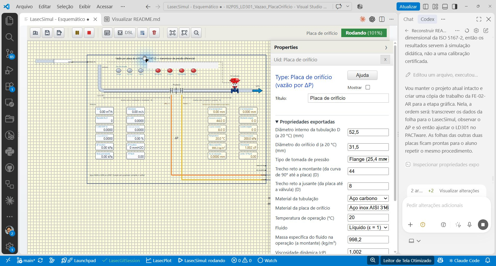

*Antes [O]: D = 52,5 mm, d = 31,5 mm, tomada flange, Líquido, ρ = 998,2 kg/m³, μ = 1,002 cP.*

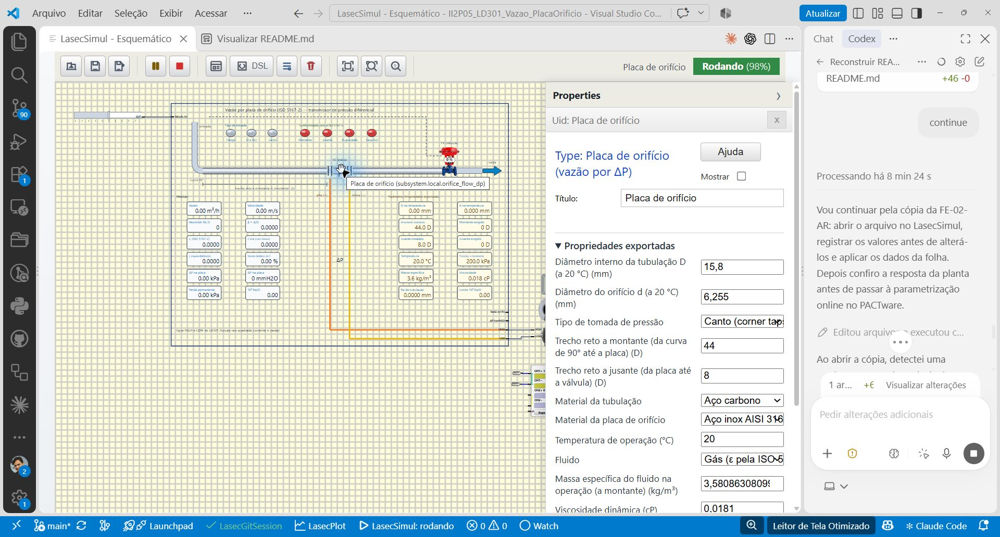

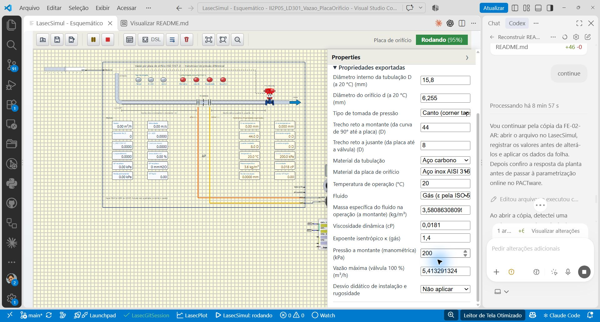

*Depois [O]: a FE-02-AR mostra `D = 15,8`, `d = 6,255`, tomada de canto, 44D/8D, aço carbono, AISI 316, 20 °C, gás, `ρ = 3,5808630809…`, `μ = 0,0181`, `κ = 1,4`, `p₁ = 200`, vazão volumétrica de operação a 100 % `= 5,413291324 m³/h` e **desvio = Não aplicar**. Nas capturas históricas, esse campo ainda aparece com o nome anterior “Vazão máxima (válvula 100 %)”; nos arquivos atuais, use o nome indicado no Passo 02. As capturas foram feitas antes da correção da biblioteca `sl.*`, por isso os indicadores aparecem zerados.*

<a id="oficina-03-etapa-02"></a>
### Etapa 02 — Rodar a planta e validar a resposta

**Como alterar a abertura da válvula:** clique no *slider*, abra **Properties → Valor do sinal** e digite um número entre **0 e 100**. Limpe o conteúdo do campo antes de preencher o novo valor. Depois, **aguarde pelo menos 5 s** para a resposta se estabilizar; o modelo tem dinâmica de primeira ordem de 1 s. Evite pressionar `Delete` ou `Backspace` com o componente selecionado, para não apagá-lo do esquema.

Para reproduzir os três pontos seguintes, ajuste a válvula primeiro para **0 %**, depois para **50 %** e por fim para **100 %**, aguardando a estabilização a cada alteração. Anote os valores lidos nos mostradores da planta. Ao terminar, retorne a abertura para **50 %**, ponto usado no início da Oficina 04.

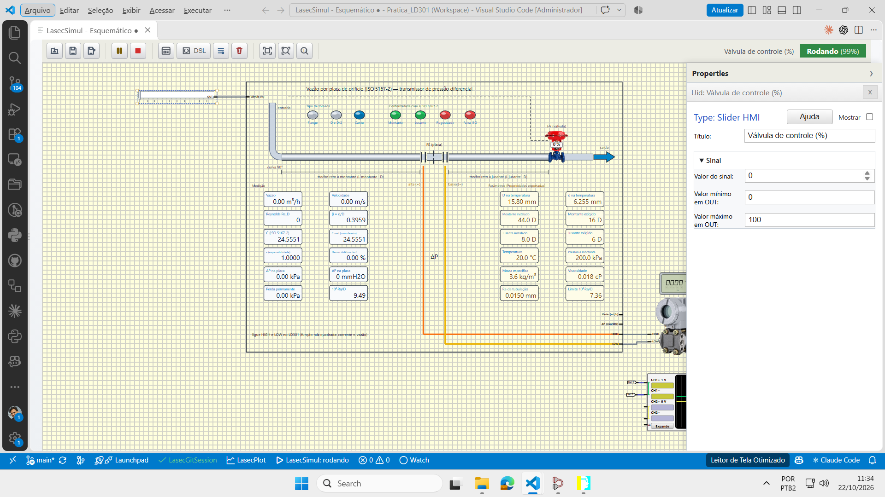

*0 % [O]: vazão 0,00 m³/h e ΔP 0. Os parâmetros (15,80 mm; 6,255 mm; 3,6 kg/m³; 0,018 cP) já aparecem nos mostradores, sinal de que a leitura dos blocos `sl.*` funciona.*


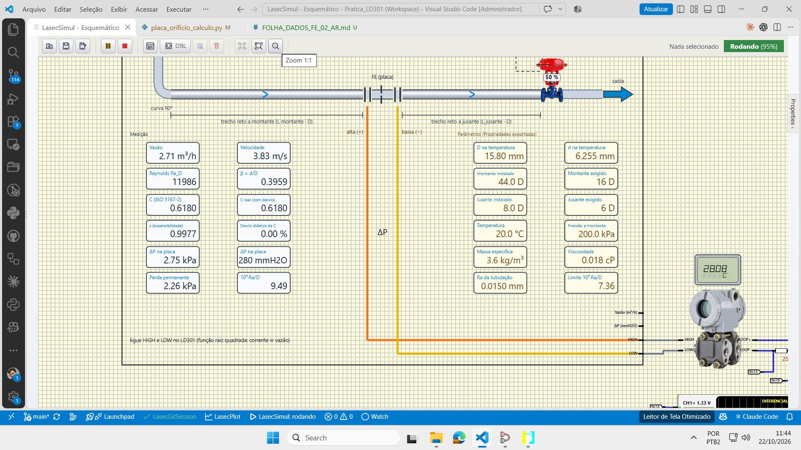

*50 % [O]: 2,71 m³/h; 3,83 m/s; Re 11986; β 0,3959; C = C real = 0,6180; ε 0,9977; desvio 0,00 %; ΔP 2,75 kPa = 280 mmH₂O; perda permanente 2,26 kPa.*

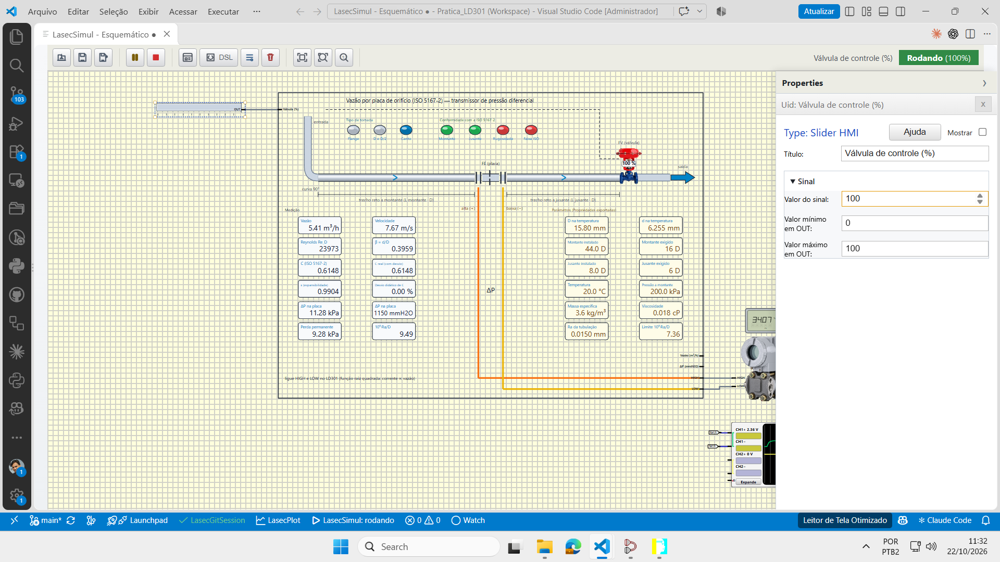

*100 % [O]: 5,41 m³/h; 7,67 m/s; Re 23973; C 0,6148; ε 0,9904; ΔP 11,28 kPa = 1150 mmH₂O; perda permanente 9,28 kPa. As lâmpadas **Rugosidade** e **Faixa ISO** ficam vermelhas, como previsto pelo Python.*

**Conferência 1 — Vazão e pressão diferencial**

| Abertura | Vazão Python [C] | Vazão planta [O] | `ΔP` Python [C] | `ΔP` planta [O] |
|---:|---:|---:|---|---|
| 0 % | 0 | 0,00 m³/h | 0 | 0 mmH₂O |
| 50 % | 2,707 m³/h | 2,71 m³/h | 2,7505 kPa = 280,5 mmH₂O | 2,75 kPa = 280 mmH₂O |
| 100 % | 5,413 m³/h | 5,41 m³/h | 11,2802 kPa = 1150,3 mmH₂O | 11,28 kPa = 1150 mmH₂O |

**Conferência 2 — Parâmetros intermediários**

| Abertura | `Re_D` (Python / planta) | `C` (Python / planta) | `ε` (Python / planta) |
|---:|---|---|---|
| 0 % | — | — | — |
| 50 % | 11986 / 11986 | 0,6180 / 0,6180 | 0,9977 / 0,9977 |
| 100 % | 23973 / 23973 | 0,6148 / 0,6148 | 0,9904 / 0,9904 |

> [!NOTE]
> **Verificação concluída:** nos três pontos, a diferença entre os resultados [C] e [O] corresponde ao arredondamento mostrado na interface. A FE-02-AR está **validada na simulação** para os testes documentados. Os pontos de 25 %, 26 % e 75 % serão analisados na Oficina 05, depois da parametrização do LD301.

---
</details>

<a id="oficina-04"></a>
<details open>
<summary><strong>📘 Oficina 04 — Montar o caminho HART no PACTware e conectar o LD301</strong></summary>

**O que você fará:** construir o caminho de comunicação no PACTware e conectar efetivamente o instrumento simulado.

**Ordem que deve ser respeitada:** com a planta **Rodando**, abra o **modem do LasecSimul**, conecte o **canal COM20** no PACTware e **só então** conecte o **LD301**. Conectar apenas o canal não significa conectar o transmissor.

**Critério de conclusão:** árvore `HOST PC → COM20 → LD301`, ambos os ícones de conexão em verde e status **Connected** no DTM do LD301.

> Todas as capturas desta oficina vêm de **uma única execução contínua**, em 22/10/2026 entre 12:45 e 13:02. O projeto resultante é [`pactware/LD301_PACTware_FE02_Pratica.PW5`](pactware/LD301_PACTware_FE02_Pratica.PW5). A única exceção é a tela do com0com, do Passo 01, registrada na sessão anterior com o mesmo par de portas.

### Fase A · Preparar a comunicação no PACTware

Nesta fase, você confere as portas, adiciona os módulos de comunicação e salva o projeto. **Não tente conectar o instrumento ainda**: o modem da simulação será aberto na fase seguinte.

#### 🔹 Passo 01 — Conferir o par virtual

1. Abra **Setup for com0com** e confira o par `COM20 ↔ CNCB0`. O PACTware usa `COM20`; o modem do LasecSimul usa `CNCB0`. Não crie outro par com esses nomes.

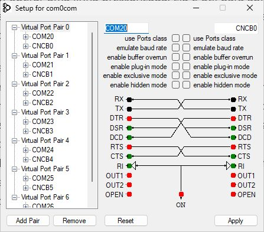

#### 🔹 Passo 02 — Abrir o PACTware

1. Abra o **PACTware 5.0** pelo menu Iniciar. O projeto novo (`<NONAME>`) mostra apenas `HOST PC` na árvore **Project**.

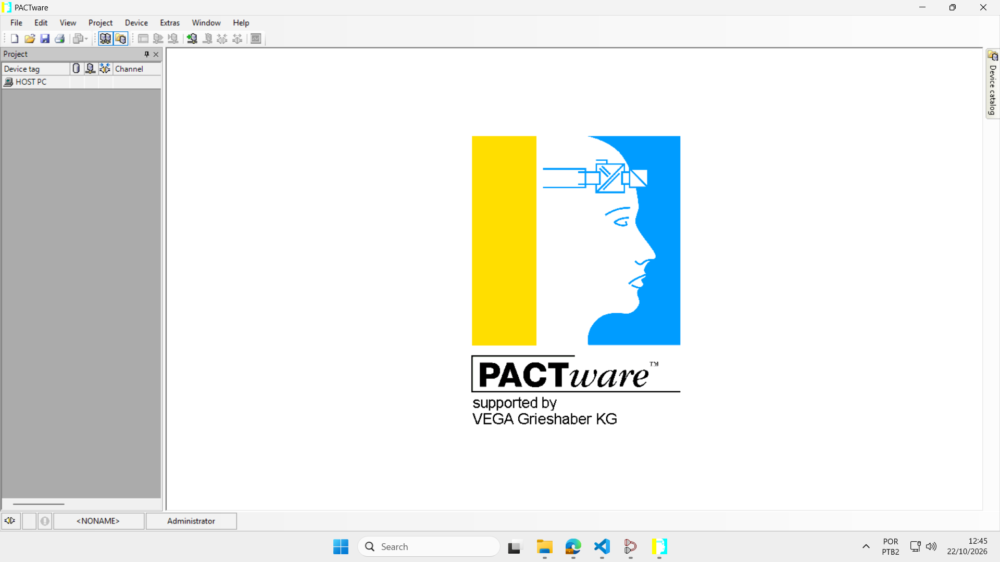

#### 🔹 Passo 03 — Add device: HART Communication em HOST PC

1. Clique com o botão direito em `HOST PC` e escolha **Add device**.

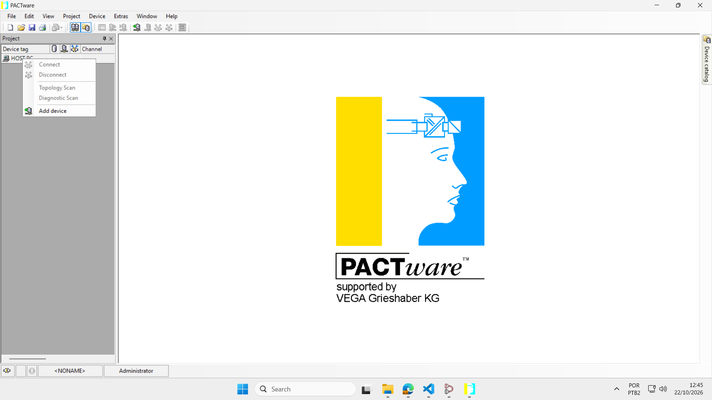

2. A janela **Device for** lista 3 DTMs para este nível (DF100, DF116-DF117 e HART Communication). Selecione **HART Communication** (CodeWrights, 1.0.58) e clique em **OK**.

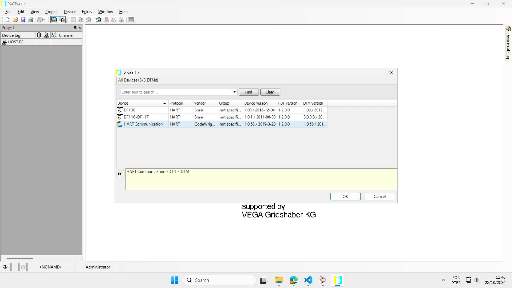

3. Surge o filho `COM0`: o DTM do modem HART, ainda na porta padrão.

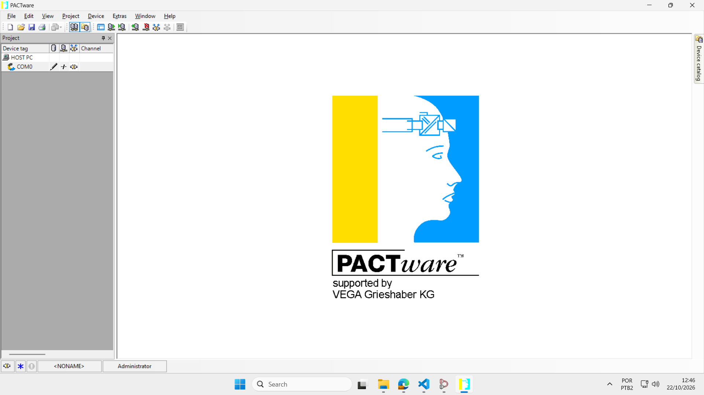

#### 🔹 Passo 04 — Dois cliques em COM0 e escolha da porta COM20

1. Dê **dois cliques em `COM0`**. Abre a aba **COM0 Parameter**: Communication interface `HART modem`, Serial Interface `COM0`, Primary Master, preâmbulo 5, 3 tentativas, endereços 0 a 0, timeout 2 s. Nesta instalação, **Multimaster and Burst mode support** vem **marcado**.

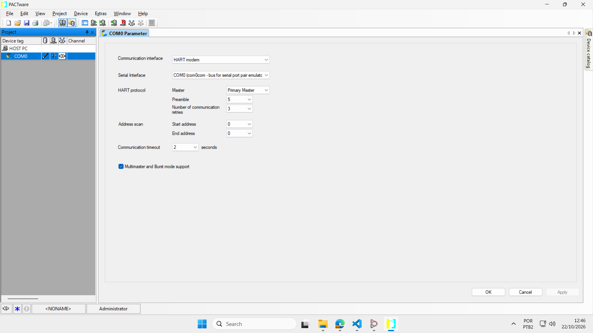

2. Abra a lista **Serial Interface** e escolha `COM20 (com0com - bus for serial port pair emulator)`.

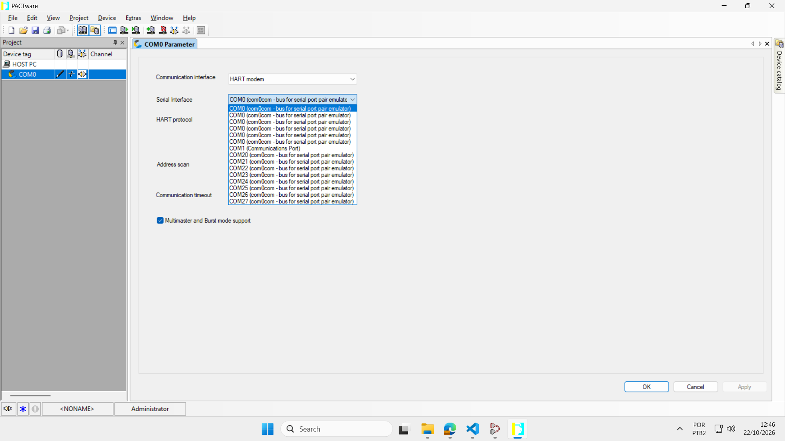


3. Clique em **Apply**. O nome na árvore muda de `COM0` para `COM20`.

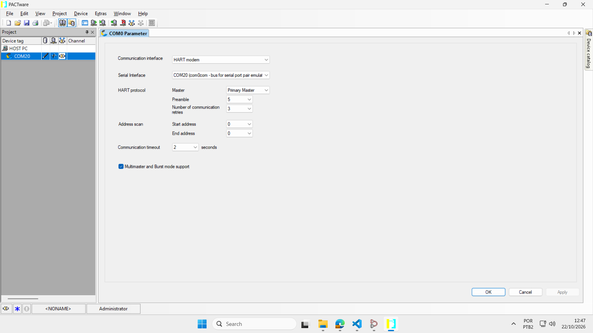

#### 🔹 Passo 05 — Desmarcar "Multimaster and Burst mode support" (etapa própria)

1. Ainda na aba de parâmetros, clique uma vez na caixa **Multimaster and Burst mode support** e confira que ela ficou vazia.


2. Clique em **Apply** (o botão fica cinza) e depois em **OK**.


3. **Confira:** dê dois cliques em `COM20` de novo. A aba agora se chama **COM20 Parameter**, com COM20 e a caixa desmarcada. Feche com **OK**.

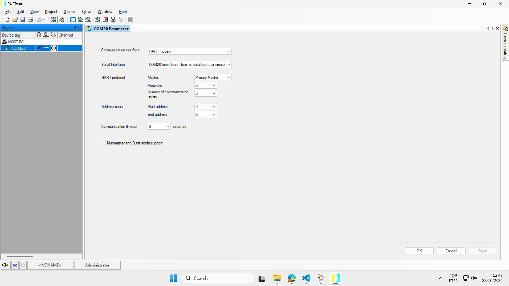

#### 🔹 Passo 06 — Add device: LD301 sob o canal COM20

1. Clique com o botão direito em `COM20` e escolha **Add device**.

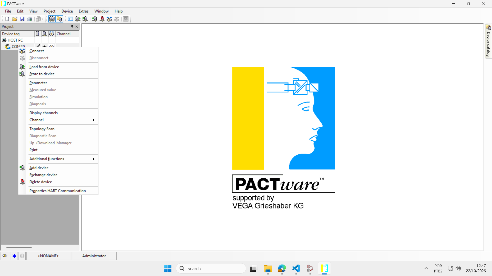

2. Agora a lista mostra **32 DTMs HART**. Digite `LD301` na busca e clique em **Find**.

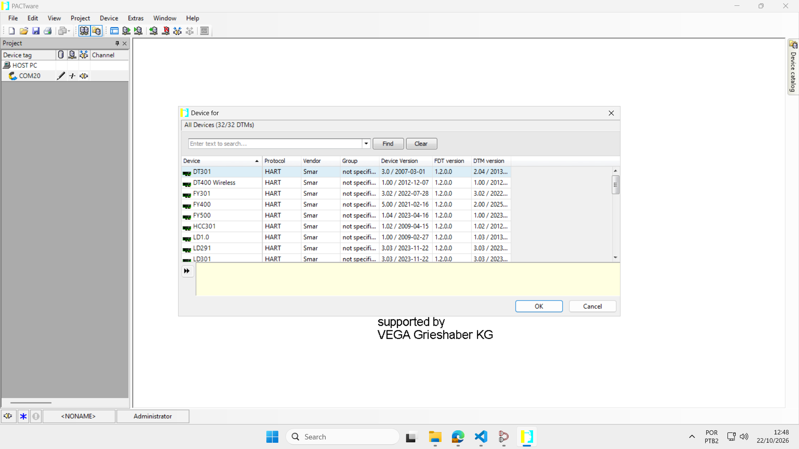

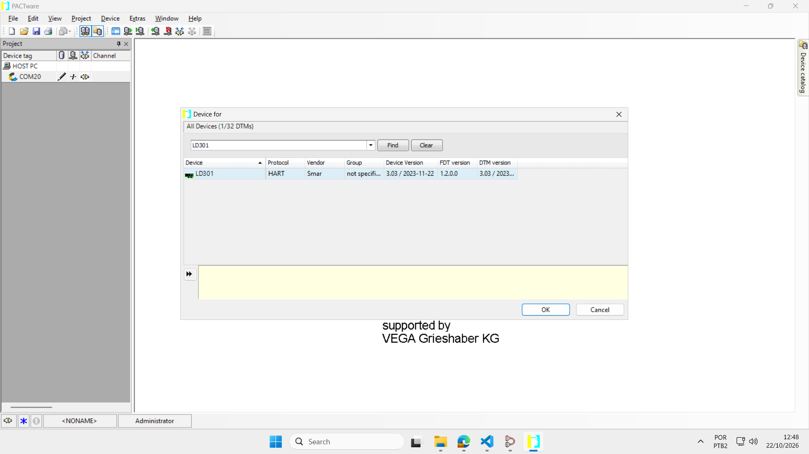

3. Selecione a linha **LD301** e clique em **OK**. A árvore fica `HOST PC → COM20 → LD301`, no canal `HARTCH`.

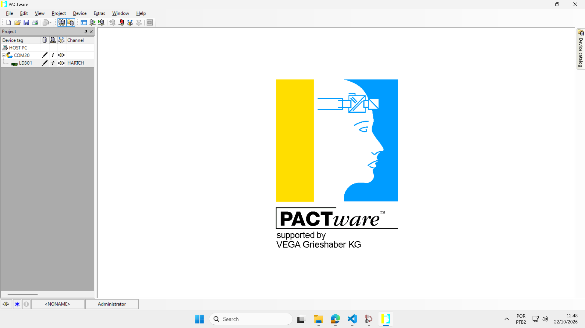

#### 🔹 Passo 07 — Salvar o projeto

1. **File → Save as**. Em **File name**, escolha a pasta `pactware/` do repositório e um nome próprio, por exemplo `LD301_PACTware_FE02_Aluno.PW5`, e clique em **Save**. O arquivo `LD301_PACTware_FE02_Pratica.PW5` fornecido no projeto permanece disponível para consulta. Na captura histórica, o projeto foi gravado na raiz porque as pastas ainda não existiam.

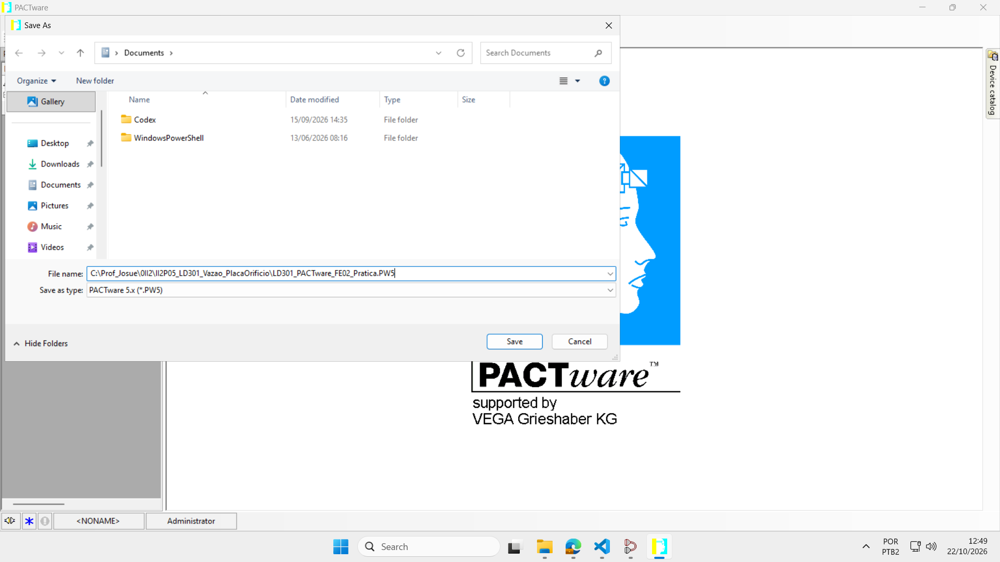

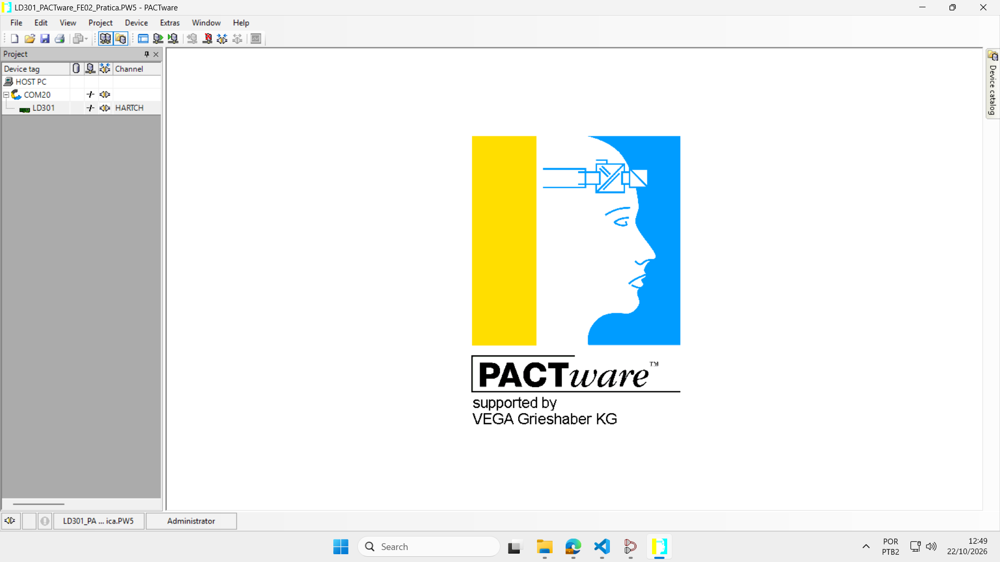

### Fase B · Abrir o modem e conectar o instrumento

Agora o caminho lógico já existe no PACTware. Falta iniciar o **ponto que responde às mensagens HART** (o LD301 simulado), liberar sua porta e conectar o canal e o instrumento nessa sequência.

#### 🔹 Passo 08 — Iniciar a simulação e abrir o modem no LasecSimul

1. No VS Code, abra `lasecsimul/placa_orificio_FE_02_AR_calculada.lsproj`, clique em **Ajustar zoom a tudo** e em **Iniciar simulação**. Ajuste a válvula para **50 %** conforme a [Oficina 03](#oficina-03-etapa-02) e aguarde a estabilização. O cabeçalho mostra **Rodando**; a planta deve indicar aproximadamente 2,71 m³/h e 280 mmH₂O. Na execução documentada, o LD301 ainda estava linear com URV 3376,3 e o amperímetro marcava 5,328 mA. Se o projeto tiver sido salvo após outra parametrização, a corrente poderá ser diferente: confira a configuração online na Oficina 05.
2. Localize o **Modem HART-1**, no canto inferior direito. O botão vertical indica **Abrir**: a porta `CNCB0` ainda está fechada.


3. Clique em **Abrir**. O texto do botão mudará para **Fechar**: isso significa que a porta `CNCB0` **está aberta** e o próximo clique a fecharia. Confira esse estado antes de prosseguir; o nome do botão indica a **ação disponível**, não o estado atual.


#### 🔹 Passo 09 — Connect no modem (canal COM20)

> [!IMPORTANT]
> Faça **Connect em COM20 antes de Connect em LD301**. No PACTware, COM20 representa o **canal HART**. Sem o canal conectado, o DTM do LD301 não consegue operar online.

1. Clique com o botão direito em **COM20** e escolha **Connect**.

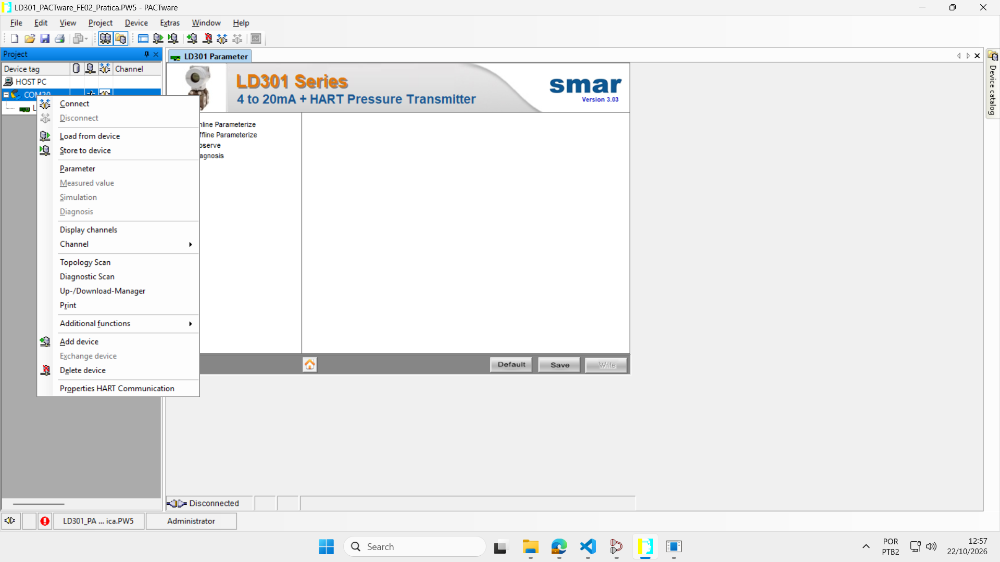

2. Confira o ícone de conexão do canal: ele precisa ficar **verde** e o nome **COM20** em negrito. O LD301 continua desconectado: conectar o canal não conecta o dispositivo.

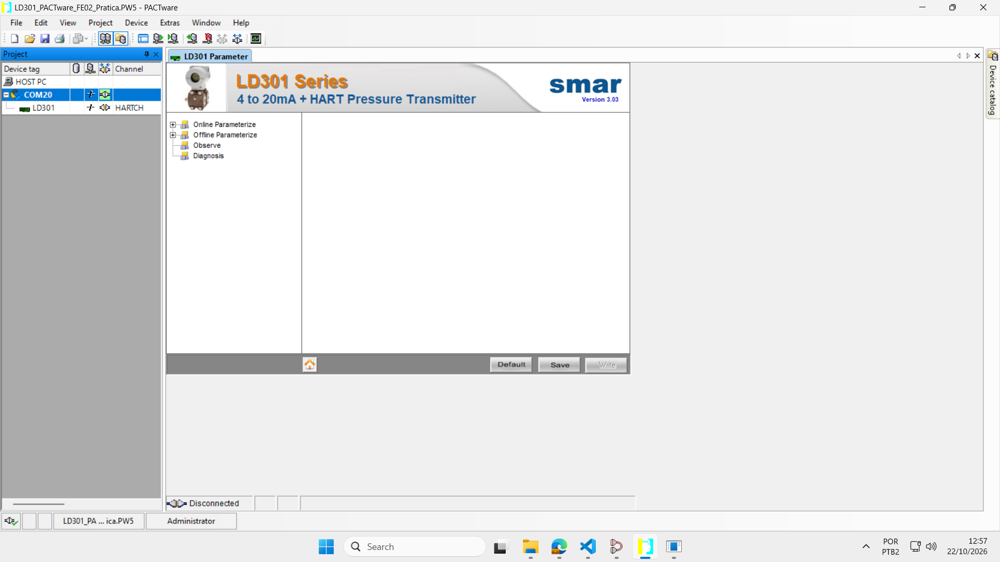

#### 🔹 Passo 10 — Connect no dispositivo LD301

1. Clique com o botão direito em **LD301** e escolha **Connect**.

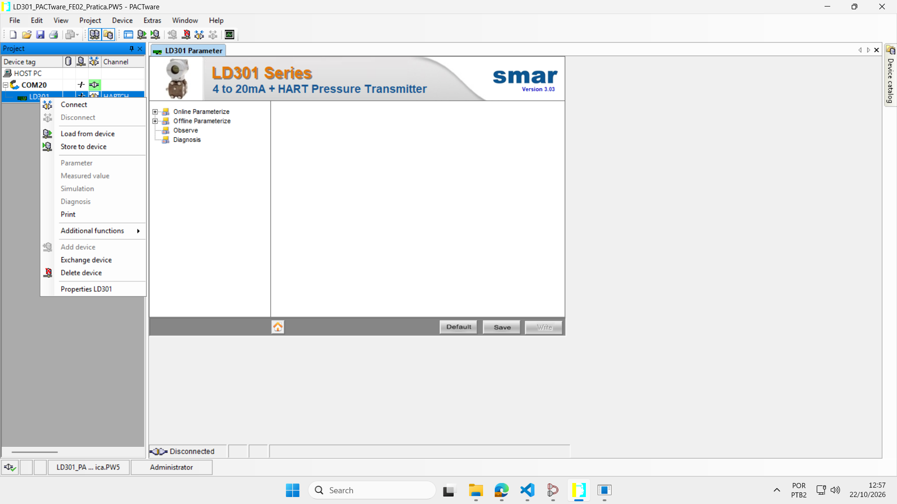

2. Aguarde a aba **LD301 # Parameter** (o `#` indica a instância online do DTM). Ela mostra tag **FT100**, descritor **MEDIDOR VAZAO**, Universal Code 5, Bell 202 e o código de pedido. Na barra inferior deve aparecer **Connected**, com os dois ícones da árvore em verde.

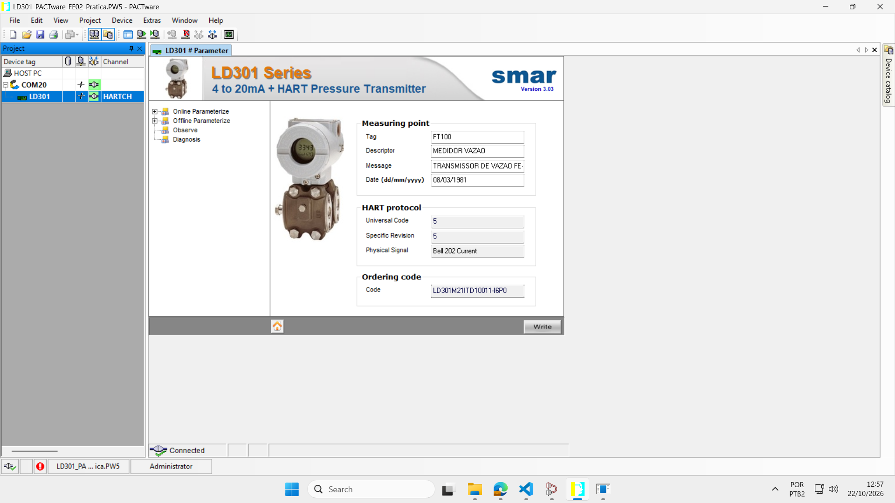

<details>
<summary><strong>🛠️ Caso documentado — conexão feita na ordem errada e recuperação</strong></summary>

Na primeira tentativa, o **Connect** em COM20 foi acionado enquanto o modem do LasecSimul ainda exibia **Abrir** (porta fechada). O PACTware parou em 67 % com a mensagem **"PACTware action active"**.

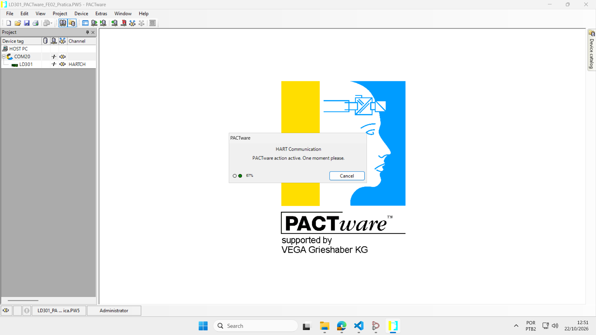

Mesmo depois de abrir o modem, o canal não ficou verde. Nas imagens, vê-se o plugue **aberto** à esquerda e o plugue **fechado, mas sem verde**, à direita:

<table><tr><td>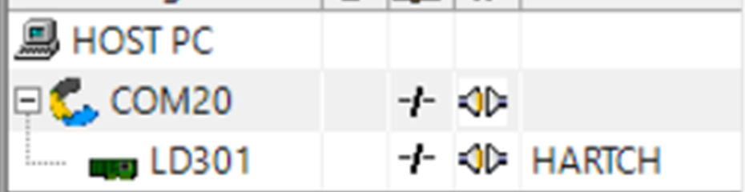</td><td>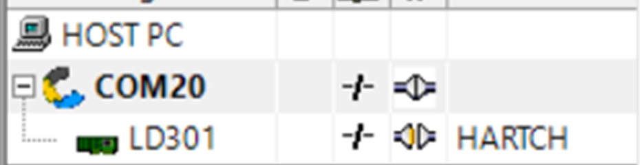</td></tr></table>

O **Connect** no LD301 deixou o nome em negrito, mas a tela mostrou **Disconnected**. Reconectar **apenas o LD301** não resolveu; a página online exibiu **"Device is Disconnected!"**:

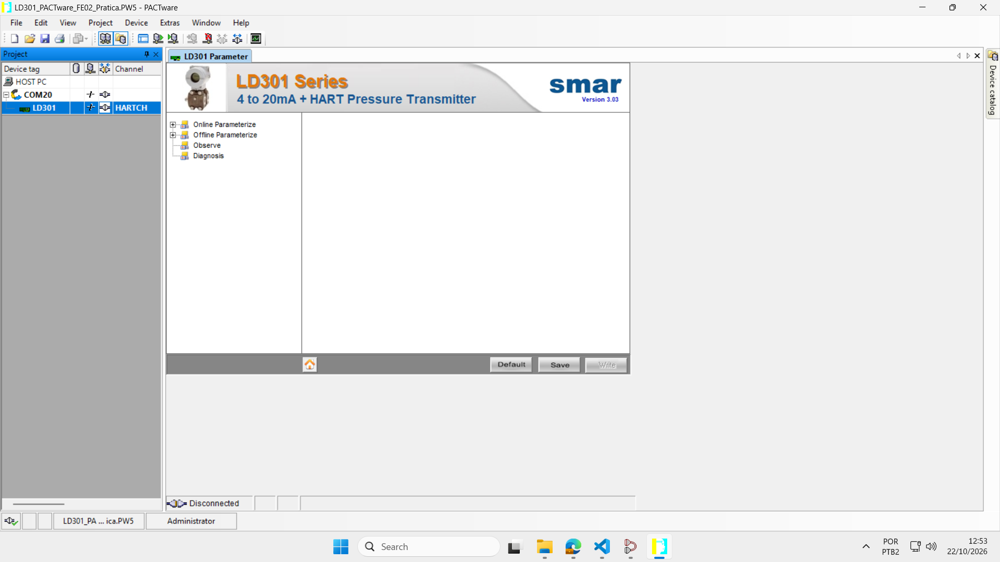

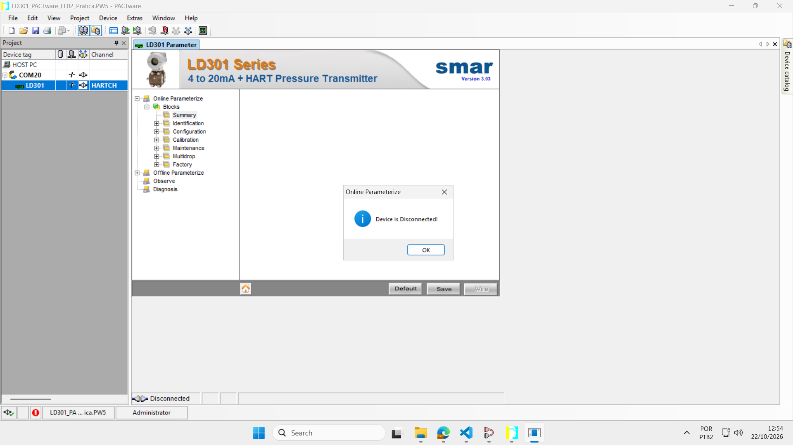

**Como a conexão foi recuperada:** foi necessário desconectar também o canal **COM20**. O PACTware perguntou **"It was not possible to close the connection… Force closing of connection?"**; a resposta foi **Yes**. Com ambos desconectados, o LasecSimul continuou **Rodando**, o modem ficou com o botão **Fechar** (porta aberta), e foi possível conectar **COM20 primeiro** e **LD301 depois**.

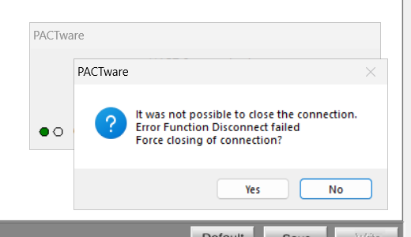

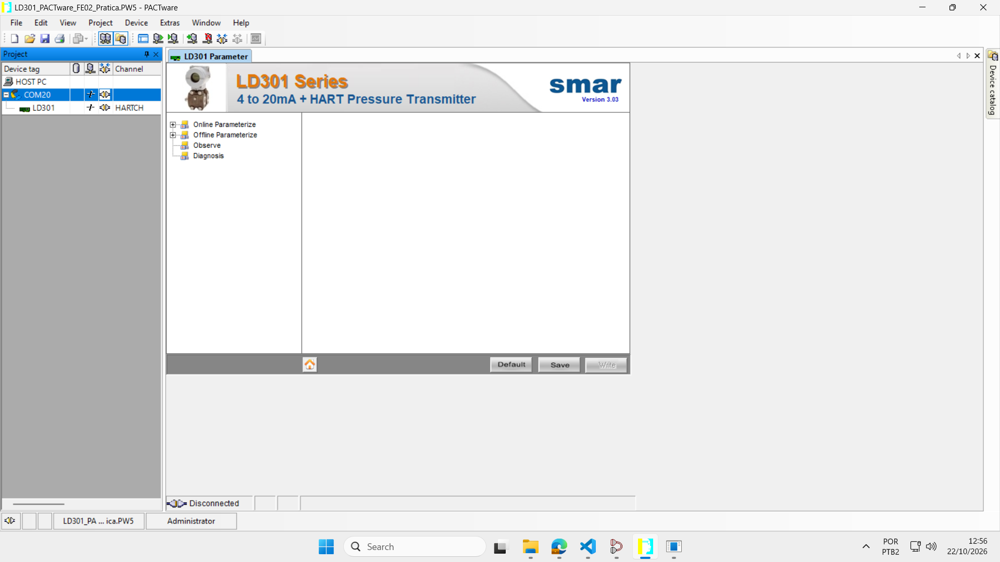

**Lição deste caso:** ícone fechado ou nome em negrito **não bastam**. Confirme os ícones verdes e **Connected**. Em outra sessão, quando COM20 já estava funcional, reconectar apenas o LD301 foi suficiente; neste caso, foi preciso reinicializar os dois níveis.

</details>

---
</details>

<a id="oficina-05"></a>
<details open>
<summary><strong>📘 Oficina 05 — Parametrizar o LD301 como transmissor de vazão (FE-02-AR)</strong></summary>

**O que você fará:** transformar a indicação do LD301, inicialmente associada à **pressão diferencial**, em uma indicação de **vazão normal**, com saída elétrica correspondente.

**Antes de começar:** a planta FE-02-AR já deve estar validada e **Rodando** a 50 %; o modem deve estar aberto e o canal COM20 e o LD301 conectados no PACTware. Os registros desta oficina foram obtidos na continuidade da execução de `LD301_PACTware_FE02_Pratica.PW5`.

**Valores finais desejados para a FE-02-AR:** `LRV = 0`, `URV = 1150,3 mmH₂O`, **Function = Sqrt**, **User Unit = 0–15 N m3/h**, **Display = PV / Out(mA)**.

### Fase A · Gravar e reler os parâmetros

> [!IMPORTANT]
> **Uma edição só está confirmada após a releitura online.** Para cada parâmetro: registre o valor anterior, altere o campo, clique em **Write**, volte à tela e confira o valor gravado.

<a id="o05-p03"></a>
#### 🔹 Passo 01 — Ler e registrar a configuração existente

1. Na aba **LD301 # Parameter**, expanda **Online Parameterize → Blocks** e clique em **Summary**. Não use o ramo **Offline Parameterize**.

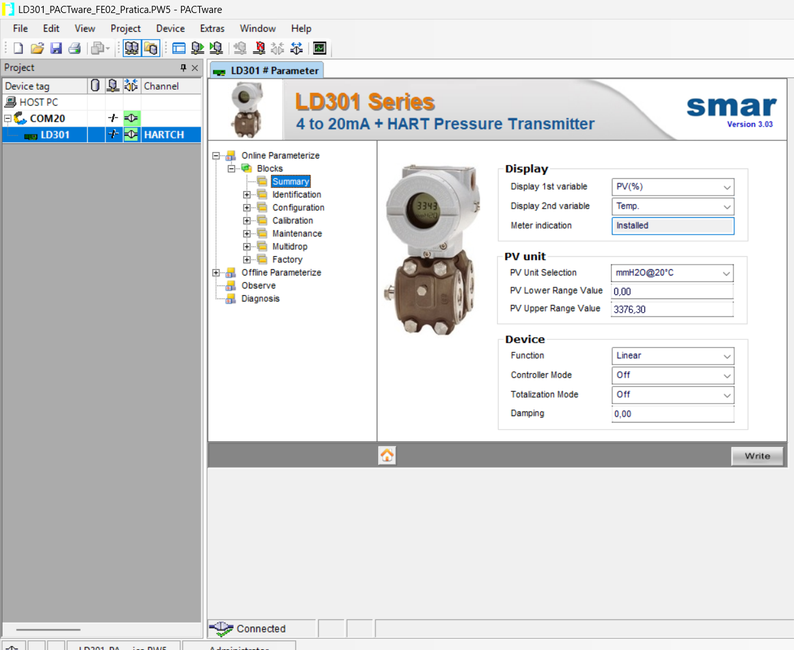

2. Expanda **Configuration** e clique em **Measurement**.

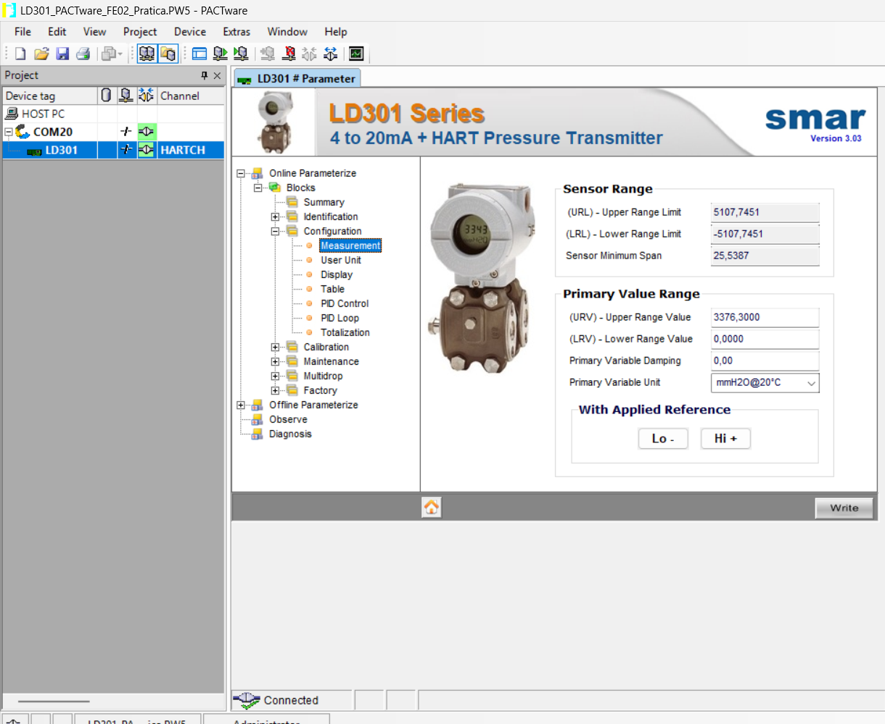

*Estado original lido online [O]: `URV = 3376,3 mmH₂O@20 °C`, função **Linear** e display **PV(%)/Temp.** A navegação em Configuration inclui Measurement, User Unit, Display, Table, PID Control, PID Loop e Totalization. Nesse momento, o transmissor ainda corresponde ao caso-base, não à vazão da FE-02-AR.*

> [!WARNING]
> **Não confunda Online com Offline.** Uma tela de **Offline Parameterize** chegou a mostrar `psi` e faixa **0–30** ([captura](capturas/pactware_28_ld301_medicao_offline.png)), valores que **não** eram a leitura do FT100. Somente o ramo **Online Parameterize** oferece evidência de leitura e gravação no dispositivo conectado.

<a id="o05-p04"></a>
#### 🔹 Passo 02 — Gravar a faixa de pressão (URV)

1. Em **Measurement**, clique no campo **(URV) - Upper Range Value**, selecione o conteúdo e digite `1150,3`. O Windows em português usa vírgula decimal. Mantenha LRV = 0 e a unidade `mmH2O@20°C`.

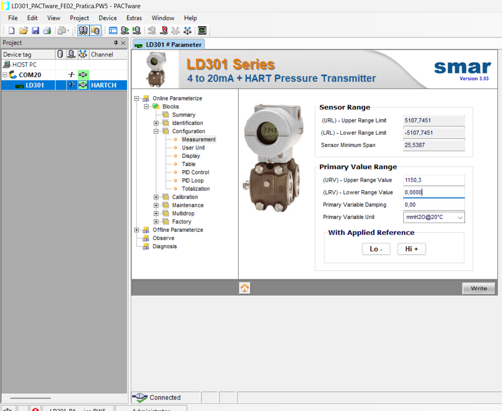

2. Clique em **Write**.

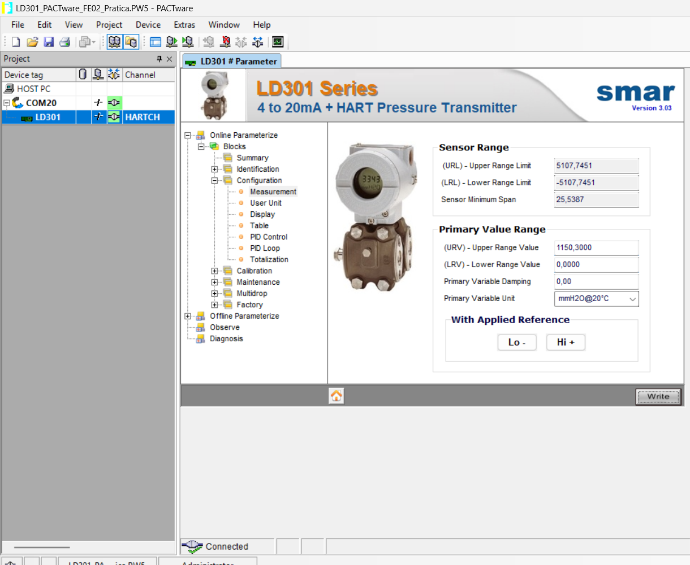

3. **Releia:** clique em **Summary** e volte a **Measurement**.


4. Efeito na planta a 50 %, ainda com função linear (captura da primeira execução, mesma configuração):

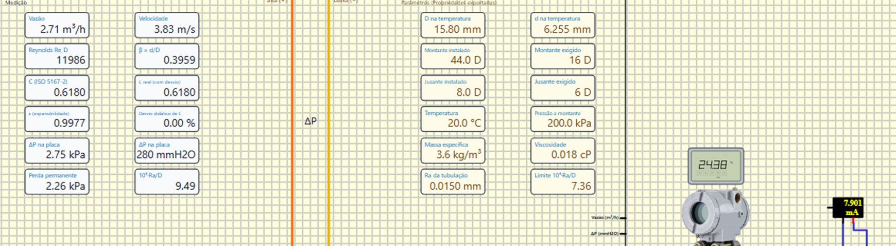

*[O]: ΔP = 280 mmH₂O, LCD 24,38 % e 7,901 mA. Previsto [C]: 280,5/1150,3 = 24,38 % → 4 + 16 × 0,2438 = 7,901 mA. Com a função linear, a corrente é proporcional ao ΔP e não à vazão.*

<a id="o05-p05"></a>
#### 🔹 Passo 03 — Gravar a função raiz quadrada

1. Em **Summary**, abra a lista **Function**. As opções coincidem com a Tabela 4.5 do manual: Linear, Sqrt, Sqrt + Table, Sqrt\*\*3, Sqrt\*\*5, Table, Table + Sqrt.

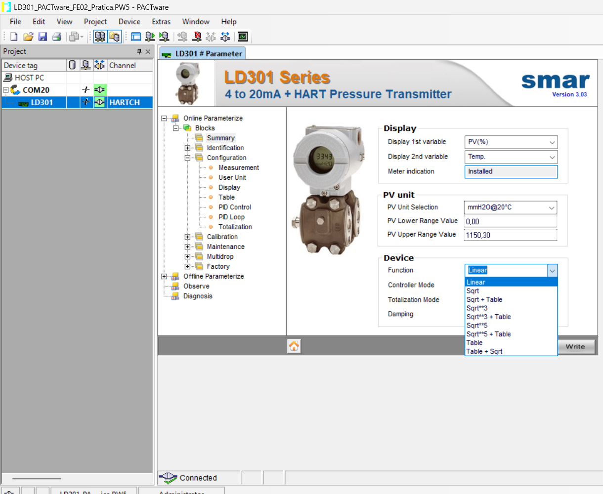

2. Selecione **Sqrt** e clique em **Write**.

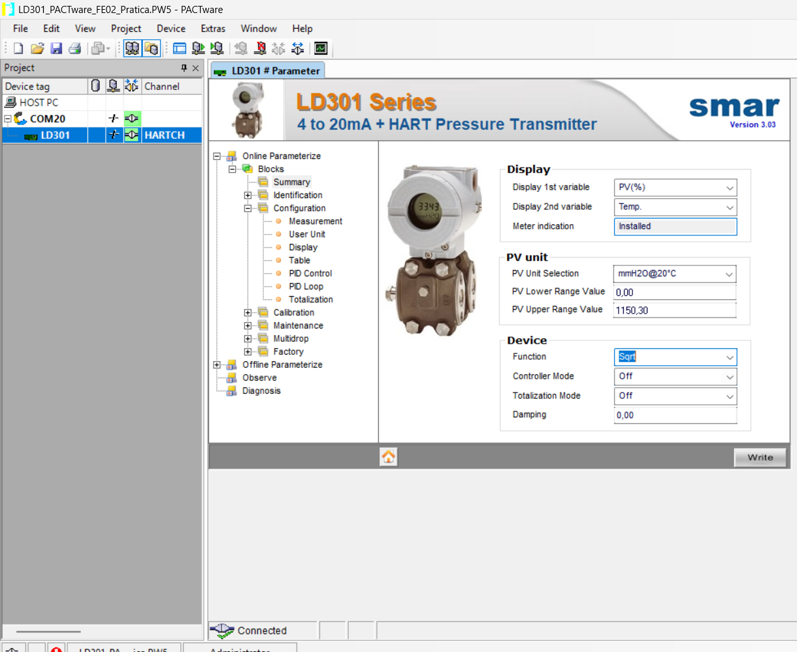

3. **Releia** (Measurement → Summary).


4. Efeito na planta a 50 % (primeira execução):

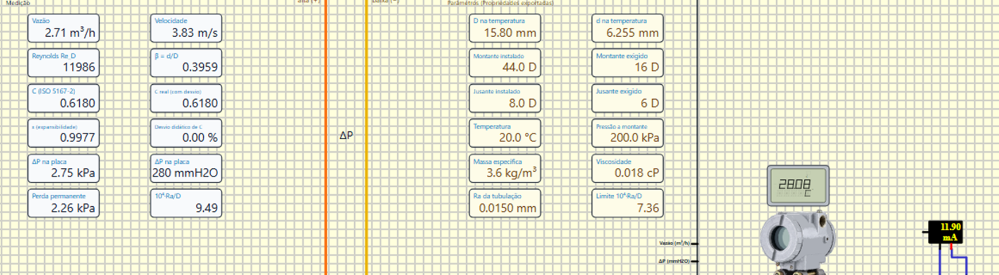

*Resultado [O]: **11,90 mA**. Cálculo [C]: a raiz de 24,38 % leva a **49,38 % da saída**, ou **11,901 mA**. A mudança não alterou a placa nem a pressão que ela gera: mudou **a maneira como o transmissor converte essa pressão em sinal de saída**.*

<a id="o05-p06"></a>
#### 🔹 Passo 04 — Conferir o ponto de corte

A função de raiz pode amplificar variações muito pequenas de pressão. Por isso, o manual (p. 3.10) prevê um **ponto de corte**, definido em porcentagem da faixa de **pressão**: nesta prática, **6 %**. No modo **Hard (abrupto)**, a saída permanece no mínimo quando a entrada está abaixo desse limite; no modo suave, o tratamento é diferente.

**Limitação da interface:** nas páginas online exploradas do **DTM 3.03**, os campos para alterar o ponto e o modo de corte **não foram encontrados**. Foram examinadas Summary, Identification (Device, Sensor, Flange/Seal), Configuration (Measurement, User Unit, Display, Table), Calibration, Maintenance e Factory. A página **Table** apresenta apenas pontos X/Y:

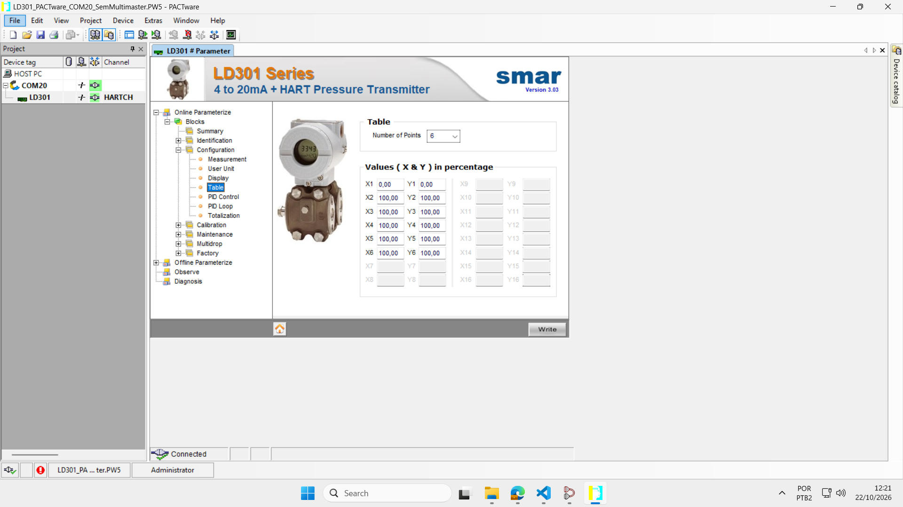

O LD301 simulado guarda `sqrtCutoff.point = 6` e `sqrtCutoff.mode = Hard`. Como o DTM não ofereceu esses campos, **o corte foi verificado pelo efeito real na saída**. O limite é `6 % de 1150,3 = 69,0 mmH₂O`: abaixo dele, a indicação cai a **4,000 mA**, com **PV = 0**. O confronto entre **25 % e 26 % de abertura**, no Passo 07, mostra essa transição.

<a id="o05-p07"></a>
#### 🔹 Passo 05 — Gravar a User Unit em N m³/h

1. Clique em **Configuration → User Unit**. Estado encontrado: **Mode On**, escala 243–800, família **Length**, unidade **mm** (herança do exemplo de nível do manual) e PV = 518,0402 mm, sem significado de vazão.

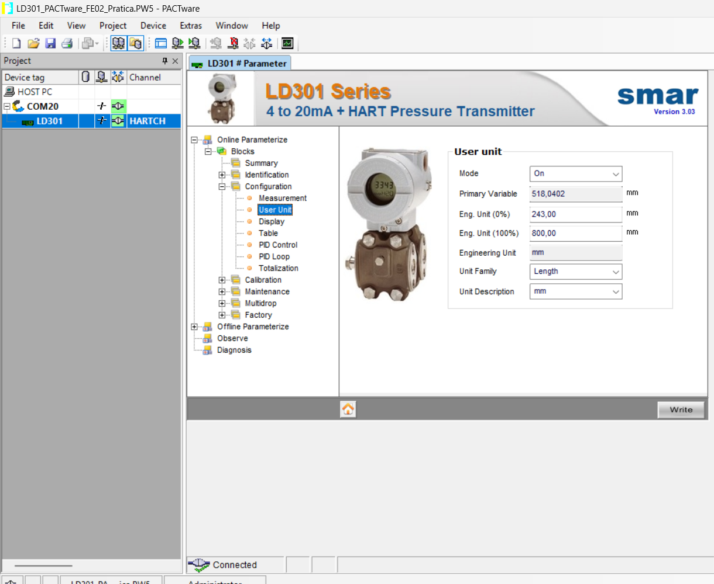

2. Em **Unit Family**, escolha **Volumetric Flow**. Em **Unit Description**, escolha **N m3/h** pelo nome apresentado na lista.

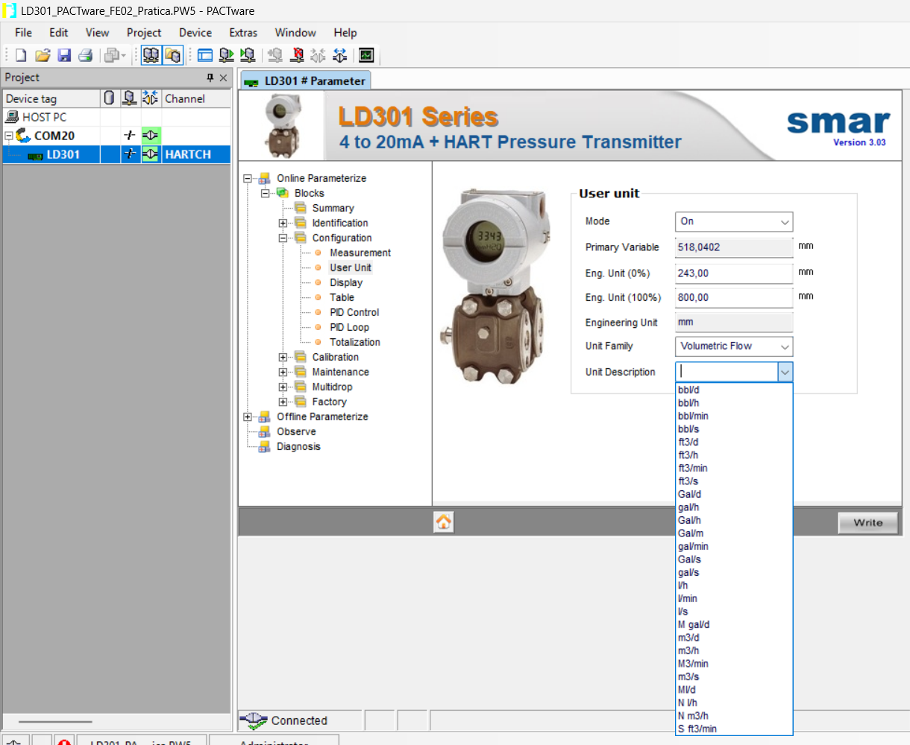

3. Digite **Eng. Unit (0%) = 0** e **Eng. Unit (100%) = 15**. Mantenha **Mode = On**.

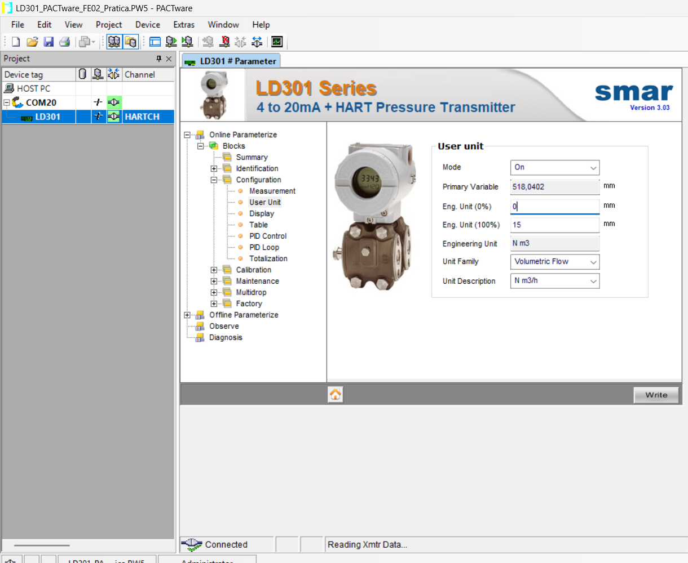

4. Clique em **Write** e **releia** (Measurement → User Unit).


*A 50 %, o PACTware leu **7,4068 N m³/h** [O], consistente com **7,407 Nm³/h** [C] pela escala da User Unit. Mas a vazão normal estipulada para esse ponto é **7,500 Nm³/h**. A diferença de cerca de **1,2 %** ocorre porque a extração simples de raiz quadrada **não corrige as variações de `C` e `ε`** entre os pontos de operação. Isso mostra a diferença entre uma indicação coerente com a configuração e uma medida idealmente corrigida.*

<a id="o05-p08"></a>
#### 🔹 Passo 06 — Configurar o display e conferir o LCD

1. Clique em **Configuration → Display**. Estado encontrado: 1ª **PV(%)**, 2ª **Temp.**

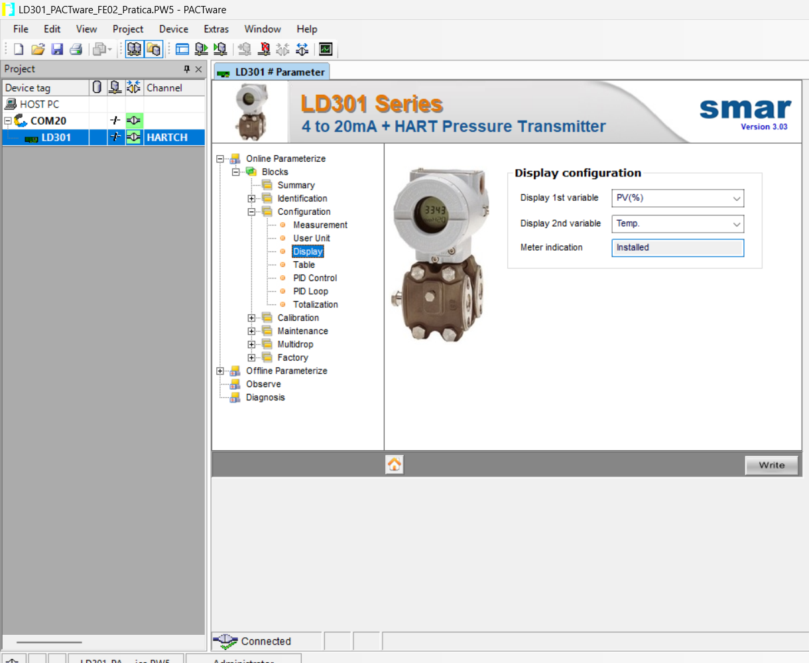

2. Escolha **Display 1st variable = PV** e **Display 2nd variable = Out(mA)**.

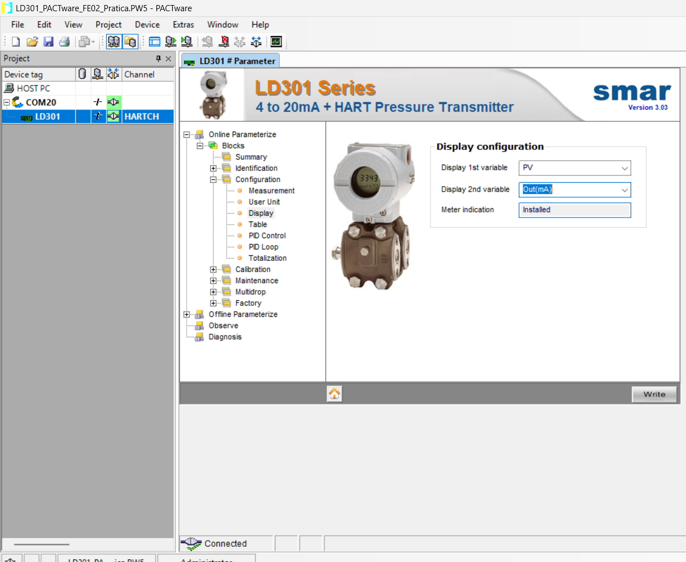

3. Clique em **Write** e **releia** pelo **Summary**.

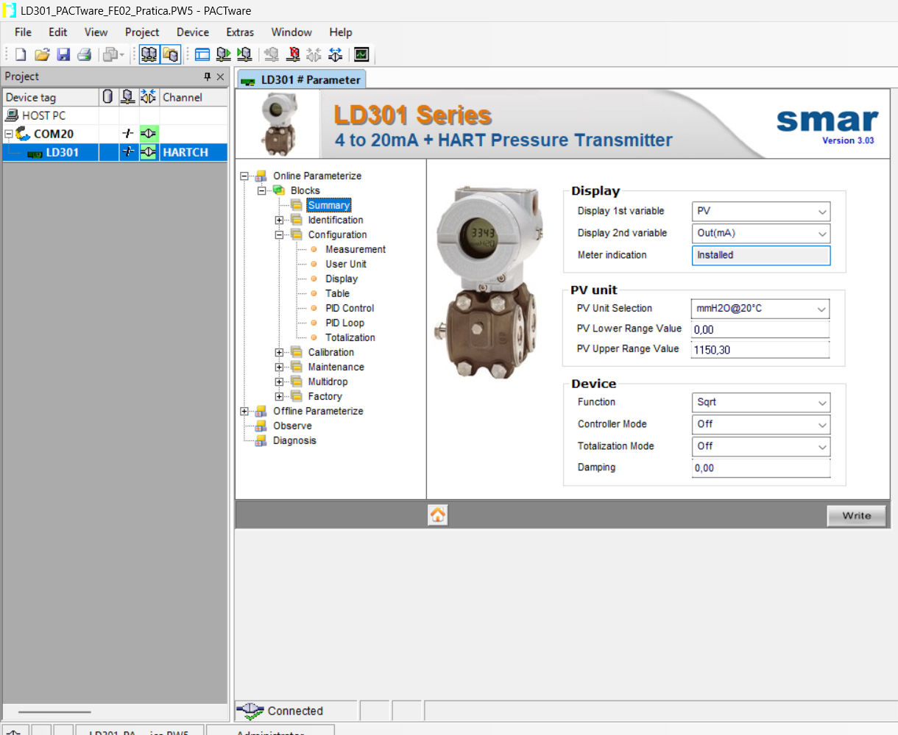

4. Confira o LCD do LD301 no LasecSimul: ele alterna as duas variáveis a cada 3 s (manual, p. 3.15).


<table><tr><td></td><td></td></tr></table>

*[O]: o LCD alterna **7.407 Nm3/h** e **11.901 mA**; o amperímetro indica **11,90 mA**. A indicação de vazão no display está confirmada.*

5. Grave o projeto PACTware com **File → Save** para guardar a árvore de comunicação e a porta. Depois de qualquer alteração online no LD301, use **Ctrl+S / Salvar** no LasecSimul: os parâmetros HART atuais do transmissor interno são copiados para o `.lsproj`.

<a id="o05-p09"></a>
### Fase B · Comparar a indicação com a planta

Com a faixa, a raiz e a User Unit já gravadas e relidas, a corrente deve responder aproximadamente à vazão, respeitando o corte de 6 %.

#### 🔹 Passo 07 — Verificar a indicação em vários pontos

Altere a abertura conforme a [Oficina 03, Etapa 02](#oficina-03-etapa-02), espere **5 s** e registre **`ΔP` na planta, corrente no amperímetro, indicação no LCD e PV no PACTware** (em **User Unit → Primary Variable**, quando aplicável). Não confunda a vazão verdadeira imposta pelo modelo com a vazão **indicada** após os ajustes do LD301.


*100 % [O]: 5,41 m³/h; 1150 mmH₂O; amperímetro e LCD **20,00 mA**; PV lida = **14,9997 N m³/h**. Na captura, o primeiro dígito (meio dígito "1") do LCD aparece fraco; a PV lida por HART é a referência numérica.*


*75 % [O]: 4,06 m³/h; Re 17980; C 0,6159; ε 0,9947; 639 mmH₂O; **15,93 mA**; LCD **11,180 Nm3/h**.*


*50 % [O]: 280 mmH₂O; **11,90 mA**; PV = **7,4068 N m³/h**.*


*26 % [O]: 1,41 m³/h; Re 6233; 74 mmH₂O = 6,47 % da faixa, logo acima do corte; **8,070 mA**. A raiz amplifica: 6,47 % de ΔP vira 25,4 % de saída.*


*25 % [O]: 1,35 m³/h; 69 mmH₂O = 5,97 % da faixa, logo abaixo do corte de 6 %; **4,000 mA** e PV = **0,0000 N m³/h**. Corte **abrupto** confirmado: com 1,35 m³/h passando, o transmissor indica zero.*

**Tabela final da FE-02-AR (Python [C] × observado [O])**

**A. Processo: diferença de pressão**

| Abertura | `ΔP` calculado no Python [C] | `ΔP` observado na planta [O] |
|---:|---:|---:|
| 100 % | 1150,3 mmH₂O | 1150 mmH₂O |
| 75 % | 639,1 mmH₂O | 639 mmH₂O |
| 50 % | 280,5 mmH₂O | 280 mmH₂O |
| 26 % | 74,4 mmH₂O | 74 mmH₂O |
| 25 % | 68,7 mmH₂O | 69 mmH₂O |

**B. Instrumento: corrente e indicação de vazão**

| Abertura | Corrente [C] / [O] | PV prevista [C] | PV / LCD observada [O] | Evidências |
|---:|---|---:|---|---|
| 100 % | 20,000 / 20,00 mA | 14,9997 Nm³/h | 14,9997 (HART); LCD 20,00 mA | [planta](capturas/lasecsimul_27_fe02_final_100_lcd_vazao.png), [PV](capturas/pactware_66_fe02_pv_100_nm3h.png) |
| 75 % | 15,926 / 15,93 mA | 11,181 Nm³/h | LCD 11,180 | [planta](capturas/lasecsimul_32_fe02_valvula_75.png) |
| 50 % | 11,901 / 11,90 mA | 7,407 Nm³/h | 7,4068 (HART); LCD 7,407 | [planta](capturas/lasecsimul_33_fe02_valvula_50_apos_regravacao.png), [PV](capturas/pactware_69_fe02_pv_50_apos_regravacao.png) |
| 26 % | 8,070 / 8,070 mA | 3,816 Nm³/h | não registrado | [planta](capturas/lasecsimul_31_fe02_valvula_26_acima_corte.png) |
| 25 % | 4,000 / 4,000 mA | 0,000 Nm³/h | 0,0000 (HART) | [planta](capturas/lasecsimul_30_fe02_valvula_25_corte_abrupto.png), [PV](capturas/pactware_67_fe02_pv_25_corte_zero.png) |

> [!NOTE]
> **Verificação concluída:** o LD301 foi parametrizado **online**, os parâmetros foram **gravados e relidos**, e os pontos registrados são coerentes com o modelo. A diferença entre 25 % e 26 % evidencia o **corte abrupto**: não é falha da placa, mas uma regra configurada na saída do instrumento.

**Questão para pensar:** por que 26 % de abertura resulta em uma saída próxima de 25 %, mas 25 % leva a **4 mA**? Como o modo suave modificaria essa transição?

---
</details>

<a id="oficina-06"></a>
<details open>
<summary><strong>📘 Oficina 06 — Exercícios FE-09-AR e FE-01-AR</strong></summary>

**O que você fará:** aplicar o procedimento completo a duas placas com geometrias muito diferentes, sem copiar os resultados da FE-02-AR.

As plantas das duas placas foram **conferidas na execução documentada** e responderam de acordo com o Python. Naquela execução, os transmissores ainda estavam na configuração inicial (função Linear, `URV = 3376,3`). Se uma cópia já tiver sido alterada e salva, releia seus parâmetros no PACTware. **A configuração do transmissor e o preenchimento dos registros observados são tarefas do aluno.**

**O que comparar:** como um orifício muito pequeno (FE-09-AR) ou relativamente grande (FE-01-AR) modifica `ΔP`, a faixa do transmissor e a interpretação da validade do modelo.

### FE-09-AR — placa02.jpg


*Verificação [O]: a 50 %, 390 mmH₂O (folha: 390,0); a 100 %, 1617 mmH₂O (folha: 1617,5). O LD301, ainda linear com URV 3376,3, indica 11,66 mA = 4 + 16 × 1617/3376,3.*

### FE-01-AR — placa01.jpg (furo corrigido)


*Verificação [O]: 10,83 m³/h e 81 mmH₂O (folha: 80,5). O LD301, linear com URV 3376,3, quase não sai de 4 mA (4,382 mA): a faixa do transmissor está 40 vezes maior que o ΔP da placa.*

### Roteiro de execução e registro

Para **cada placa**, repita a sequência a seguir e mantenha separadas as anotações [P], [E], [C] e [O]:

1. Abra a foto da placa e confira cada valor [P] da folha.
2. Calcule `ρₙ`, `ρ₁`, `Q₁,max` e `β` com as fórmulas da fundamentação. Na calculadora, selecione a placa e use **Válvula (%) = 100** para obter `Re`, `C`, `ε` e `ΔPmax`; arredonde o ΔP para o URV de referência. Anote essas previsões [C] separadamente. A tabela da seção 7 da folha é reservada aos valores observados [O].
3. Abra `lasecsimul/placa_orificio_FE_09_AR_calculada.lsproj` ou `lasecsimul/placa_orificio_FE_01_AR_calculada.lsproj` e confira as Propriedades exportadas (Oficina 03).
4. Rode a simulação, clique **Abrir** no modem e faça **Connect** no modem COM20 e depois no LD301 (Oficina 04, Passos 08–10).
5. Grave e releia: URV da folha, **Sqrt**, User Unit 0 → Qₙ,max em **N m3/h**, display PV / Out(mA).
6. Preencha a seção 7 da folha com valores **observados** a 0, 25, 50 e 100 %, citando a captura de cada um.
7. **FE-09-AR:** discuta o Re_D < 5000 e o uso da equação de C fora da faixa.
8. **FE-01-AR:** o URV de 80,5 mmH₂O fica acima do span mínimo do sensor, mas é 63 vezes menor que o limite superior de 50 kPa. Pela tabela de faixas do manual (p. 5.20), qual sensor você especificaria? Para estimar a vazão normal a 100 % que produz cerca de 1000 mmH₂O, altere **Vazão volumétrica de operação a 100 % [m³/h]** na calculadora, mantenha **Válvula (%) = 100**, recalcule até se aproximar do ΔP desejado e divida a vazão de operação obtida por `0,360886`. Para recuperar o caso original, escolha outra configuração e volte a selecionar **FE-01-AR**.

---
</details>

<a id="oficina-07"></a>
<details open>
<summary><strong>📘 Oficina 07 — Diagnosticar e avaliar</strong></summary>

**O que você fará:** localizar a origem de uma divergência sem alterar parâmetros aleatoriamente. A lógica é partir da planta e avançar, uma camada por vez, até o computador.

**Regra prática:** se o cálculo e a planta não concordam, investigar a **placa e seus parâmetros**; se a planta está correta, mas a corrente não está, investigar o **LD301 e seus ajustes**; se o PACTware não lê o instrumento, investigar **modem, portas e conexão**.

Investigue por camada, do processo para o computador:

1. **Planta:** a simulação está **Rodando**? Os mostradores mudam com a abertura? Se os blocos aparecem como "?", aplique a correção da [Oficina 03, Etapa 01](#oficina-03-etapa-01).
2. **Transmissor:** a corrente no amperímetro é coerente com ΔP/URV e com a função (linear ou raiz)? Na janela Python, selecione **Corrente (mA)**, informe o **LRV** e o **URV** lidos em Measurement e marque a raiz apenas quando a função estiver em **Sqrt**. O corte `6 % / Hard` é o padrão da prática e não está exposto no DTM 3.03. Com corte abrupto ativo e corrente no mínimo, use o ΔP da planta: a corrente não identifica um único ΔP.
3. **Modem e porta:** o botão do modem está em **Fechar** (porta aberta)? O par `COM20 ↔ CNCB0` existe? Outro programa ocupa a porta?
4. **PACTware:** o **modem COM20** está com o ícone **verde** e o **dispositivo** mostra `#` na aba e **Connected**? Se não: desconecte o LD301 e o COM20 (forçando o fechamento se o PACTware pedir), confira o modem do LasecSimul em **Fechar** e faça Connect no COM20 e depois no LD301.
5. **Persistência HART:** depois de alterar parâmetros online, use **Ctrl+S / Salvar** no LasecSimul. Se o projeto foi reconstruído, confira o indicador de alterações e salve o `.lsproj` antes de fechar.

### O que deve constar no registro da prática

| Item | O que demonstrar |
|---|---|
| **Princípio físico** | Explicar a relação entre vazão e `ΔP`, a função raiz e a conversão **Nm³/h → m³/h**. |
| **Cálculo** | Usar a janela gráfica e interpretar `β`, Reynolds, `C`, `ε` e `ΔP`; identificar o `URV` de referência a partir do ΔP a 100 %. |
| **Planta** | Comparar a vazão e a pressão calculadas com os valores observados em pelo menos os pontos solicitados. |
| **Instrumento** | Diferenciar a medição de pressão da indicação de vazão; demonstrar a gravação e **releitura** da faixa, função e User Unit. |
| **Comunicação** | Descrever o caminho `CNCB0 ↔ COM20`, o canal HART e o DTM do LD301. |
| **Conclusão** | Identificar cada ensaio como **APROVADO**, **FALHOU** ou **PENDENTE**, sempre com a captura ou resultado que sustenta a classificação. |

**Não é preciso esconder uma divergência**: registrá-la e explicar sua causa faz parte da análise técnica.

---
</details>

<a id="validacao-final"></a>
## Validação final e limitações restantes

Esta seção reúne o **que foi efetivamente verificado na execução documentada**. Ela não significa que todos os computadores terão as mesmas condições nem que as placas foram aprovadas para uso industrial.

| Situação encontrada | O que ela permite concluir |
|---|---|
| **APROVADO** | Há uma execução ou teste documentado para o comportamento indicado. |
| **CORRIGIDO** | Um defeito identificado foi tratado e a correção descrita foi testada no contexto informado. |
| **LIMITAÇÃO** | O comportamento foi identificado, mas não foi removido ou está fora do alcance desta prática. |
| **PENDENTE / exercício** | Uma etapa deve ser executada ou confirmada pelo estudante em seu próprio ambiente. |

<details>
<summary><strong>🔎 Abrir o quadro técnico completo de validação e evidências</strong></summary>

| Item | Estado | Evidência |
|---|---|---|
| Planta zerada no LasecSimul | **CORRIGIDO** nesta máquina (biblioteca `block-library` ausente no pacote 0.0.100) | [antes](capturas/lasecsimul_10_fe02_antes_mostradores_zerados_ld301_responde.png), [teste](capturas/lasecsimul_11_teste_sl_gain_sem_biblioteca.png), [depois](capturas/lasecsimul_15_modelo_interno_blocos_reconhecidos.png) |
| Resposta da planta FE-02-AR (0/25/26/50/75/100 %) | **APROVADO** | Oficinas 03 e 05 |
| Caso-base com água a 50 % | **APROVADO** | [captura](capturas/lasecsimul_37_caso_base_agua_valvula_50_corrigido.png) |
| FE-09-AR e FE-01-AR na planta | **APROVADO** (planta); LD301 **não parametrizado** (exercício) | [FE-09](capturas/lasecsimul_34_fe09_valvula_100_verificacao.png), [FE-01](capturas/lasecsimul_36_fe01_valvula_100_verificacao.png) |
| Blocos atuais e subsistema local nos três projetos de placa | **APROVADO** — `sl.*` e definição completa incorporada no `.lsproj`; sem dependência de `.lssubcircuit` externo | `lasecsimul/placa_orificio_FE_{02,09,01}_AR_calculada.lsproj`; gerador validado |
| Montagem do PACTware desde o projeto vazio (Add device, duplo clique, COM20, Multimaster em etapa própria, Add LD301, salvar) | **APROVADO** | [início](capturas/pw_n01_pactware_aberto_host_pc.png), [COM20](capturas/pw_n08_com20_aplicada_multimaster_marcado.png), [Multimaster](capturas/pw_n10_multimaster_aplicado.png), [árvore](capturas/pw_n15_arvore_com20_ld301.png), [salvo](capturas/pw_n17_projeto_salvo.png) |
| Modem aberto; Connect no modem COM20 e depois no LD301 | **APROVADO** | [modem](capturas/ls_n02_fe02_modem_aberto_fechar.png), [COM20 verde](capturas/pw_n35_modem_com20_conectado_verde.png), [Connected](capturas/pw_n37_ld301_connected_ft100.png) |
| Ordem errada (Connect com o modem fechado) e recuperação | **REGISTRADO** — só reconectar o LD301 não bastou; foi preciso forçar o fechamento do COM20 e reconectar modem e dispositivo | [67 %](capturas/pw_n19_connect_com20_modem_fechado_preso_67.png), [Disconnected](capturas/pw_n30_dtm_aberto_antes_reconexao_disconnected.png), [forçar](capturas/pw_n32_canal_preso_forcar_fechamento.png) |
| URV, Sqrt, User Unit e Display gravados e relidos online | **APROVADO** (duas execuções) | [releitura final](capturas/pw_n52_summary_releitura_final.png), [User Unit](capturas/pw_n49_user_unit_releitura.png), [LCD](capturas/ls_n03z_lcd_7407_nm3h.png) |
| Indicação de vazão no LCD e por HART | **APROVADO** | [LCD 50 %](capturas/lasecsimul_24_fe02_final_50_lcd_nm3h_zoom.png), [PV 100 %](capturas/pactware_66_fe02_pv_100_nm3h.png) |
| Edição do ponto e do modo de corte pelo DTM | **LIMITAÇÃO DO DTM 3.03** — a tela não expõe esses parâmetros; o LD301 aceita Command 157 (valor em %) e Command 191 (Hard/Bumpless), com releitura por Command 156. O padrão desta atividade continua 6 % / Hard. | [25 %](capturas/pactware_67_fe02_pv_25_corte_zero.png), [26 %](capturas/lasecsimul_31_fe02_valvula_26_acima_corte.png); comandos validados em `core/test/core/protocols/HartLd301Test.cpp` |
| Persistência da configuração HART no `.lsproj` | **CORRIGIDO** — Salvar no LasecSimul copia as propriedades atuais do LD301 interno; a captura também ocorre antes de reconstruir o circuito. Use Ctrl+S após parametrizar pelo PACTware para gravar o arquivo em disco. O projeto `.PW5` do PACTware guarda a árvore e a porta, não substitui o `.lsproj`. | Regressão save/reopen de Sqrt e cutoff em `core/test/core/protocols/HartLd301Test.cpp`; auditoria LD301: 256 verificações, 0 falhas |
| Correção da extensão nas outras máquinas | **CORRIGIDO NO EMPACOTADOR** — `scripts/package-release.js` agora inclui `project/schema/block-library` em `bundled/` e interrompe o empacotamento se a biblioteca faltar. A correção chega às máquinas com a próxima versão empacotada da extensão. | Oficina 03, Etapa 01 |
| Dimensões físicas das placas e conformidade ISO | **FORA DO ESCOPO** — leitura por foto; D < 50 mm; uso didático | folhas de dados |

**Registro adicional:** no encerramento da primeira execução, desconectar COM20 depois de interromper a simulação levou o PACTware a travar em 67 % (**"PACTware action active"**). A operação foi encerrada com **Cancel → Yes**. A Oficina 04 foi então refeita desde um projeto vazio.

</details>

<a id="diagnostico"></a>
## Diagnóstico de problemas

Se alguma etapa não funcionar, **não modifique vários parâmetros ao mesmo tempo**. Primeiro determine **onde a cadeia deixa de funcionar**: cálculo → planta → LD301 → modem → PACTware. Depois escolha o sintoma mais próximo no quadro e verifique os itens na ordem.

| Sintoma | Verificações em ordem | Interpretação |
|---|---|---|
| Blocos do modelo interno aparecem como "?" e mostradores ficam em 0 | atualize para uma versão empacotada após 22/10/2026; confirme `bundled/project/schema/block-library` e recarregue a janela | versões anteriores não incluíam a biblioteca `sl.*`; o empacotador agora exige e instala os JSON necessários |
| Planta não altera ΔP | simulação rodando; slider 0–100; aguardar 5 s; vazão volumétrica de operação a 100 % e geometria | conferir o mesmo ponto na janela Tkinter |
| Valor do slider vira 100 ao digitar | apagar o conteúdo antes de digitar | o campo limita a 0–100 e anexa o texto |
| Parâmetros HART não aparecem ao reabrir o `.lsproj` | o projeto LasecSimul foi salvo depois das alterações online? | use Ctrl+S / Salvar no LasecSimul; salvar apenas o `.PW5` do PACTware não grava a configuração no `.lsproj` |
| Connect no COM20 parado em 67 % | o modem do LasecSimul está em **Abrir** (fechado) ou a simulação foi parada antes de desconectar | inicie a simulação, deixe o modem em **Fechar** (porta aberta), desconecte o LD301 e depois o COM20; se preso, force o fechamento e reconecte COM20 antes do LD301 |
| COM20 em negrito sem verde e DTM Disconnected | Connect feito antes de abrir o modem | Disconnect no LD301 e no COM20 (forçar = Yes), depois Connect no COM20 (verde) e no LD301 |
| Canal verde e LD301 Disconnected | modem **Aberto**? Disconnect/Connect no LD301 | observação do professor; resolveu na sessão anterior |
| `Upload failed` | conexão do dispositivo feita antes de abrir o modem | reconectar o LD301 |
| Corrente 4 mA com vazão > 0 | ΔP/URV abaixo de 6 % com corte Hard? | comportamento esperado do corte abrupto |
| Corrente quase 4 mA na FE-01-AR | URV muito maior que o ΔP da placa | ajustar URV para 80,5 mmH₂O |
| PV em `mm` sem sentido | User Unit ligada com escala de nível | configurar Volumetric Flow / N m3/h |
| Janela de cálculo não abre | reabra `python/interface/tela_tk.py` no VS Code e use **Run Python File**; confira se o VS Code selecionou uma instalação Python com Tkinter | a calculadora recebe decimais com ponto ou vírgula |

<a id="siglas"></a>
## Siglas, abreviações e símbolos

As siglas identificam equipamentos, tipos de sinal ou parâmetros. Esta lista é uma referência rápida; o significado prático de cada termo aparece no trecho do roteiro em que ele é utilizado.

### Siglas e abreviações

| Sigla | Significado | Em linguagem simples |
|---|---|---|
| **FE** | *Flow Element* (elemento de vazão) | Identifica a placa de orifício, como FE-02-AR. |
| **FT** | *Flow Transmitter* (transmissor de vazão) | Identifica o instrumento de transmissão; **FT100** é a tag do LD301 usado nesta planta. |
| **LD301** | Modelo do transmissor SMAR | Equipamento que recebe HIGH e LOW, calcula a pressão diferencial e fornece o sinal de saída. |
| **HART** | *Highway Addressable Remote Transducer* | Protocolo de comunicação digital utilizado sobre o laço de 4–20 mA. |
| **DTM** | *Device Type Manager* | Módulo de software que disponibiliza as telas e funções de um dispositivo no PACTware. |
| **PACTware** | Nome do aplicativo de configuração | Programa que reúne os DTMs do canal HART e do LD301. |
| **COM** | Designação de porta serial | Porta de comunicação do computador; nesta prática, `COM20` se comunica com `CNCB0` pelo com0com. |
| **PV** | *Primary Variable* (variável primária) | Valor principal apresentado pelo transmissor; nesta configuração, a indicação após a função e a User Unit. |
| **LRV** | *Lower Range Value* | Limite inferior da **faixa de pressão** associada à saída de 4 mA. |
| **URV** | *Upper Range Value* | Limite superior da **faixa de pressão** associada à saída de 20 mA. |
| **LCD** | *Liquid Crystal Display* | Visor do LD301 que alterna as variáveis configuradas. |
| **Sqrt / SQR** | *Square root* (raiz quadrada) | Função aplicada pelo LD301 para converter a relação quadrática `ΔP`–vazão em uma saída aproximadamente proporcional à vazão. |
| **ISO** | *International Organization for Standardization* | Organização responsável pela norma técnica ISO 5167. |
| **GUI** | *Graphical User Interface* | Forma de executar cálculos por uma janela com campos e botões. |
| **PID** | Proporcional, integral e derivativo | Tipo de controlador citado entre páginas do DTM, mas que não é objeto dos ajustes de vazão desta aula. |
| **[P]** | Plaqueta | Valor extraído da fotografia. |
| **[E]** | Estipulado | Condição definida para a prática, não extraída da placa. |
| **[C]** | Calculado | Valor obtido pelas equações, pela calculadora gráfica ou por uma conversão feita à parte. |
| **[O]** | Observado | Valor lido em uma tela, captura ou instrumento da simulação. |

### Símbolos e unidades mais usados

| Notação | O que representa | Unidade ou observação |
|---|---|---|
| `D` / `d` | Diâmetro interno da tubulação / diâmetro do orifício | mm nas propriedades; m nas equações SI. |
| `β` | Razão de diâmetros: `d/D` | Sem unidade. |
| `Q`, `Q₁` | Vazão volumétrica nas condições de operação | m³/h nos mostradores; m³/s nas equações. |
| `Qₙ` | Vazão volumétrica referida às condições normais estipuladas | Nm³/h. |
| `ΔP` | Diferença entre HIGH e LOW | kPa, Pa ou mmH₂O, conforme a tela. |
| `ρ` | Massa específica do fluido | kg/m³. |
| `μ` | Viscosidade dinâmica | cP no formulário; Pa·s na equação de Reynolds. |
| `κ` | Expoente isentrópico do gás | Sem unidade. |
| `Re_D` | Número de Reynolds baseado em `D` | Sem unidade. |
| `C` | Coeficiente de descarga | Sem unidade. |
| `ε` | Fator de expansibilidade do gás | Sem unidade; para líquido, `ε = 1`. |
| `p₁` / `p₂` | Pressão a montante / pressão a jusante | Usar pressões **absolutas** na razão `p₂/p₁`. |
| `mA` | Miliampère | Unidade de corrente do laço, de 4 a 20 mA. |
| `mmH₂O` | Milímetro de coluna d'água convencional | **9,80665 Pa**, adotado no cálculo e na planta. |
| `mmH₂O@20 °C` | Milímetro de coluna d'água segundo a unidade HART do LD301 | **9,7891 Pa**; não confundir com a unidade convencional. |

<a id="glossario"></a>
## Glossário de conceitos

| Conceito | Explicação para esta prática |
|---|---|
| **Montante / jusante** | Antes / depois da placa, considerando o sentido do escoamento. |
| **Placa de orifício** | Peça com um furo de diâmetro conhecido, inserida na tubulação para produzir uma pressão diferencial relacionada à vazão. |
| **Tomada de pressão** | Ponto da tubulação a partir do qual a pressão é levada à entrada HIGH ou LOW do transmissor. |
| **Laço de corrente** | Circuito elétrico por onde circula o sinal de 4–20 mA do transmissor. |
| **Faixa de medição** | Intervalo entre os valores inferior e superior configurados no instrumento; aqui, faixa de **pressão diferencial**. |
| **Span** | Amplitude da faixa: diferença entre o limite superior e o inferior. |
| **Função de transferência** | Regra que transforma o valor medido no valor de saída; neste roteiro, saída linear ou com raiz quadrada. |
| **User Unit** | Escala de engenharia que associa os extremos da saída a valores indicados em uma unidade escolhida, como `N m3/h`. |
| **Ponto de corte (cutoff)** | Limite abaixo do qual a função raiz é tratada de forma especial; no modo Hard, a saída vai ao mínimo. |
| **Damping** | Amortecimento aplicado ao sinal para reduzir oscilações rápidas da indicação. |
| **Vena contracta** | Região de maior contração do jato após o orifício, próxima da menor pressão. |
| **Perda permanente** | Parcela da queda de pressão que não é recuperada depois da placa; não é o `ΔP` entre as tomadas usado como `URV`. |
| **Releitura online** | Ação de voltar ao dispositivo conectado e conferir o valor que foi realmente gravado. |
| **Caso-base** | Exemplo inicial do projeto principal, com água, usado para conhecer a planta antes de trabalhar com a FE-02-AR. |

<a id="referencias"></a>
## Referências

1. SMAR. *LD301 — Manual de Instruções, Operação e Manutenção*, cópia local [docs/MANUAL_LD301.pdf](docs/MANUAL_LD301.pdf); também no [site da SMAR](https://www.smar.com.br/public/img/dropzone/arquivos/ld301mp.pdf). Páginas usadas: 3.8–3.11, 3.15–3.16, 4.13–4.14, 5.20 e 5.25.
2. ISO 5167-1 e ISO 5167-2:2022. *Measurement of fluid flow by means of pressure differential devices*. [Escopo da parte 2](https://www.iso.org/standard/79180.html).
3. Reader-Harris, M. J.; Sattary, J. A. "The orifice plate discharge coefficient equation". *Flow Measurement and Instrumentation*, 1990.
4. NIST. [Pressure and gas flow unit conversions](https://www.nist.gov/pml/owm/metric-si/unit-conversion/pressure-and-gas-flow-unit-conversions) (condições de referência de gás).
5. LASEC-UFU. [Repositório LasecSimul](https://github.com/LASEC-UFU/LasecSimul).
6. Delmée, G. J. *Manual de Medição de Vazão*. Blucher.
7. Bell, C. et al. Biblioteca `fluids` (referência bibliográfica dos valores usados na validação matemática do modelo).

<a id="apendices"></a>
## Apêndices

<a id="apendice-calculadora"></a>
### A. Abrir e usar a calculadora gráfica

1. Abra `python/interface/tela_tk.py` no VS Code.
2. Clique em **Run Python File** (▶) para abrir a janela.
3. Edite os parâmetros da placa, selecione a grandeza de entrada, informe o valor e clique em **Calcular**.
4. Consulte os resultados e as explicações de conformidade na própria janela. Os valores de referência para cada placa estão na Oficina 02 e nas folhas de dados.

<a id="apendice-caso-base"></a>
### B. Caso-base do projeto principal (água, 15 m³/h)

Este é o exemplo mostrado na **Oficina 01**, antes da troca para o gás da FE-02-AR. Não use seu URV como ajuste das placas de ar.

Configuração do arquivo: D = 52,5 mm, d = 31,5 mm, β = 0,6, tomada flange, água a 20 °C (ρ = 998,2 kg/m³, μ = 1,002 cP), p₁ = 200 kPa, 44D/8D, LD301 com URV = 3376,3 mmH₂O.

| Abertura | Q | Re_D | C | ΔP | Corrente linear | Corrente com raiz |
|---:|---:|---:|---:|---:|---:|---:|
| 100 % | 15,00 m³/h | 100668 | 0,6124 | 3376,3 mmH₂O | 20,00 mA | 20,00 mA |
| 75 % | 11,25 m³/h | 75501 | 0,6135 | 1892,5 mmH₂O | 12,97 mA | 15,98 mA |
| 50 % | 7,50 m³/h | 50334 | 0,6153 | 836,1 mmH₂O | 7,96 mA | 11,96 mA |
| 30 % | 4,50 m³/h | 30200 | 0,6184 | 298,0 mmH₂O | 5,41 mA | 8,75 mA |
| 20 % | 3,00 m³/h | 20134 | 0,6216 | 131,1 mmH₂O | 4,62 mA | 4,00 mA (corte) |

Vazão, Reynolds, `C` e `ΔP` são resultados [C] do modelo. As correntes da tabela foram calculadas separadamente a partir da faixa do transmissor, da função e do corte; a janela permite usar uma corrente como entrada para estimar `ΔP` e vazão. O ponto de 50 % foi observado na planta corrigida (Oficina 01): 7,50 m³/h, 836 mmH₂O e 7,961 mA com o LD301 linear.

<a id="apendice-correcoes"></a>
### C. Correções técnicas registradas no material de origem

Este histórico fica separado das instruções de execução. Ele documenta mudanças já realizadas e ajuda a entender por que capturas mais antigas podem mostrar valores ou blocos diferentes.

1. **FE-01-AR:** d = 15,673 mm e d/D = 0,7488 (antes 8,89 mm e 0,425). Folha e projeto recalculados. URV de 1123,2 para 80,5 mmH₂O.
2. **Planta zerada:** causa identificada (biblioteca `block-library` ausente no pacote 0.0.100) e corrigida; resposta da planta comprovada. A afirmação anterior de que "a resposta da planta falhou" foi reinterpretada: o motor calculava, só a visualização falhava.
3. **Projetos LasecSimul:** as cópias prontas usam o modelo `sl.*` e incluem a definição local da placa; o projeto FE-01-AR contém o diâmetro de furo corrigido.
4. **Calculadora gráfica:** a janela apresenta vazão, ΔP nas unidades adotadas, propriedades intermediárias e explicações das verificações. As equações de referência foram preservadas.
5. **Folhas de dados:** origem de cada valor ([P]/[E]/[C]/[O]); Re, C e ε por ponto; páginas reais do DTM para cada parâmetro; seção de valores observados; verificação item a item dos limites da ISO; nota sobre mmH₂O@20 °C.
6. **User Unit inicial:** estava **ligada** (243–800 mm), e não desligada como dizia o README anterior.
7. **Manual:** referências passaram a citar a página impressa e a do PDF. Registradas a lista de funções, as unidades de User Unit, o display e as divergências (span mínimo; código M2).

<a id="indice-evidencias"></a>
### D. Índice de evidências (capturas desta revisão)

Use este índice para localizar as imagens pelo assunto. As capturas ilustram uma **execução já realizada**; nos exercícios, registre também os resultados obtidos na sua própria máquina.

| Arquivo em `capturas/` | Etapa |
|---|---|
| `lasecsimul_05`, `09`, `10`, `11` | Oficina 03 — sintoma da planta zerada e teste discriminante (antes da correção) |
| `lasecsimul_15` | Oficina 03 — modelo interno depois da correção |
| `lasecsimul_06`, `07`, `08` | Oficina 03 — Propriedades exportadas antes e depois (FE-02-AR) |
| `lasecsimul_12`, `13`, `14`, `16` | Oficina 03 — validação da planta FE-02-AR |
| `lasecsimul_37` | Oficina 01 — caso-base com água |
| `com0com_01`, `pw_n01` a `pw_n17` | Oficina 04 — par virtual e PACTware desde o projeto vazio até salvar (12:45–12:49) |
| `ls_n01`, `ls_n02`, `pw_n19` a `pw_n37` | Oficina 04 — modem, ordem errada, recuperação e conexão correta (12:49–12:57) |
| `pw_n38` a `pw_n52`, `ls_n03`, `ls_n03z`, `ls_n04z` | Oficina 05 — leitura, gravação, releitura e LCD (12:57–13:02) |
| `pactware_28` | Oficina 05 — exemplo de página offline (sessão anterior) |
| `lasecsimul_20`, `22`, `pactware_68` | Oficina 05 — efeito do URV e da raiz na planta; página Table sem campos de corte (primeira execução) |
| `lasecsimul_26`, `pactware_65` | Oficina 05 — reconstrução da simulação e releitura |
| `lasecsimul_24`, `27` a `33`, `pactware_66`, `67`, `69` | Oficina 05 — verificação em 100/75/50/26/25 % (primeira execução) |
| `lasecsimul_34` a `36` | Oficina 06 — FE-09-AR e FE-01-AR |

As capturas de sessões anteriores que não aparecem no texto foram removidas na organização do repositório. Continuam disponíveis no histórico do git (commit `2d4e531`).
